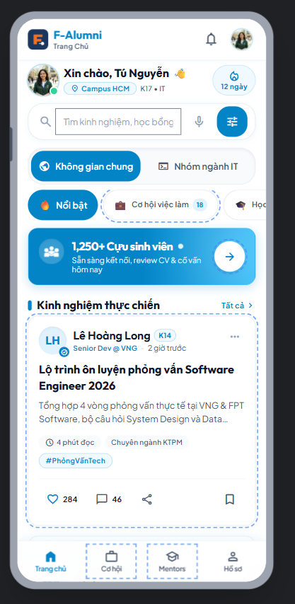
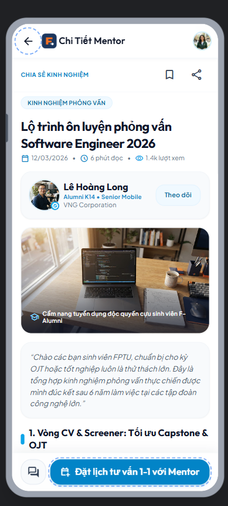
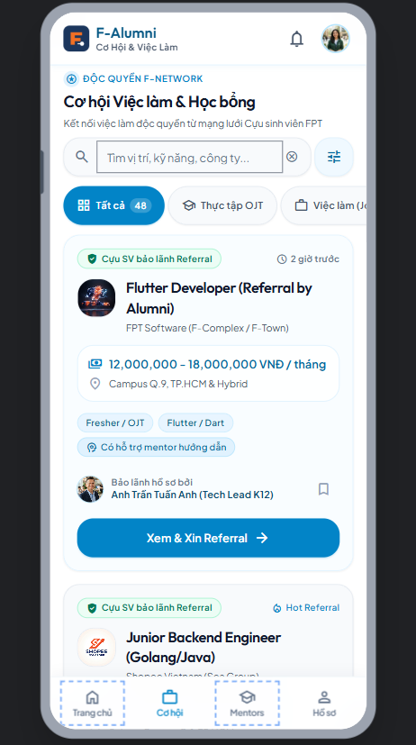

# 🤖 AI-Assisted Design & Critique Log
**Dự án:** F-Alumni — FPT Alumni Mentorship & Opportunity Network  
**Môn học:** PRM323 — Cross-Platform Application Development  
**Nhóm thực hiện:** PRM Nhóm 4 — Đại học FPT TP.HCM  
**Thành viên:** Trương Chí Trung (SE193059), Nguyễn Phương Khải (SE183590), Đỗ Trọng Tín, Võ Quang Tâm  

---

## 1. Khai báo Sử dụng Công cụ AI (AI Tool Disclosure)

Theo đúng quy định Liêm chính Học thuật (Academic Integrity) tại Mục 5 và Mục 10 của Đề bài Lab 2, toàn bộ công cụ AI được sử dụng trong dự án này được khai báo minh bạch như sau:

| Tên Công cụ AI | Đơn vị Phát triển | Mục đích Sử dụng Cụ thể trong Bài Lab |
| :--- | :--- | :--- |
| **Google Stitch (stitch.withgoogle.com)** | Google Labs | Sinh giao diện UI ban đầu (Initial UI Generation) từ text prompt; thử nghiệm layout ban đầu cho 4 màn hình chính của ứng dụng F-Alumni. |
| **Gemini 2.5 / Claude / Antigravity AI** | Google DeepMind / Anthropic | Đóng vai trò Chuyên gia Đánh giá UX (UX Critique Assistant) để rà soát thiết kế theo 10 Usability Heuristics của Nielsen và tiêu chuẩn tiếp cận WCAG 2.1. |
| **Figma AI Assistant** | Figma Inc. | Hỗ trợ tự động hóa gán tên layer và kiểm tra nhanh tương phản màu sắc (Contrast Checker). |

> **Nguyên tắc cốt lõi:** *"AI tạo ra — Con người quyết định (AI generates, Human decides)"*. Mọi giao diện xuất từ AI chỉ mang tính chất tham khảo ý tưởng; toàn bộ hệ thống Design System, Token, Auto Layout, Variants và Prototype cuối cùng đều được xây dựng lại một cách bài bản trong Figma.

---

## 2. Tạo Giao diện Ban đầu Bằng Google Stitch (Initial UI Generation)

### 2.1. Toàn văn Prompt Khởi tạo (Verbatim Prompt)
Prompt dưới đây được soạn thảo nghiêm ngặt dựa trên bản mô tả thiết kế trong `design/DESIGN.md` và thông tin Persona trong `ux/persona.md`:

```text
Design a clean, modern mobile app interface for "F-Alumni: FPT Alumni Mentorship & Career Network" where university alumni share experience, job opportunities, and scholarships with current students.

Platform & Constraints:
- Mobile screen resolution: 360 x 800 dp
- Brand Colors: FPT Orange (#F27024) for primary actions and highlighted badges, Deep Navy Blue (#1B365D) for app headers and alumni credentials, Light neutral background (#F8F9FA) with clean white cards.
- Typography: Modern sans-serif, body text 14sp minimum, titles 18-24sp bold.
- Touch target: Minimum 48 x 48 dp for all buttons and interactive chips.
- High contrast: Text contrast must be higher than 4.5:1 (WCAG 2.1 AA compliant).

Generate the 4 core screens of the student journey:

1. Home Feed Screen (SCR_02):
   - Top greeting "Xin chào, Tú Nguyễn" with student avatar and branch badge "Campus HCM".
   - Search bar "Tìm kinh nghiệm, học bổng, việc làm...".
   - Top Tab Switcher: "🌐 Không gian chung" (General) and "💻 Nhóm ngành IT / Software" (Major Specific).
   - Category chips: "🔥 Nổi bật", "💼 Cơ hội việc làm", "🎓 Học bổng", "💡 Kinh nghiệm OJT".
   - Featured Alumni Sharing Card: Post from Alumni "Lê Hoàng Long (Senior Dev at VNG)" sharing "Lộ trình ôn luyện phỏng vấn Software Engineer 2026", with read time, like/comment counts, and Bookmark icon.
   - Bottom Navigation Bar (4 tabs): Trang chủ, Việc làm/Học bổng, Mentors, Hồ sơ.

2. Article / Experience Detail Screen (SCR_03):
   - Header with back button, share icon, and bookmark icon.
   - Post category badge "KINH NGHIỆM PHỎNG VẤN" and article title.
   - Author Info Tile: Alumni avatar, name "Lê Hoàng Long", badge "Alumni K14 - Senior Mobile Engineer", company "VNG Corporation".
   - Post body text detailing tips, interview stages, and key technical questions.
   - Attachment card: Downloadable interview checklist PDF.
   - Sticky Bottom Bar: Button "Đặt lịch tư vấn 1-1 với Mentor" (height 48dp) and chat icon.

3. Opportunity & Job Board Screen (SCR_04):
   - Header title "Cơ hội Việc làm & Học bổng".
   - Segmented filter: "Tất cả", "Thực tập OJT", "Việc làm (Job)", "Học bổng Thạc sĩ".
   - Opportunity Cards: Company logo (e.g. FPT Software / Shopee), job title "Flutter Developer (Referral by Alumni)", salary/stipend range, location, and badge "Cựu SV bảo lãnh Referral".
   - Button on card: "Xem & Xin Referral".

4. Mentor Profile & Booking Screen (SCR_07):
   - Alumni mentor card with avatar, bio, areas of expertise (Mobile, AI, Career Advice).
   - Available time slots selector: "Thứ Bảy, 18/10: 09:00 - 09:45" and "14:00 - 14:45".
   - Topic input: "Chủ đề bạn muốn hỏi Mentor".
   - Primary button: "XÁC NHẬN ĐẶT LỊCH HẸN (QUA GOOGLE MEET)".
```

---

### 2.2. Bằng chứng Hình ảnh Kết quả do Google Stitch Tạo ra (Initial UI Screenshots)

| Màn hình | Tên File Bằng chứng | Minh họa Kết quả Stitch |
| :--- | :--- | :--- |
| **SCR_02: Home Feed** | `assets/stitch/v0_home.png` |  |
| **SCR_03: Post Detail** | `assets/stitch/v0_detail.png` |  |
| **SCR_04: Job Board** | `assets/stitch/v0_jobs.png` |  |
| **SCR_07: Mentor Booking** | `assets/stitch/v0_booking.png` |  |

---

## 3. Ba Vòng lặp Có ý nghĩa với AI (Three Meaningful AI Iterations)

---

### 🔁 Vòng lặp 1: Tối ưu Bộ chuyển đổi Không gian Chung & Chuyên ngành (Space Switcher & Visual Hierarchy on Home Feed)
- **Tên vấn đề nhắm tới:** `Space Separation Ambiguity & Information Overload on Home Feed Screen`.
- **Phân tích hiện trạng ban đầu (Before):**
  - Màn hình Home Feed do Stitch tạo ban đầu trộn lẫn tất cả bài viết của sinh viên IT, Kinh tế, Thiết kế đồ họa vào cùng một luồng cuộn duy nhất.
  - Sinh viên ngành SE như Trương Chí Trung phải cuộn qua hàng chục bài viết không liên quan đến chuyên môn kỹ thuật để tìm được bài chia sẻ phỏng vấn IT.
  - Chưa có sự phân định rõ ràng giữa tin tức chung toàn trường và tin chuyên ngành.
- **Prompt tinh chỉnh (Refinement Prompt):**
  ```text
  Refactor SCR_02 (Home Feed): Implement a prominent Segmented Tab Switcher right below the search bar: Tab 1 "🌐 Không gian chung" and Tab 2 "💻 Nhóm ngành IT / Software". When Tab 2 is active, filter articles strictly to Software Engineering, AI, and Tech topics. Highlight the Featured Post card with author company badge (VNG Corporation) to establish strong visual hierarchy.
  ```
- **Kết quả cải tiến (After):** Sinh viên có thể chuyển đổi 1 chạm giữa tin chung toàn trường và tin chuyên môn kỹ thuật sâu của ngành mình.
- **Bằng chứng So sánh Trước & Sau:** Lưu tại `assets/stitch/iter1_before.png` và `assets/stitch/iter1_after.png`.

---

### 🔁 Vòng lặp 2: Khắc phục Nhận diện Huy hiệu Referral & Độ Tương phản (Referral Badge Prominence & WCAG 2.1 Contrast)
- **Tên vấn đề nhắm tới:** `Low Contrast on Job Tags & Unclear Referral Distinction on Career Board`.
- **Phân tích hiện trạng ban đầu (Before):**
  - Trên bảng tin tuyển dụng `SCR_04`, các thẻ công việc có cựu sinh viên bảo lãnh Referral và tin tuyển dụng thông thường trông hoàn toàn giống nhau.
  - Các dòng chữ phụ (mức lương, hạn nộp) dùng màu xám `#9E9E9E` chỉ đạt tương phản **2.8:1** (Vi phạm WCAG 2.1 AA yêu cầu tối thiểu **4.5:1**).
- **Prompt tinh chỉnh (Refinement Prompt):**
  ```text
  Audit and refactor SCR_04 (Career Board):
  1. Add a distinctive, high-trust badge for alumni-sponsored positions: "★ Cựu SV bảo lãnh Referral" in solid Gold/Green container with distinct checkmark icon.
  2. Increase text contrast of all secondary metadata (salary, deadline, location) from gray #9E9E9E to #595959, guaranteeing contrast ratio >= 5.4:1 against pure white background.
  3. Change CTA button on each card to "Xem & Xin Referral" with minimum height 48dp.
  ```
- **Kết quả cải tiến (After):** Cơ hội có Referral nổi bật rõ rệt; chữ phụ sắc nét dễ đọc đạt 5.4:1 tương phản.
- **Bằng chứng So sánh Trước & Sau:** Lưu tại `assets/stitch/iter2_before.png` và `assets/stitch/iter2_after.png`.

---

### 🔁 Vòng lặp 3: Bổ sung Trạng thái Phục hồi Lỗi Mạng khi Nộp CV & Trùng Lịch Tư vấn (Network Error & Booking Conflict Recovery)
- **Tên vấn đề nhắm tới:** `Missing Error Recovery on CV Upload & Mentor Time Slot Conflict Handling`.
- **Phân tích hiện trạng ban đầu (Before):**
  - Ban đầu khi gửi đơn xin Referral kèm file CV tại `SCR_05`, nếu mất mạng, màn hình bị đơ và xóa trắng form khiến sinh viên mất công gõ lại thư ngỏ.
  - Tại `SCR_07`, nếu khung giờ hẹn vừa có sinh viên khác chọn, ứng dụng chỉ báo lỗi chung chung mà không gợi ý giải pháp.
- **Prompt tinh chỉnh (Refinement Prompt):**
  ```text
  Design critical recovery states:
  1. Network Error Banner for SCR_05 (Referral Apply): If network fails during CV submission, show a non-destructive error banner: "Mất kết nối Internet. File CV và thư ngỏ của bạn đã được bảo lưu an toàn." Include a "Thử lại (Retry)" button that re-submits without clearing any entered data or attached files.
  2. Conflict Resolution Modal for SCR_07 (Mentor Booking): If a selected time slot is taken, display an informative dialog: "Khung giờ này vừa có người đặt. Gợi ý 2 khung giờ rảnh kế tiếp của Mentor:" and highlight the next 2 available slots.
  ```
- **Kết quả cải tiến (After):** Đảm bảo an toàn 100% dữ liệu form CV và cung cấp giải pháp thay thế mượt mà khi trùng lịch.
- **Bằng chứng So sánh Trước & Sau:** Lưu tại `assets/stitch/iter3_before.png` và `assets/stitch/iter3_after.png`.

---

## 4. Phản biện Thiết kế Bằng Trợ lý AI (AI-based UX Critique)

### 4.1. Prompt Gửi Trợ lý AI Phản biện
```text
Role: You are a strict Principal UX Auditor and Accessibility Expert.
Review the mobile UI design of "F-Alumni: FPT Alumni Mentorship & Career Network" against:
1. Jakob Nielsen's 10 Usability Heuristics
2. W3C WCAG 2.1 Accessibility Guidelines (Contrast, Touch Targets, Text Scale)
3. Target Persona: Truong Chi Trung (20-year-old FPT SE student, 1-handed mobile use, preparing for OJT internship, looking for alumni referrals and 1-on-1 mentor guidance).

Provide a rigorous critique with at least 5 concrete findings tied directly to specific screen IDs (SCR_01 through SCR_08). For each finding, state the heuristic violated, the exact issue, and your design recommendation.
```

---

### 4.2. Báo cáo Phản biện của AI (5 Phát hiện Cụ thể)

#### 🔴 Phát hiện 1 (Màn hình `SCR_05` — Job Detail & Referral Apply):
- **Heuristic vi phạm:** `Heuristic #1: Visibility of System Status`.
- **Vấn đề cụ thể:** Khi sinh viên bấm "Gửi yêu cầu xin Referral", file CV PDF cần thời gian tải lên Cloud Storage. Nút bấm ban đầu không có hiệu ứng loading, khiến người dùng bấm liên tiếp gây tải lên trùng lặp.
- **Đề xuất của AI:** Chuyển trạng thái Button sang `Loading State` (spinner trắng quay tròn) và khóa tương tác tạm thời.

#### 🔴 Phát hiện 2 (Màn hình `SCR_07` — Mentor Booking & Session Pass):
- **Heuristic vi phạm:** `Heuristic #3: User Control and Freedom`.
- **Vấn đề cụ thể:** Nút "Hủy lịch hẹn tư vấn" nếu bấm vào sẽ xóa lịch ngay lập tức mà không có hộp thoại xác nhận, khiến sinh viên dễ bị mất lịch hẹn quý giá với cựu sinh viên.
- **Đề xuất của AI:** Bắt buộc mở `Confirmation Dialog` 2 bước giải thích rõ việc hủy lịch sẽ mở lại khung giờ cho bạn khác.

#### 🟡 Phát hiện 3 (Màn hình `SCR_01` — Login & Role Selection):
- **Heuristic vi phạm:** `Heuristic #5: Error Prevention`.
- **Vấn đề cụ thể:** Nếu sinh viên không chọn chuyên ngành mà bấm đăng nhập ngay, màn hình Home Feed sẽ không biết lọc bài viết gì, hiển thị lộn xộn.
- **Đề xuất của AI:** Đặt giá trị chuyên ngành mặc định hoặc khóa nút đăng nhập nếu chưa chọn chuyên ngành.

#### 🟡 Phát hiện 4 (Màn hình `SCR_02` — Home Feed):
- **Heuristic vi phạm:** `Heuristic #7: Flexibility and Efficiency of Use`.
- **Vấn đề cụ thể:** Sinh viên muốn lưu bài viết hay để đọc lại sau nhưng phải bấm vào chi tiết bài mới lưu được.
- **Đề xuất của AI:** Thêm nút icon Bookmark nhanh ngay trên góc thẻ bài viết ở màn hình Home.

#### 🟢 Phát hiện 5 (Tiêu chí Tiếp cận WCAG 2.1 — Màn hình `SCR_04` & `SCR_06`):
- **Heuristic vi phạm:** `WCAG Success Criterion 2.5.5: Target Size`.
- **Vấn đề cụ thể:** Các chip lọc chuyên ngành và công ty có kích thước vùng chạm thực tế chỉ 32dp, dễ bấm trượt khi cầm máy bằng một tay.
- **Đề xuất của AI:** Mở rộng vùng đệm cảm ứng của chip đạt tối thiểu **48 × 48 dp**.

---

## 5. Lập luận và Ghi nhận Quyết định của Nhóm Sinh viên (Student Decision Log)

| STT | Đề xuất từ Trợ lý AI | Quyết định của Nhóm | Lập luận Chi tiết (Dựa trên Persona, Heuristic & Kỹ thuật) | Phản ánh trong File Figma |
| :---: | :--- | :---: | :--- | :--- |
| **01** | Bổ sung Loading State (Spinner) vào nút bấm khi gửi đơn Referral tại `SCR_05`. | ✅ **CHẤP NHẬN (Accept)** | Phù hợp Heuristic #1. Tránh việc sinh viên bấm đúp khi mạng campus lag, ngăn trùng lặp đơn ứng tuyển trên Firebase. | Variant `Button / Loading` có spinner trắng; áp dụng trong Prototype Page 06. |
| **02** | Bắt buộc mở Confirmation Dialog khi sinh viên bấm Hủy lịch tư vấn tại `SCR_07`. | ✅ **CHẤP NHẬN (Accept)** | Phù hợp Heuristic #3 & #5. Bảo vệ lịch hẹn của sinh viên với cựu sinh viên bận rộn, tránh bấm nhầm khi đi đường. | Component `Dialog / Confirmation` trên Page 05; thiết lập tương tác Overlay trên Page 06. |
| **03** | Khóa nút đăng nhập nếu chưa chọn chuyên ngành tại `SCR_01`. | 🔄 **CHỈNH SỬA (Modify)** | Thay vì khóa nút (gây khó hiểu), hệ thống sẽ **tự động gợi ý chuyên ngành dựa trên email sinh viên** (ví dụ email `...se...@fpt.edu.vn` tự động chọn Kỹ thuật phần mềm), sinh viên có thể đổi lại nếu muốn. | Dropdown chọn ngành có giá trị gợi ý sẵn, vẫn cho phép đổi linh hoạt. |
| **04** | Thêm icon Bookmark nhanh trên thẻ bài viết `SCR_02`. | ✅ **CHẤP NHẬN (Accept)** | Phù hợp Heuristic #7 và thói quen lướt nhanh của persona Trung. Có thể lưu nhanh bài viết hay để đọc khi về nhà. | Thêm IconButton Bookmark trên `PostCard` với vùng chạm tối thiểu 48dp. |
| **05** | Tăng Touch Target của toàn bộ Chip lọc lên tối thiểu 48 × 48 dp. | ✅ **CHẤP NHẬN (Accept)** | Phù hợp chuẩn WCAG 2.1 SC 2.5.5 và thói quen thao tác bằng 1 ngón tay cái của sinh viên khi di chuyển. | Toàn bộ chip Filter trong Figma Page 05 đều được bọc frame tối thiểu 48 × 48 dp. |
