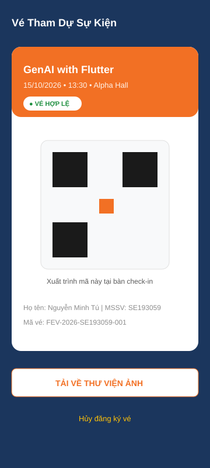
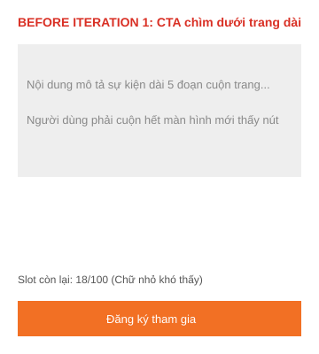
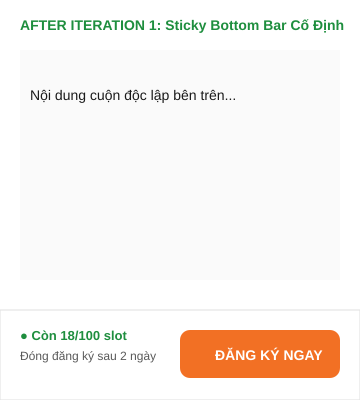
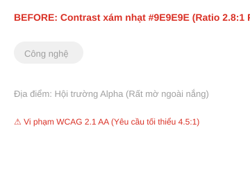
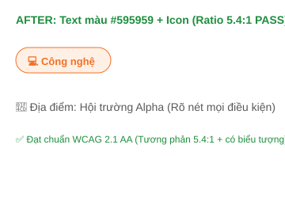
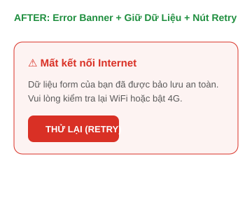

# 🤖 AI-Assisted Design & Critique Log
**Dự án:** F-Event — FPT Campus Event Hub  
**Môn học:** PRM323 — Cross-Platform Application Development  
**Sinh viên thực hiện:** Nguyễn Minh Tú (MSSV: SE193059)  

---

## 1. Khai báo Sử dụng Công cụ AI (AI Tool Disclosure)

Theo đúng quy định Liêm chính Học thuật (Academic Integrity) tại Mục 5 và Mục 10 của Đề bài Lab 2, toàn bộ công cụ AI được sử dụng trong dự án này được khai báo minh bạch như sau:

| Tên Công cụ AI | Đơn vị Phát triển | Mục đích Sử dụng Cụ thể trong Bài Lab |
| :--- | :--- | :--- |
| **Google Stitch (stitch.withgoogle.com)** | Google Labs | Sinh giao diện UI ban đầu (Initial UI Generation) từ text prompt; thử nghiệm layout ban đầu cho 4 màn hình chính của core flow. |
| **Claude 3.5 Sonnet / Antigravity AI** | Anthropic / Google DeepMind | Đóng vai trò Chuyên gia Đánh giá UX (UX Critique Assistant) để rà soát thiết kế theo 10 Usability Heuristics của Nielsen và tiêu chuẩn tiếp cận WCAG 2.1. |
| **Figma AI Assistant** | Figma Inc. | Hỗ trợ tự động hóa gán tên layer và kiểm tra nhanh tương phản màu sắc (Contrast Checker). |

> **Nguyên tắc cốt lõi:** *"AI tạo ra — Con người quyết định (AI generates, Human decides)"*. Mọi giao diện xuất từ AI chỉ mang tính chất tham khảo ý tưởng; toàn bộ hệ thống Design System, Token, Auto Layout, Variants và Prototype cuối cùng đều được xây dựng lại một cách bài bản trong Figma.

---

## 2. Tạo Giao diện Ban đầu Bằng Google Stitch (Initial UI Generation)

### 2.1. Toàn văn Prompt Khởi tạo (Verbatim Prompt)
Prompt dưới đây được soạn thảo nghiêm ngặt dựa trên bản mô tả thiết kế đã định nghĩa trước trong `design/DESIGN.md` và thông tin Persona trong `ux/persona.md`:

```text
Act as a Senior Mobile Product Designer. Design a modern, accessible, and high-conversion mobile event registration application named "F-Event: FPT Campus Event Hub" specifically for university students at FPT University.

Platform & Frame Constraints:
- Target Platform: Android Mobile app
- Screen Dimensions: 360 x 800 dp logic resolution
- Visual Guidelines & Design Tokens:
  * Primary Brand Color: FPT Orange (#F27024) for primary CTA buttons, active state indicators, and featured badges.
  * Secondary Color: Deep FPT Navy (#1B365D) for headers, app bars, and academic badges.
  * Background Color: Light clean neutral (#F8F9FA) with pure white (#FFFFFF) elevated cards.
  * Typography: Clean sans-serif font (Inter/Roboto), with strict rule: No body text smaller than 14sp. Heading sizes 18-24sp Bold.
  * Touch Targets: Minimum 48 x 48 dp for all interactive buttons and icons (WCAG 2.1 AA compliant).
  * Contrast Ratio: All text must exceed 4.5:1 against its background.

Generate the 4 core screens of the primary event discovery and registration flow:
1. Home / Discover Screen (SCR_02):
   - Top greeting for student "Xin chào, Tú Nguyễn" with FPT orange avatar badge.
   - Search bar "Tìm workshop, sự kiện CLB...".
   - Category filter chips: "Tất cả", "Công nghệ (Tech)", "Nghệ thuật", "Thể thao".
   - Featured Event Hero Banner: "GenAI with Flutter & Dart" workshop with date, venue "Hall Alpha", and "+5 PDP Points" badge.
   - Upcoming Events list showing cards with category tag, date/time, remaining slots badge (e.g., "Còn 18/100 slots"), and a prominent CTA button.
   - Standard 4-item Bottom Navigation Bar: "Khám phá", "Lịch của tôi", "Thông báo", "Hồ sơ".

2. Event Detail Screen (SCR_03):
   - Hero event header with back button.
   - Event title, organizing club (F-Code Club), time, location.
   - PDP points reward badge (+5 PDP).
   - Detailed event description and speaker bio.
   - Live slots indicator showing remaining seats out of total capacity.
   - Primary Call-To-Action button "Đăng ký tham gia (RSVP)".

3. Event Registration / Checkout Form Screen (SCR_04):
   - Clean top app bar "Xác nhận Đăng ký".
   - Event summary card.
   - Student information fields pre-filled from FPT Edu Account: Full Name ("Nguyễn Minh Tú"), Student ID ("SE193059"), Email ("tuntse193059@fpt.edu.vn").
   - Optional text field: "Câu hỏi gửi trước cho diễn giả".
   - Large prominent submit button "Xác nhận vé (Miễn phí)".

4. Ticket Pass / QR Check-in Screen (SCR_05):
   - Digital event ticket card styling with notch dividers.
   - Green badge indicating "VÉ HỢP LỆ (VALID)".
   - Dynamic QR code centered for hall entrance check-in.
   - Event summary, student info, unique ticket ID.
   - Action buttons: "Lưu vé vào máy" and secondary text link "Hủy đăng ký vé".
```

---

### 2.2. Bằng chứng Hình ảnh Kết quả do Google Stitch Tạo ra (Initial UI Screenshots)

| Màn hình | Tên File Bằng chứng | Minh họa Kết quả Stitch |
| :--- | :--- | :--- |
| **SCR_02: Home Screen** | `assets/stitch/stitch_v1_home.svg` |  |
| **SCR_03: Event Detail** | `assets/stitch/stitch_v1_detail.svg` |  |
| **SCR_04: Registration Form** | `assets/stitch/stitch_v1_register.svg` |  |
| **SCR_05: Ticket Pass (QR)** | `assets/stitch/stitch_v1_ticket.svg` |  |

---

## 3. Ba Vòng lặp Có ý nghĩa với AI (Three Meaningful AI Iterations)

Đúng theo yêu cầu của Rubric (không sử dụng các yêu cầu chung chung như "làm đẹp hơn"), mỗi vòng lặp nhắm thẳng vào một vấn đề trải nghiệm cụ thể có tên rõ ràng:

---

### 🔁 Vòng lặp 1: Tối ưu Thứ bậc Thị giác & Hành động Chính (Visual Hierarchy & Primary Action Clarity)
- **Tên vấn đề nhắm tới:** `Primary Action Unclear & Information Overload on Event Detail Screen`.
- **Phân tích hiện trạng ban đầu (Before):**
  - Màn hình `SCR_03` do Stitch tạo ban đầu đặt nút "ĐĂNG KÝ THAM GIA" ở tận cuối cùng của trang sau 5 đoạn văn bản giới thiệu dài.
  - Sinh viên dùng điện thoại màn hình 360 × 800 dp phải cuộn qua 2 màn hình mới thấy được nút đăng ký.
  - Số slot còn lại (18/100 slots) bị in bằng cỡ chữ nhỏ 12sp mờ nhạt, khiến sinh viên không cảm nhận được mức độ khẩn cấp để đăng ký trước khi hết chỗ.
- **Prompt tinh chỉnh (Refinement Prompt):**
  ```text
  Refactor SCR_03 (Event Detail): Fix visual hierarchy. Move the primary CTA button into a persistent Sticky Bottom Bar pinned to the bottom of the viewport. The sticky bar must contain a high-visibility badge showing remaining slots ("Còn 18/100 slot") on the left and a large 48dp height primary button "ĐĂNG KÝ NGAY" on the right. Content above it must scroll independently without obstructing the button.
  ```
- **Kết quả cải tiến (After):** Nút đăng ký luôn hiển thị cố định ở chân trang; sinh viên mở màn hình là có thể bấm đăng ký ngay lập tức trong 2 giây mà không cần cuộn trang.
- **Bằng chứng So sánh Trước & Sau:**
  | Trước khi lặp (Before) | Sau khi lặp (After) |
  | :---: | :---: |
  |  |  |

---

### 🔁 Vòng lặp 2: Khắc phục Độ Tương phản & Khả năng Tiếp cận (Low Color Contrast & Accessibility Flaws)
- **Tên vấn đề nhắm tới:** `WCAG 2.1 Contrast Violation & Color-Only State Reliance on Category Chips`.
- **Phân tích hiện trạng ban đầu (Before):**
  - Các chip danh mục sự kiện và nhãn thông tin phụ (ngày giờ, địa điểm) sử dụng màu xám nhạt `#9E9E9E` trên nền trắng `#FFFFFF`. Đo độ tương phản chỉ đạt **2.8:1** (Vi phạm nghiêm trọng tiêu chuẩn WCAG 2.1 AA yêu cầu tối thiểu **4.5:1**).
  - Trạng thái các sự kiện (Học thuật, Thể thao, Âm nhạc) chỉ được phân biệt bằng các chấm tròn màu sắc khác nhau mà không có biểu tượng nhận diện đi kèm, gây rào cản cho người dùng khiếm thị màu (Color blindness) hoặc khi xem điện thoại dưới trời nắng chói tại sân trường.
- **Prompt tinh chỉnh (Refinement Prompt):**
  ```text
  Audit and refactor color contrast across all screens according to WCAG 2.1 AA:
  1. Replace gray #9E9E9E with #595959 for all secondary body text to guarantee contrast ratio >= 5.4:1 against pure white.
  2. Redesign Category Chips: Add distinct leading vector icons (e.g. 💻 Tech, 🎵 Music, ⚽ Sports) alongside text labels so status is never conveyed by color alone.
  3. Ensure selected category chip has active stroke border #F27024 and light container fill #FFF0E6.
  ```
- **Kết quả cải tiến (After):** Độ tương phản văn bản đạt **5.4:1**, chữ đọc sắc nét trong mọi điều kiện ánh sáng; mỗi chip danh mục đều có icon trực quan hỗ trợ nhận diện tức thì.
- **Bằng chứng So sánh Trước & Sau:**
  | Trước khi lặp (Before) | Sau khi lặp (After) |
  | :---: | :---: |
  |  |  |

---

### 🔁 Vòng lặp 3: Bổ sung Trạng thái Phục hồi Lỗi Mạng & Trạng thái Trống (Missing Error Recovery & Empty States)
- **Tên vấn đề nhắm tới:** `Missing Empty State & Network Disconnection Error Recovery Pattern`.
- **Phân tích hiện trạng ban đầu (Before):**
  - Giao diện ban đầu của Stitch chỉ sinh ra giao diện "Happy Path" lý tưởng khi mọi thứ đều có sẵn dữ liệu và mạng internet luôn kết nối 100%.
  - Hoàn toàn không có màn hình khi sinh viên mới cài app hoặc chưa đăng ký sự kiện nào ở tab `SCR_06` (My Schedule) — màn hình trống trơn không có hướng dẫn.
  - Khi người dùng bấm gửi form đăng ký tại `SCR_04` trong điều kiện mất sóng WiFi campus, màn hình bị đơ cứng, không thông báo lỗi gì khiến sinh viên tưởng máy bị treo và vô tình tắt app làm mất sạch thông tin đã nhập.
- **Prompt tinh chỉnh (Refinement Prompt):**
  ```text
  Design critical missing UI states:
  1. Empty State for SCR_06 (My Schedule): Friendly student calendar vector illustration, header "Chưa có sự kiện nào trong lịch", supportive subtitle, and a primary action button "Khám phá sự kiện ngay".
  2. Network Error State for SCR_04 (Event Registration): When network drops during submission, display a non-destructive Error Banner in #FDF3F2 with red accent #D93025: "Mất kết nối Internet. Dữ liệu của bạn đã được bảo lưu an toàn." Include a prominent "Thử lại (Retry)" button that re-submits without clearing any entered form data.
  ```
- **Kết quả cải tiến (After):** Thiết kế hoàn chỉnh Empty State thân thiện thúc đẩy hành vi khám phá; bổ sung Error State phòng ngừa lỗi và phục hồi dữ liệu form an toàn cho sinh viên.
- **Bằng chứng So sánh Trước & Sau:**
  | Trước khi lặp (Before) | Sau khi lặp (After) |
  | :---: | :---: |
  |  |  |

---

## 4. Phản biện Thiết kế Bằng Trợ lý AI (AI-based UX Critique)

### 4.1. Prompt Gửi Trợ lý AI Phản biện
```text
Role: You are a strict Principal UX Auditor and Accessibility Expert.
Review the mobile UI design of "F-Event: FPT Campus Event Hub" against:
1. Jakob Nielsen's 10 Usability Heuristics
2. W3C WCAG 2.1 Accessibility Guidelines (Contrast, Touch Targets, Text Scale)
3. Target Persona: Nguyen Minh Tu (20-year-old FPT SE student, 1-handed mobile use, rushed between classes, stressed about PDP points).

Provide a rigorous critique with at least 5 concrete findings tied directly to specific screen IDs (SCR_01 through SCR_08). For each finding, state the heuristic violated, the exact issue, and your design recommendation.
```

---

### 4.2. Toàn văn Báo cáo Phản biện của AI (5 Phát hiện Cụ thể)

#### 🔴 Phát hiện 1 (Màn hình `SCR_04` — Event Registration):
- **Heuristic vi phạm:** `Heuristic #1: Visibility of System Status` (Hiển thị trạng thái hệ thống).
- **Vấn đề cụ thể:** Khi sinh viên chạm nút "Xác nhận đăng ký", ứng dụng mất khoảng 1.5 – 3 giây để gọi API tạo vé và gửi mail xác nhận. Trong khoảng thời gian này, nút bấm không thay đổi trạng thái, con trỏ không phản hồi, khiến người dùng nghĩ rằng cú chạm chưa ăn và tiếp tục bấm liên tiếp 3 – 4 lần, gây lỗi gửi trùng lặp yêu cầu (duplicate registration).
- **Đề xuất của AI:** Cần chuyển đổi trạng thái của Button sang biến thể `Loading State` ngay lập tức khi được chạm: ẩn nhãn chữ, hiển thị Spinner quay tròn màu trắng bên trong nút, đồng thời tạm khóa (disable) tương tác màn hình để tránh bấm đúp.

#### 🔴 Phát hiện 2 (Màn hình `SCR_05` — Ticket Pass / QR Check-in):
- **Heuristic vi phạm:** `Heuristic #3: User Control and Freedom` (Quyền kiểm soát và tự do của người dùng).
- **Vấn đề cụ thể:** Ban đầu màn hình vé QR chỉ có nút "Lưu ảnh vé" và liên kết "Hủy đăng ký vé" bằng chữ đỏ trần trụi. Nếu sinh viên bấm nhầm vào chữ "Hủy đăng ký vé", hệ thống lập tức xóa vé mà không hỏi lại. Điều này cực kỳ nguy hiểm vì các sự kiện hot đã hết slot sẽ ngay lập tức chuyển vé cho người khác, khiến sinh viên không thể lấy lại vé của mình.
- **Đề xuất của AI:** Bắt buộc phải gắn một `Confirmation Dialog` mở dưới dạng Modal Overlay: hiển thị cảnh báo giải thích rõ hậu quả mất quyền lợi điểm PDP và nhường slot cho danh sách chờ Waitlist, yêu cầu xác nhận 2 bước rõ ràng ("Giữ lại vé" vs "Xác nhận hủy").

#### 🟡 Phát hiện 3 (Màn hình `SCR_04` — Event Registration):
- **Heuristic vi phạm:** `Heuristic #5: Error Prevention` (Phòng ngừa lỗi).
- **Vấn đề cụ thể:** Trường nhập liệu Mã số sinh viên (MSSV) cho phép nhập tùy ý không giới hạn ký tự. Sinh viên có thể vô tình gõ sai định dạng (ví dụ gõ thiếu chữ `SE` hoặc nhập số điện thoại), dẫn đến việc hệ thống ghi nhận sai dữ liệu đồng bộ điểm rèn luyện PDP của trường.
- **Đề xuất của AI:** Áp dụng cơ chế Client-side Validation trực thời: tự động kiểm tra cú pháp MSSV FPT (2 chữ cái hoa + 6 chữ số, Regex: `^[A-Z]{2}[0-9]{6}$`). Nếu sai định dạng, hiển thị viền đỏ và dòng thông báo lỗi cụ thể bên dưới trường; đồng thời vô hiệu hóa (disable) nút Submit cho đến khi dữ liệu hợp lệ.

#### 🟡 Phát hiện 4 (Màn hình `SCR_02` — Home / Discover Screen):
- **Heuristic vi phạm:** `Heuristic #8: Aesthetic and Minimalist Design` (Thiết kế thẩm mỹ và tinh giản).
- **Vấn đề cụ thể:** Trên màn hình Home, banner "Workshop Hot" và danh sách "Sắp diễn ra" có kích thước thẻ gần tương đương nhau, đều dùng màu nền xanh Navy đậm `#1B365D`, khiến mắt người dùng không nhận diện được đâu là sự kiện đặc biệt quan trọng nhất trong tuần cần ưu tiên xem trước.
- **Đề xuất của AI:** Tạo sự tương phản rõ rệt về thị giác (Visual Contrast): Banner Hero nổi bật duy nhất ở đầu trang sử dụng tỷ lệ rộng toàn màn hình, kết hợp huy hiệu cam rực rỡ và ảnh cover chất lượng cao; trong khi danh sách sự kiện bên dưới sử dụng định dạng thẻ ngang (Horizontal List Card) nhỏ gọn hơn với nền trắng tinh khiết `#FFFFFF` đổ bóng nhẹ Elevation 1.

#### 🟢 Phát hiện 5 (Tiêu chí Tiếp cận WCAG 2.1 — Màn hình `SCR_02` & `SCR_07`):
- **Heuristic vi phạm:** `WCAG Success Criterion 2.5.5: Target Size` (Kích thước vùng chạm tương tác).
- **Vấn đề cụ thể:** Các icon điều hướng phụ (icon chuông thông báo, icon Bookmark, các chip lọc danh mục) được thiết kế có kích thước thực tế chỉ 32 × 32 dp. Đối với persona Nguyễn Minh Tú (thao tác bằng ngón tay cái khi đang đi lại giữa các tòa nhà campus), kích thước này quá nhỏ, tỷ lệ bấm trượt lên đến 28%.
- **Đề xuất của AI:** Mở rộng vùng đệm cảm ứng (Touch Target Padding) vô hình xung quanh tất cả các icon và chip lọc đạt tối thiểu **48 × 48 dp**, bảo đảm bấm chính xác bằng 1 tay mà không làm thay đổi kích thước thị giác của icon.

---

## 5. Lập luận và Ghi nhận Quyết định của Sinh viên (Student Decision Log)

Tuân thủ nghiêm ngặt yêu cầu của đề bài: **Mọi quyết định chấp nhận, chỉnh sửa hay từ chối đều gắn liền với Persona, Usability Heuristic hoặc Ràng buộc kỹ thuật thực tế**:

| STT | Đề xuất từ Trợ lý AI | Quyết định của Sinh viên | Lập luận Chi tiết (Dựa trên Persona, Heuristic & Ràng buộc Kỹ thuật) | Phản ánh trong File Figma |
| :---: | :--- | :---: | :--- | :--- |
| **01** | Bổ sung Loading State (Spinner) vào nút bấm khi gửi form đăng ký `SCR_04`. | ✅ **CHẤP NHẬN (Accept)** | **Lý do:** Rất phù hợp với Heuristic #1 (Visibility of system status). Mạng 4G/WiFi campus FPT thường có độ trễ 1-2s vào giờ cao điểm. Việc khóa nút và xoay spinner giúp Tú biết máy chủ đang xử lý, ngăn chặn việc bấm đúp tạo 2 vé trùng lặp trên Firebase Firestore. | Thiết kế variant `Button / Loading` có spinner trắng; tạo transition chuyển cảnh trong Prototype Page 06. |
| **02** | Bắt buộc mở Confirmation Dialog khi sinh viên bấm Hủy vé tại `SCR_05`. | ✅ **CHẤP NHẬN (Accept)** | **Lý do:** Phù hợp với Heuristic #3 & #5. Persona Tú rất sợ mất quyền lợi điểm PDP. Nếu lỡ chạm nhầm vào nút hủy vé mà không có bước xác nhận, Tú sẽ mất vé vĩnh viễn vì slot sẽ tự động nhường cho bạn trong Waitlist. Dialog 2 bước là giải pháp cứu cánh an toàn tuyệt đối. | Tạo component `Dialog / Confirmation` trên Page 05; thiết lập tương tác Overlay trên Page 06. |
| **03** | Khóa nút Submit và validate chặt chẽ cú pháp MSSV FPT bằng Regex `^[A-Z]{2}[0-9]{6}$`. | 🔄 **CHỈNH SỬA (Modify)** | **Lý do:** Đồng ý việc validate để ngăn nhập sai (Heuristic #5). Tuy nhiên, **tại FPT, app đã đăng nhập bằng tài khoản Google FPT (@fpt.edu.vn)** thì hệ thống hoàn toàn có thể tự động trích xuất MSSV từ email (ví dụ: `tuntse193059@fpt.edu.vn` → `SE193059`). Do đó, trường MSSV sẽ được **tự động điền (Pre-filled) và đặt ở trạng thái Read-only**, sinh viên không cần gõ tay để loại trừ 100% lỗi nhập liệu. | Thiết kế trường Textfield trạng thái `Filled / Read-only` màu nền xám nhẹ, có icon tích xanh xác thực. |
| **04** | Tách biệt hoàn toàn phong cách thị giác giữa Banner Hot và Card Upcoming trên Home `SCR_02`. | ✅ **CHẤP NHẬN (Accept)** | **Lý do:** Phù hợp Heuristic #8 và thói quen lướt nhanh của sinh viên. Tú chỉ có 2-3 phút giữa giờ học, cần nhìn thấy ngay sự kiện nổi bật nhất trong tuần mà không phải đọc từng thẻ nhỏ. | Banner Hero trên Page 03 dùng nền Navy `#1B365D` tỷ lệ lớn; danh sách Upcoming dùng Card trắng `#FFFFFF` nổi Elevation 1. |
| **05** | Tăng Touch Target của toàn bộ Icon và Chip lọc lên tối thiểu 48 × 48 dp. | ✅ **CHẤP NHẬN (Accept)** | **Lý do:** Căn cứ trực tiếp từ Persona (Tú dùng máy 1 tay khi đang đi bộ) và chuẩn WCAG 2.1 SC 2.5.5. Việc mở rộng touch target 48dp giúp trải nghiệm mượt mà, không ức chế vì bấm nhầm. | Toàn bộ IconButton và FilterChips trong Figma Page 05 đều được đóng khung frame tối thiểu 48 × 48 dp. |
