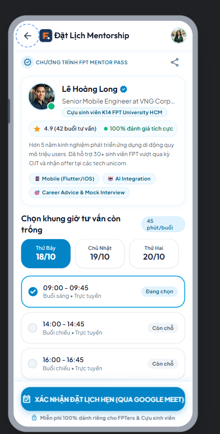
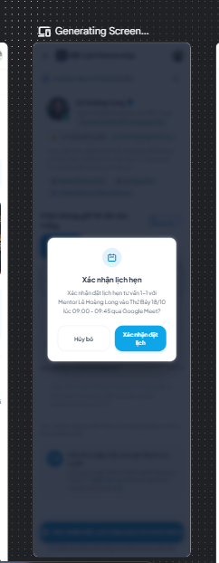
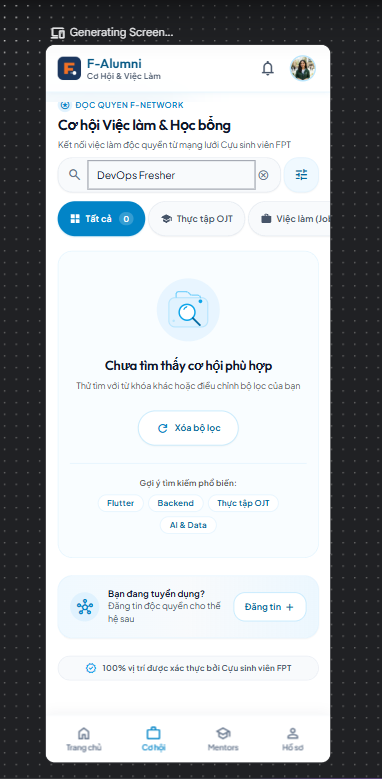
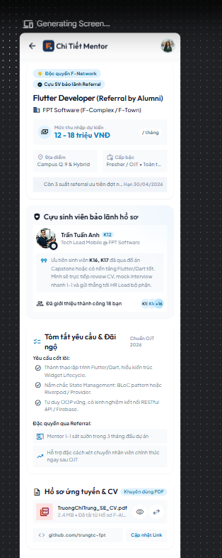
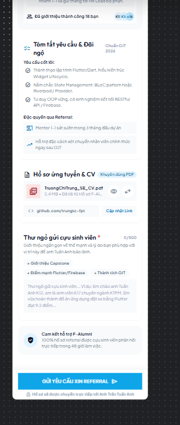

# 🤖 AI-Assisted Design & Critique Log
**Dự án:** F-Alumni — FPT Alumni Mentorship & Opportunity Network  
**Môn học:** PRM323 — Cross-Platform Application Development  
**Nhóm thực hiện:** PRM Nhóm 4 — Đại học FPT TP.HCM  
**Thành viên:** Trương Chí Trung (SE193059), Nguyễn Phương Khải (SE183590), Đỗ Trọng Tín, Võ Quang Tâm (SE192621)  

---

## 1. Khai báo Sử dụng Công cụ AI (AI Tool Disclosure)

Theo đúng quy định Liêm chính Học thuật (Academic Integrity) tại Mục 5 và Mục 10 của Đề bài Lab 2, toàn bộ công cụ AI được sử dụng trong dự án này được khai báo minh bạch như sau:

| Tên Công cụ AI | Đơn vị Phát triển | Mục đích Sử dụng Cụ thể trong Bài Lab |
| :--- | :--- | :--- |
| **Google Stitch (stitch.withgoogle.com)** | Google Labs | Sinh giao diện UI ban đầu (Initial UI Generation) từ text prompt; thử nghiệm layout ban đầu cho 4 màn hình chính của ứng dụng F-Alumni. |
| **Gemini 2.5 / Claude / Antigravity AI** | Google DeepMind / Anthropic | Đóng vai trò Chuyên gia Đánh giá UX (UX Critique Assistant) để rà soát thiết kế theo 10 Usability Heuristics của Nielsen và tiêu chuẩn tiếp cận WCAG 2.1. |
| **Figma AI Assistant** | Figma Inc. | Hỗ trợ tự động hóa gán tên layer và kiểm tra nhanh tương phản màu sắc (Contrast Checker). |

> **Nguyên tắc cốt lõi:** *"AI tạo ra — Con người quyết định (AI generates, Human decides)"*. Mọi giao diện xuất từ AI chỉ mang tính chất tham khảo ý tưởng; toàn bộ hệ thống Design System, Token, Auto Layout, Variants và Prototype cuối cùng đều được xây dựng lại một cách bài bản trong Figma.

---

## 2. Tạo Giao diện Ban đầu Bằng Google Stitch (Initial UI Generation)

### 2.1. Toàn văn Prompt Khởi tạo (Verbatim Prompt)
Prompt dưới đây được soạn thảo nghiêm ngặt dựa trên bản mô tả thiết kế trong `design/DESIGN.md` và thông tin Persona trong `ux/persona.md`:

```text
Design a clean, modern mobile app interface for "F-Alumni: FPT Alumni Mentorship & Career Network" where university alumni share experience, job opportunities, and scholarships with current students.

Platform & Constraints:
- Mobile screen resolution: 360 x 800 dp
- Brand Colors: FPT Orange (#F27024) for primary actions and highlighted badges, Deep Navy Blue (#1B365D) for app headers and alumni credentials, Light neutral background (#F8F9FA) with clean white cards.
- Typography: Modern sans-serif, body text 14sp minimum, titles 18-24sp bold.
- Touch target: Minimum 48 x 48 dp for all buttons and interactive chips.
- High contrast: Text contrast must be higher than 4.5:1 (WCAG 2.1 AA compliant).

Generate the 4 core screens of the student journey:

1. Home Feed Screen (SCR_02):
   - Top greeting "Xin chào, Tú Nguyễn" with student avatar and branch badge "Campus HCM".
   - Search bar "Tìm kinh nghiệm, học bổng, việc làm...".
   - Top Tab Switcher: "🌐 Không gian chung" (General) and "💻 Nhóm ngành IT / Software" (Major Specific).
   - Category chips: "🔥 Nổi bật", "💼 Cơ hội việc làm", "🎓 Học bổng", "💡 Kinh nghiệm OJT".
   - Featured Alumni Sharing Card: Post from Alumni "Lê Hoàng Long (Senior Dev at VNG)" sharing "Lộ trình ôn luyện phỏng vấn Software Engineer 2026", with read time, like/comment counts, and Bookmark icon.
   - Bottom Navigation Bar (4 tabs): Trang chủ, Việc làm/Học bổng, Mentors, Hồ sơ.

2. Article / Experience Detail Screen (SCR_03):
   - Header with back button, share icon, and bookmark icon.
   - Post category badge "KINH NGHIỆM PHỎNG VẤN" and article title.
   - Author Info Tile: Alumni avatar, name "Lê Hoàng Long", badge "Alumni K14 - Senior Mobile Engineer", company "VNG Corporation".
   - Post body text detailing tips, interview stages, and key technical questions.
   - Attachment card: Downloadable interview checklist PDF.
   - Sticky Bottom Bar: Button "Đặt lịch tư vấn 1-1 với Mentor" (height 48dp) and chat icon.

3. Opportunity & Job Board Screen (SCR_04):
   - Header title "Cơ hội Việc làm & Học bổng".
   - Segmented filter: "Tất cả", "Thực tập OJT", "Việc làm (Job)", "Học bổng Thạc sĩ".
   - Opportunity Cards: Company logo (e.g. FPT Software / Shopee), job title "Flutter Developer (Referral by Alumni)", salary/stipend range, location, and badge "Cựu SV bảo lãnh Referral".
   - Button on card: "Xem & Xin Referral".

4. Mentor Profile & Booking Screen (SCR_07):
   - Alumni mentor card with avatar, bio, areas of expertise (Mobile, AI, Career Advice).
   - Available time slots selector: "Thứ Bảy, 18/10: 09:00 - 09:45" and "14:00 - 14:45".
   - Topic input: "Chủ đề bạn muốn hỏi Mentor".
   - Primary button: "XÁC NHẬN ĐẶT LỊCH HẸN (QUA GOOGLE MEET)".
```

---

### 2.2. Bằng chứng Hình ảnh Kết quả do Google Stitch Tạo ra (Initial UI Screenshots)

| Màn hình | Tên File Bằng chứng | Minh họa Kết quả Stitch |
| :--- | :--- | :--- |
| **SCR_02: Home Feed** | `assets/stitch/v0_home.png` |  |
| **SCR_03: Post Detail** | `assets/stitch/v0_detail.png` |  |
| **SCR_04: Job Board** | `assets/stitch/v0_jobs.png` |  |
| **SCR_07: Mentor Booking** | `assets/stitch/v0_booking.png` |  |

---

## 3. Ba Vòng lặp Có ý nghĩa với AI (Three Meaningful AI Iterations)

Theo đúng quy định của đề bài và Rubric chấm điểm, mỗi vòng lặp nhắm vào một vấn đề trải nghiệm cụ thể có tên riêng, kèm đầy đủ ảnh **Trước (Before)** và **Sau (After)**:

---

### 🔁 Vòng lặp 1: Bổ sung Hộp thoại Xác nhận 2 Bước khi Đặt lịch Tư vấn
- **Tên vấn đề nhắm tới:** `Missing Confirmation Dialog on Mentor Booking Screen (Usability Heuristic #5: Error Prevention & #3: User Freedom)`.
- **Phân tích hiện trạng ban đầu (Before):**
  - Màn hình chọn giờ tư vấn ban đầu (`iter1_before.png`) chỉ có nút "XÁC NHẬN ĐẶT LỊCH HẸN (QUA GOOGLE MEET)". Khi người dùng bấm nút, hệ thống chốt lịch ngay lập tức mà không có bước xác nhận lại thông tin ngày giờ và hình thức gặp mặt.
  - Người dùng thao tác một tay rất dễ chạm nhầm khung giờ hoặc bấm nhầm nút gửi, dẫn đến việc chiếm dụng khung giờ rảnh quý báu của cựu sinh viên.
- **Prompt tinh chỉnh nguyên văn (Refinement Prompt):**
  ```text
  On the Mentor Booking screen, add a centered confirmation modal dialog overlay: "Xác nhận đặt lịch hẹn tư vấn 1-1 với Mentor Lê Hoàng Long vào Thứ Bảy 18/10 lúc 09:00 - 09:45 qua Google Meet?" with two buttons: "Hủy bỏ" and "Xác nhận đặt lịch".
  ```
- **Kết quả cải tiến (After):** Xuất hiện hộp thoại Modal Dialog sắc nét ở trung tâm màn hình, có icon lịch màu xanh, ghi rõ ngày giờ và tên Mentor, kèm 2 nút "Hủy bỏ" (viền xám) và "Xác nhận đặt lịch" (nút xanh nổi bật), nền xung quanh được làm tối để hướng sự tập trung.
- **Bằng chứng So sánh Trước & Sau:**
  | Trước khi lặp (Before) | Sau khi lặp (After) |
  | :---: | :---: |
  |  |  |

---

### 🔁 Vòng lặp 2: Thiết kế Trạng thái Trống (Empty State) khi Tìm kiếm Việc làm không có kết quả
- **Tên vấn đề nhắm tới:** `Missing Empty State & Filter Reset on Job Search (Usability Heuristic #1: Visibility of System Status & #9: Error Recovery)`.
- **Phân tích hiện trạng ban đầu (Before):**
  - Màn hình Bảng tin Việc làm & Học bổng ban đầu (`iter2_before.png`) chỉ có danh sách việc làm khi có sẵn dữ liệu.
  - Khi sinh viên gõ từ khóa tìm kiếm không tồn tại (ví dụ: "DevOps Fresher") hoặc chọn kết hợp các bộ lọc quá hẹp, màn hình sẽ bị trắng trơn không có thông báo gì, khiến sinh viên tưởng ứng dụng bị đơ hoặc mất mạng.
- **Prompt tinh chỉnh nguyên văn (Refinement Prompt):**
  ```text
  On the Career & Job Board screen, generate the Empty State when search returns no results. Show a search input with keyword "DevOps Fresher", a friendly vector illustration of an empty folder, title "Chưa tìm thấy cơ hội phù hợp", subtitle "Thử tìm với từ khóa khác hoặc điều chỉnh bộ lọc của bạn", and a button "Xóa bộ lọc".
  ```
- **Kết quả cải tiến (After):** Hiển thị màn hình Empty State hoàn chỉnh với ô tìm kiếm "DevOps Fresher", icon chiếc cặp tài liệu có kính lúp, thông điệp hướng dẫn rõ ràng, nút "↻ Xóa bộ lọc" màu xanh, cùng các chip gợi ý từ khóa phổ biến ("Flutter", "Backend", "AI & Data") và khối kêu gọi cựu sinh viên đăng tin tuyển dụng.
- **Bằng chứng So sánh Trước & Sau:**
  | Trước khi lặp (Before) | Sau khi lặp (After) |
  | :---: | :---: |
  |  |  |

---

### 🔁 Vòng lặp 3: Thiết kế Chi tiết Hồ sơ Ứng tuyển & Tải File CV xin Referral (`SCR_05`)
- **Tên vấn đề nhắm tới:** `Missing Endorsement Details & Two-Way Referral Application Flow (Feature Completeness for Flow 2)`.
- **Phân tích hiện trạng ban đầu (Before):**
  - Bảng tin việc làm ban đầu (`iter3_before.png`) chỉ có thẻ tóm tắt với nút "Xem & Xin Referral" nhưng chưa có màn hình chi tiết để sinh viên xem lời nhắn bảo lãnh từ cựu SV và nộp hồ sơ.
  - Sinh viên không có nơi để đính kèm file CV PDF cũng như không có chỗ để viết thư ngỏ giới thiệu bản thân gửi cho cựu sinh viên.
- **Prompt tinh chỉnh nguyên văn (Refinement Prompt):**
  ```text
  Design the Job Detail & Referral Application screen (SCR_05) for "Flutter Developer (Referral by Alumni)" at FPT Software. Include job title, salary 12-18M VNĐ, an alumni endorsement card "Bảo lãnh hồ sơ bởi Anh Trần Tuấn Anh (Tech Lead K12)", an uploaded CV card showing "TruongChiTrung_SE_CV.pdf (2.4 MB)", a cover letter input field "Thư ngỏ gửi cựu sinh viên...", and a primary button "GỬI YÊU CẦU XIN REFERRAL".
  ```
- **Kết quả cải tiến (After):** Màn hình chi tiết ứng tuyển toàn diện: hiển thị mức lương 12-18 triệu, trích dẫn lời nhắn bảo lãnh trực tiếp từ anh Trần Tuấn Anh (Tech Lead K12), thẻ file CV đã tải lên `TruongChiTrung_SE_CV.pdf`, link GitHub `github.com/trungtc-fpt`, ô nhập thư ngỏ 500 ký tự có chip gợi ý ("+ Giới thiệu Capstone", "+ Điểm mạnh Flutter"), cam kết phản hồi trong 48h, và nút CTA lớn "GỬI YÊU CẦU XIN REFERRAL ▶".
- **Bằng chứng So sánh Trước & Sau:**
  | Trước khi lặp (Before) | Sau khi lặp (After - Phần 1 & 2) |
  | :---: | :---: |
  |  | <br> |

---

## 4. Phản biện Thiết kế Bằng Trợ lý AI (AI-based UX Critique)

### 4.1. Prompt Gửi Trợ lý AI Phản biện
```text
Role: You are a strict Principal UX Auditor and Accessibility Expert.
Review the mobile UI design of "F-Alumni: FPT Alumni Mentorship & Career Network" against:
1. Jakob Nielsen's 10 Usability Heuristics
2. W3C WCAG 2.1 Accessibility Guidelines (Contrast, Touch Targets, Text Scale)
3. Target Persona: Truong Chi Trung (20-year-old FPT SE student, 1-handed mobile use, preparing for OJT internship, looking for alumni referrals and 1-on-1 mentor guidance).

Provide a rigorous critique with at least 5 concrete findings tied directly to specific screen IDs (SCR_01 through SCR_08). For each finding, state the heuristic violated, the exact issue, and your design recommendation.
```

---

### 4.2. Báo cáo Phản biện của AI (5 Phát hiện Cụ thể)

#### 🔴 Phát hiện 1 (Màn hình `SCR_05` — Job Detail & Referral Apply):
- **Heuristic vi phạm:** `Heuristic #1: Visibility of System Status`.
- **Vấn đề cụ thể:** Khi sinh viên bấm "Gửi yêu cầu xin Referral", file CV PDF cần thời gian tải lên Cloud Storage. Nút bấm ban đầu không có hiệu ứng loading, khiến người dùng bấm liên tiếp gây tải lên trùng lặp.
- **Đề xuất của AI:** Chuyển trạng thái Button sang `Loading State` (spinner trắng quay tròn) và khóa tương tác tạm thời.

#### 🔴 Phát hiện 2 (Màn hình `SCR_07` — Mentor Booking & Session Pass):
- **Heuristic vi phạm:** `Heuristic #3: User Control and Freedom`.
- **Vấn đề cụ thể:** Nút "Hủy lịch hẹn tư vấn" nếu bấm vào sẽ xóa lịch ngay lập tức mà không có hộp thoại xác nhận, khiến sinh viên dễ bị mất lịch hẹn quý giá với cựu sinh viên.
- **Đề xuất của AI:** Bắt buộc mở `Confirmation Dialog` 2 bước giải thích rõ việc hủy lịch sẽ mở lại khung giờ cho bạn khác.

#### 🟡 Phát hiện 3 (Màn hình `SCR_01` — Login & Role Selection):
- **Heuristic vi phạm:** `Heuristic #5: Error Prevention`.
- **Vấn đề cụ thể:** Nếu sinh viên không chọn chuyên ngành mà bấm đăng nhập ngay, màn hình Home Feed sẽ không biết lọc bài viết gì, hiển thị lộn xộn.
- **Đề xuất của AI:** Đặt giá trị chuyên ngành mặc định hoặc khóa nút đăng nhập nếu chưa chọn chuyên ngành.

#### 🟡 Phát hiện 4 (Màn hình `SCR_02` — Home Feed):
- **Heuristic vi phạm:** `Heuristic #7: Flexibility and Efficiency of Use`.
- **Vấn đề cụ thể:** Sinh viên muốn lưu bài viết hay để đọc lại sau nhưng phải bấm vào chi tiết bài mới lưu được.
- **Đề xuất của AI:** Thêm nút icon Bookmark nhanh ngay trên góc thẻ bài viết ở màn hình Home.

#### 🟢 Phát hiện 5 (Tiêu chí Tiếp cận WCAG 2.1 — Màn hình `SCR_04` & `SCR_06`):
- **Heuristic vi phạm:** `WCAG Success Criterion 2.5.5: Target Size`.
- **Vấn đề cụ thể:** Các chip lọc chuyên ngành và công ty có kích thước vùng chạm thực tế chỉ 32dp, dễ bấm trượt khi cầm máy bằng một tay.
- **Đề xuất của AI:** Mở rộng vùng đệm cảm ứng của chip đạt tối thiểu **48 × 48 dp**.

---

## 5. Lập luận và Ghi nhận Quyết định của Nhóm Sinh viên (Student Decision Log)

| STT | Đề xuất từ Trợ lý AI | Quyết định của Nhóm | Lập luận Chi tiết (Dựa trên Persona, Heuristic & Kỹ thuật) | Phản ánh trong File Figma |
| :---: | :--- | :---: | :--- | :--- |
| **01** | Bổ sung Loading State (Spinner) vào nút bấm khi gửi đơn Referral tại `SCR_05`. | ✅ **CHẤP NHẬN (Accept)** | Phù hợp Heuristic #1. Tránh việc sinh viên bấm đúp khi mạng campus lag, ngăn trùng lặp đơn ứng tuyển trên Firebase. | Variant `Button / Loading` có spinner trắng; áp dụng trong Prototype Page 06. |
| **02** | Bắt buộc mở Confirmation Dialog khi sinh viên bấm Hủy lịch tư vấn tại `SCR_07`. | ✅ **CHẤP NHẬN (Accept)** | Phù hợp Heuristic #3 & #5. Bảo vệ lịch hẹn của sinh viên với cựu sinh viên bận rộn, tránh bấm nhầm khi đi đường. | Component `Dialog / Confirmation` trên Page 05; thiết lập tương tác Overlay trên Page 06. |
| **03** | Khóa nút đăng nhập nếu chưa chọn chuyên ngành tại `SCR_01`. | 🔄 **CHỈNH SỬA (Modify)** | Thay vì khóa nút (gây khó hiểu), hệ thống sẽ **tự động gợi ý chuyên ngành dựa trên email sinh viên** (ví dụ email `...se...@fpt.edu.vn` tự động chọn Kỹ thuật phần mềm), sinh viên có thể đổi lại nếu muốn. | Dropdown chọn ngành có giá trị gợi ý sẵn, vẫn cho phép đổi linh hoạt. |
| **04** | Thêm icon Bookmark nhanh trên thẻ bài viết `SCR_02`. | ✅ **CHẤP NHẬN (Accept)** | Phù hợp Heuristic #7 và thói quen lướt nhanh của persona Trung. Có thể lưu nhanh bài viết hay để đọc khi về nhà. | Thêm IconButton Bookmark trên `PostCard` với vùng chạm tối thiểu 48dp. |
| **05** | Tăng Touch Target của toàn bộ Chip lọc lên tối thiểu 48 × 48 dp. | ✅ **CHẤP NHẬN (Accept)** | Phù hợp chuẩn WCAG 2.1 SC 2.5.5 và thói quen thao tác bằng 1 ngón tay cái của sinh viên khi di chuyển. | Toàn bộ chip Filter trong Figma Page 05 đều được bọc frame tối thiểu 48 × 48 dp. |
| **06** | Thay thế cố vấn con người bằng Chatbot AI tự động phân tích CV và trả lời thắc mắc nghề nghiệp. | ❌ **TỪ CHỐI (Reject)** | Căn cứ Heuristic #2 & Persona Trung: Sinh viên cần kết nối con người thật (Human-to-human) và cần **bảo lãnh Referral nội bộ** uy tín vào doanh nghiệp. Chatbot AI không thể cấp thư bảo lãnh và làm mất đi giá trị kết nối thiêng liêng của cộng đồng cựu sinh viên FPT. | Giữ nguyên tính năng đặt lịch tư vấn 1-1 qua Google Meet (`SCR_07`) và quy trình duyệt Referral nội bộ có cựu SV bảo chứng. |
