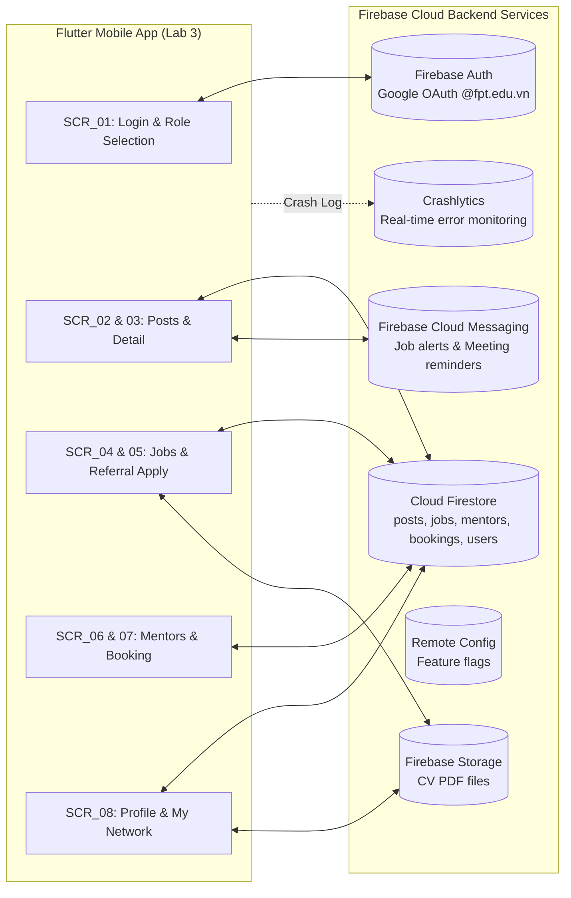

# 🚀 Flutter Developer Handoff Specification
**Dự án:** F-Alumni — FPT Alumni Mentorship & Opportunity Network  
**Môn học:** PRM323 — Cross-Platform Application Development  
**Nhóm thực hiện:** PRM Nhóm 4 — Đại học FPT TP.HCM  
**Thành viên:**
- Trương Chí Trung — MSSV: **SE193059** (Trưởng nhóm / TV2)
- Võ Quang Tâm — MSSV: **SE192621** (TV1)
- Nguyễn Phương Khải — MSSV: **SE183590** (TV3)
- Đỗ Trọng Tín — MSSV: **SE190218** (TV4 — Developer Handoff)

**Người soạn thảo tài liệu:** Đỗ Trọng Tín — SE190218  
**Mục tiêu:** Bản đặc tả kỹ thuật chi tiết để lập trình viên Flutter xây dựng giao diện hoàn hảo mà không cần hỏi lại, đồng thời chuẩn bị sẵn sàng cho **Lab 3 (Flutter + Firebase Backend)**.

---

## 1. Bảng Ánh xạ Kỹ thuật Toàn cục (Global Mapping Tables)

### 1.1. Bảng Ánh xạ Design Tokens sang Mã nguồn Flutter (Tokens → Flutter)

```dart
// lib/core/theme/app_colors.dart
class AppColors {
  static const Color primary        = Color(0xFFF27024); // FPT Orange
  static const Color primaryContainer  = Color(0xFFFFF0E6);
  static const Color secondary      = Color(0xFF1B365D); // FPT Navy Blue
  static const Color secondaryContainer = Color(0xFFE8EEF5);
  static const Color surface        = Color(0xFFFFFFFF);
  static const Color background     = Color(0xFFF8F9FA);
  static const Color textPrimary    = Color(0xFF1A1A1A);
  static const Color textSecondary  = Color(0xFF595959);
  static const Color textDisabled   = Color(0xFF8C8C8C);
  static const Color border         = Color(0xFFE0E0E0);
  static const Color success        = Color(0xFF1E8E3E);
  static const Color error          = Color(0xFFD93025);
  static const Color errorContainer = Color(0xFFFDF3F2);
  static const Color warning        = Color(0xFFE37400);
}

// lib/core/theme/app_spacing.dart
class AppSpacing {
  static const double xxs = 4.0;
  static const double xs  = 8.0;
  static const double sm  = 12.0;
  static const double md  = 16.0;  // Standard Screen Margin
  static const double lg  = 24.0;
  static const double xl  = 32.0;
  static const double xxl = 48.0;  // Min Touch Target
}

// lib/core/theme/app_radius.dart
class AppRadius {
  static const double sm   = 8.0;
  static const double md   = 12.0;
  static const double lg   = 16.0;
  static const double full = 999.0;
}
```

| Tên Token (Figma / DESIGN.md)    | Giá trị Kỹ thuật | Flutter ThemeData / Hằng số tương ứng |
| :--- | :--- | :--- |
| `color-primary`                  | `#F27024`   | `Theme.of(context).colorScheme.primary` |
| `color-primary-container`        | `#FFF0E6`   | `Theme.of(context).colorScheme.primaryContainer` |
| `color-secondary`                | `#1B365D`   | `Theme.of(context).colorScheme.secondary` |
| `color-secondary-container`      | `#E8EEF5`   | `Theme.of(context).colorScheme.secondaryContainer` |
| `color-surface`                  | `#FFFFFF`   | `Theme.of(context).colorScheme.surface` |
| `color-background`               | `#F8F9FA`   | `Theme.of(context).scaffoldBackgroundColor` |
| `color-text-primary`             | `#1A1A1A`   | `Theme.of(context).colorScheme.onSurface` |
| `color-text-secondary`           | `#595959`   | `Theme.of(context).textTheme.bodyMedium?.color` |
| `color-success`                  | `#1E8E3E`   | `AppColors.success` |
| `color-error`                    | `#D93025`   | `Theme.of(context).colorScheme.error` |
| `color-warning`                  | `#E37400`   | `AppColors.warning` |
| `type-display-large`             | 26sp, Bold 700, lh=34   | `Theme.of(context).textTheme.headlineMedium` |
| `type-title-large`               | 20sp, Bold 700, lh=28   | `Theme.of(context).textTheme.titleLarge` |
| `type-title-medium`              | 18sp, SemiBold 600, lh=24 | `Theme.of(context).textTheme.titleMedium` |
| `type-body-large`                | 16sp, Regular 400, lh=24  | `Theme.of(context).textTheme.bodyLarge` |
| `type-body-medium`               | 14sp, Regular 400, lh=20  | `Theme.of(context).textTheme.bodyMedium` (min WCAG 14sp) |
| `type-label-large`               | 14sp, SemiBold 600, lh=20 | `Theme.of(context).textTheme.labelLarge` (Button Text) |
| `type-label-small`               | 12sp, Medium 500, lh=16   | `Theme.of(context).textTheme.labelSmall` (Badge/Tag) |
| `spacing-screen-margin`          | 16dp  | `EdgeInsets.symmetric(horizontal: 16)` |
| `spacing-section-gap`            | 24dp  | `SizedBox(height: AppSpacing.lg)` |
| `radius-card`                    | 12dp  | `BorderRadius.circular(AppRadius.md)` |
| `radius-button`                  | 8dp   | `BorderRadius.circular(AppRadius.sm)` |
| `radius-chip`                    | 999dp (Pill) | `StadiumBorder()` |

---

### 1.2. Bảng Ánh xạ Component Figma sang Widget Flutter (Components → Widgets)

| Component Figma (Page 05)    | Flutter Widget (Material 3)  | Package Phụ thuộc          | Thuộc tính / Variant Quan trọng |
| :--- | :--- | :--- | :--- |
| **Button — Primary**         | `FilledButton`               | Built-in Flutter SDK        | `minimumSize: Size(double.infinity, 48)`, `backgroundColor: AppColors.primary` |
| **Button — Secondary**       | `OutlinedButton`             | Built-in Flutter SDK        | `side: BorderSide(color: AppColors.primary)`, `foregroundColor: AppColors.primary` |
| **Button — Loading**         | `FilledButton` + `CircularProgressIndicator` | Built-in | `onPressed: null` để khóa tương tác khi đang loading |
| **Button — Destructive**     | `TextButton`                 | Built-in Flutter SDK        | `foregroundColor: AppColors.error` |
| **Text Field**               | `TextFormField`              | Built-in Flutter SDK        | `contentPadding: EdgeInsets.symmetric(horizontal: 16, vertical: 14)`, `borderRadius: 8` |
| **Post Card / Job Card**     | `Card` + `InkWell`           | Built-in Flutter SDK        | `elevation: 1`, `borderRadius: 12dp`, `splashColor` |
| **Category / Filter Chip**   | `FilterChip` / `ChoiceChip` | Built-in Flutter SDK        | `shape: StadiumBorder()`, `selectedColor: AppColors.primaryContainer` |
| **Navigation Bottom Bar**    | `NavigationBar`              | Built-in Flutter SDK (M3)   | `indicatorColor: AppColors.primaryContainer`, 4 `NavigationDestination` |
| **App Bar**                  | `AppBar` / `SliverAppBar`   | Built-in Flutter SDK        | `backgroundColor: AppColors.secondary`, `foregroundColor: Colors.white` |
| **Confirmation Dialog**      | `AlertDialog`                | Built-in Flutter SDK        | Gọi bằng `showDialog(context: context, builder: ...)` |
| **Shimmer Loading Skeleton** | `Shimmer.fromColors`         | `shimmer: ^3.0.0`           | `baseColor: Colors.grey[300]!`, `highlightColor: Colors.grey[100]!` |
| **File Picker — CV Upload**  | `FilePicker.platform.pickFiles()` | `file_picker: ^8.0.0`  | `type: FileType.custom, allowedExtensions: ['pdf', 'docx']` |
| **Avatar**                   | `CircleAvatar`               | Built-in Flutter SDK        | `radius: 24`, `backgroundImage: NetworkImage(user.photoUrl)` |
| **Error / Offline Banner**   | `MaterialBanner`             | Built-in Flutter SDK        | Hiển thị qua `ScaffoldMessenger.of(context).showMaterialBanner(...)` |
| **Mentor Time Slot Chip**    | `ChoiceChip`                 | Built-in Flutter SDK        | Variant: `Available` (viền cam), `Selected` (nền cam), `Disabled` (xám) |
| **Session Pass Card**        | `Card` tùy chỉnh             | Built-in Flutter SDK        | `color: AppColors.success.withOpacity(0.08)`, border màu xanh lá |
| **Segmented Tab Switcher**   | `SegmentedButton<T>`         | Built-in Flutter SDK (M3)   | Dùng cho Home Feed chuyển đổi "Không gian chung" / "Nhóm ngành" |

---

## 2. Đặc tả Chi tiết 6 Mục cho Toàn bộ 8 Màn hình

---

### 📱 SCR_01: Login & Role Selection Screen

#### 1. Layout Structure
- `Scaffold`
  - `SafeArea`
    - `Padding(horizontal: 24)`
      - `Column(mainAxisAlignment: MainAxisAlignment.center)`:
        - `Image.asset('assets/images/f_alumni_logo.png', height: 110)`
        - `SizedBox(height: AppSpacing.md)`
        - `Text("F-Alumni", style: AppTypography.displayLarge.copyWith(color: AppColors.primary))`
        - `Text("Mạng lưới Kết nối Cựu sinh viên & Sinh viên FPT", style: AppTypography.bodyMedium, textAlign: TextAlign.center)`
        - `SizedBox(height: AppSpacing.xl)`
        - `DropdownButtonFormField<String>` — Chọn vai trò: "Sinh viên trường" / "Cựu sinh viên Mentor"
        - `SizedBox(height: AppSpacing.sm)`
        - `DropdownButtonFormField<String>` — Chọn chuyên ngành: SE, AI, IA, BA, Marketing, GD, Ngôn ngữ
        - `SizedBox(height: AppSpacing.sm)`
        - `DropdownButtonFormField<String>` — Chọn cơ sở: TP.HCM, Hòa Lạc, Đà Nẵng, Cần Thơ, Quy Nhơn
        - `SizedBox(height: AppSpacing.lg)`
        - `OutlinedButton.icon` — Nút Google Sign-in với icon Google SVG
        - `SizedBox(height: AppSpacing.md)`
        - `Text("Đăng nhập dành riêng cho tài khoản FPT Edu (@fpt.edu.vn)", style: AppTypography.labelSmall, textAlign: TextAlign.center)`

#### 2. Components Sử dụng
- `DropdownButtonFormField` (Variant: `Default`, `Bordered`)
- `Button` (Variant: `GoogleSignInButton` — chiều cao bắt buộc 48dp)

#### 3. States Áp dụng
| State | Mô tả |
| :--- | :--- |
| `Default` | Sẵn sàng để chọn vai trò, chuyên ngành và cơ sở |
| `Loading` | `CircularProgressIndicator` trong nút, tắt mọi tương tác |
| `Error — Email sai domain` | `SnackBar` màu đỏ: *"Chỉ tài khoản @fpt.edu.vn mới được phép đăng nhập"* |

#### 4. User Interactions & Validation Rules
- **Chọn vai trò và chuyên ngành:** Bắt buộc chọn trước khi bấm đăng nhập để cá nhân hóa Home Feed `SCR_02`.
- **Validation email Google:** Backend kiểm tra email kết thúc bằng `@fpt.edu.vn`, từ chối tất cả email cá nhân khác.
- **Chọn cơ sở:** Lưu vào Firestore `users.campus` để lọc nội dung phù hợp theo cơ sở.

#### 5. Navigation
- **Đăng nhập thành công:** `context.go('/home')` → `SCR_02`.
- **Nút Back (Android):** Thoát ứng dụng (`SystemNavigator.pop()`).

#### 6. Important UI Constraints
- Nút Google Sign-in đạt chiều cao tối thiểu **48 dp**.
- Màn hình rộng (≥ 600dp): Form đăng nhập căn giữa, chiều rộng tối đa **400 dp**.
- Không có Bottom Navigation Bar trên màn hình này.

---

### 📱 SCR_02: Home Feed Screen

#### 1. Layout Structure
- `Scaffold`
  - `AppBar` — Lời chào "Xin chào, [Tên SV]", avatar cá nhân, icon thông báo
  - `RefreshIndicator` (Pull-to-refresh gọi lại Firestore)
    - `CustomScrollView`:
      - `SliverToBoxAdapter`:
        - `Padding(horizontal: 16)`:
          - `TextField` — Thanh tìm kiếm chiều cao 44dp, placeholder: *"Tìm bài chia sẻ, học bổng, việc làm..."*
          - `SizedBox(height: AppSpacing.sm)`
          - `SegmentedButton<SpaceType>` — Tab: **"🌐 Không gian chung"** / **"💻 Nhóm ngành IT / Software"**
          - `SizedBox(height: AppSpacing.sm)`
          - `SizedBox(height: 40)`: `ListView` ngang chứa các `FilterChip` — "🔥 Nổi bật", "💼 Việc làm", "🎓 Học bổng", "💡 Kinh nghiệm OJT"
          - `SizedBox(height: AppSpacing.md)`
          - `Text("Bài chia sẻ nổi bật từ Alumni 🔥", style: textTheme.titleLarge)`
          - `SizedBox(height: AppSpacing.xs)`
          - `FeaturedPostCard` — Ảnh bìa, tên tác giả, chức danh VNG, tiêu đề bài viết, nút Bookmark
          - `SizedBox(height: AppSpacing.lg)`
          - `Text("Mới nhất trong tuần", style: textTheme.titleLarge)`
          - `SizedBox(height: AppSpacing.xs)`
      - `SliverList.builder` — Render danh sách các `PostCard`
      - `SliverToBoxAdapter`: `SizedBox(height: 80)` — Khoảng đệm Bottom Navigation
  - `bottomNavigationBar`: `NavigationBar` — Tab 1 "Trang chủ" ở `Selected`

#### 2. Components Sử dụng
- `SearchField` (Variant: `Default`)
- `SegmentedButton<SpaceType>` (Variant: 2 tab)
- `FilterChip` (Variant: `Selected`, `Unselected`)
- `FeaturedPostCard` (Variant: `WithCoverImage`)
- `PostCard` (Variant: `Default`, `Pressed`)
- `NavigationBar` (4 tabs)

#### 3. States Áp dụng
| State | Mô tả |
| :--- | :--- |
| `Loading` | Shimmer skeleton 3 thẻ PostCard (dùng `shimmer: ^3.0.0`) |
| `Populated` | Danh sách bài viết tải từ Cloud Firestore collection `posts` |
| `Empty` | Vector minh họa + text *"Chưa có bài viết mới trong nhóm ngành của bạn"* + nút *"Khám phá bài viết chung"* |
| `Error — Network` | Icon wifi-off + text *"Không có kết nối internet. Hiển thị nội dung đã cache."* |

#### 4. User Interactions & Validation Rules
- **Chuyển đổi Tab Không gian:** Lọc lại danh sách bài viết theo `major: 'general'` hoặc `major: user.major`.
- **Chạm vào FilterChip:** Lọc thêm theo `category: 'job' | 'scholarship' | 'experience'`.
- **Chạm vào thẻ bài viết:** Mở chi tiết `SCR_03`.
- **Pull-to-refresh:** Gọi lại Firestore lấy danh sách bài mới nhất.

#### 5. Navigation
- **Chạm PostCard:** `Navigator.pushNamed(context, '/post-detail', arguments: postId)` → `SCR_03`.
- **Tab Việc làm:** Chuyển sang `SCR_04`.
- **Tab Mentors:** Chuyển sang `SCR_06`.
- **Tab Hồ sơ:** Chuyển sang `SCR_08`.

#### 6. Important UI Constraints
- Touch target của mọi Chip tối thiểu **48 × 48 dp** (bọc thêm padding nếu cần).
- Màn hình rộng (≥ 600dp): `SliverList` chuyển thành `SliverGrid` 2 cột.
- Thanh tìm kiếm KHÔNG được có viền nổi khi không được focus, chỉ hiện viền màu cam khi đang focus.

---

### 📱 SCR_03: Post / Experience Detail Screen

#### 1. Layout Structure
- `Scaffold`
  - `CustomScrollView`:
    - `SliverAppBar` — Back, nút Share, nút Bookmark. `floating: true`, `snap: true`
    - `SliverToBoxAdapter`:
      - `Padding(all: 16)`:
        - `Row`: Badge chuyên mục "KINH NGHIỆM PHỎNG VẤN" + Thời gian đọc "5 phút đọc"
        - `SizedBox(height: AppSpacing.xs)`
        - `Text(post.title, style: textTheme.titleLarge)`
        - `SizedBox(height: AppSpacing.xs)`
        - `Text(post.createdAt, style: textTheme.labelSmall, color: AppColors.textSecondary)`
        - `Divider(height: AppSpacing.lg)`
        - `AlumniAuthorCard` — Avatar, tên cựu SV, khóa K14, chức danh Senior, logo VNG, nút "Xem hồ sơ Mentor"
        - `SizedBox(height: AppSpacing.md)`
        - `Text(post.content, style: textTheme.bodyLarge)`
        - `SizedBox(height: AppSpacing.lg)`
        - `AttachmentCard` — Icon PDF, tên file "Interview_Preparation_Checklist_2026.pdf", dung lượng, nút Tải về
        - `Divider(height: AppSpacing.xl)`
        - `Text("Hỏi đáp với tác giả", style: textTheme.titleMedium)`
        - `SizedBox(height: AppSpacing.sm)`
        - `CommentList` — Danh sách câu hỏi và phản hồi
        - `SizedBox(height: 100)` — Khoảng trống tránh Sticky Bar che nội dung
  - `bottomNavigationBar`:
    - `Container(height: 80, decoration: BoxDecoration(border: Border(top: ...), color: Colors.white))`:
      - `Padding(horizontal: 16, vertical: 12)`:
        - `FilledButton("ĐẶT LỊCH TƯ VẤN 1-1 VỚI MENTOR", minimumSize: Size(double.infinity, 48))`

#### 2. Components Sử dụng
- `AlumniAuthorCard` (Variant: `Compact` — dùng trong bài viết)
- `AttachmentCard` (Variant: `PDF`)
- `StickyBottomBar` (Variant: `SingleButtonCTA`)
- `CommentItem` (Variant: `StudentQuestion`, `AlumniReply`)

#### 3. States Áp dụng
| State | Mô tả |
| :--- | :--- |
| `Loading` | Shimmer toàn bộ nội dung bài viết |
| `Default — Populated` | Nội dung bài viết đầy đủ, hiển thị đính kèm PDF |
| `Bookmarked` | Icon Bookmark đổi sang màu cam `AppColors.primary` |

#### 4. User Interactions & Validation Rules
- **Chạm "Đặt lịch tư vấn 1-1 với Mentor":** Điều hướng sang `SCR_07`, truyền kèm `mentorId` của tác giả.
- **Chạm Bookmark:** Gọi Firestore cập nhật `users.savedPostIds` (thêm hoặc xóa `postId`).
- **Chạm "Xem hồ sơ Mentor":** Điều hướng sang `SCR_06` mở trực tiếp hồ sơ cựu sinh viên đó.
- **Chạm Tải về (PDF):** Gọi thư viện `url_launcher` mở link Storage hoặc tải file về thiết bị.

#### 5. Navigation
- **Nguồn đến:** Từ `SCR_02` (bấm PostCard).
- **Đặt lịch tư vấn:** `Navigator.pushNamed(context, '/mentor-booking', arguments: mentorId)` → `SCR_07`.
- **Back:** `Navigator.pop(context)` về `SCR_02`.

#### 6. Important UI Constraints
- Chiều cao Sticky Bottom Bar cố định **80 dp**, không thay đổi khi bàn phím mở.
- Màn hình rộng (≥ 600dp): Chia 2 cột — 65% bài viết + 35% thông tin Mentor và nút đặt lịch.
- `SliverAppBar` phải `floating: true` để tái xuất hiện khi cuộn lên, không bị mất.

---

### 📱 SCR_04: Career & Opportunity Board Screen

#### 1. Layout Structure
- `Scaffold`
  - `AppBar(title: Text("Cơ hội Việc làm & Học bổng"))` — Có nút lọc nâng cao bên phải
  - `Column`:
    - `Padding(horizontal: 16, vertical: 8)`:
      - `SizedBox(height: 40)`: `ListView` ngang — Chip lọc: "Tất cả", "Thực tập OJT", "Việc làm (Full-time)", "Học bổng Thạc sĩ"
    - `Expanded`:
      - `ListView.separated(itemCount: jobs.length, separatorBuilder: (_, __) => SizedBox(height: 12))`:
        - `JobCard`:
          - Row: `Image.network(company.logoUrl, width: 40, height: 40)` + Tên vị trí + Badge "Cựu SV bảo lãnh Referral" (chip vàng)
          - Mức lương / phụ cấp
          - Row: Icon vị trí + địa điểm | Icon lịch + hạn chót nộp
          - Nút `OutlinedButton("Xem & Xin Referral")`
  - `bottomNavigationBar`: `NavigationBar` — Tab 2 "Việc làm" ở `Selected`

#### 2. Components Sử dụng
- `FilterChip` (Bộ lọc hình thức tuyển dụng — Variant: `Selected`, `Unselected`)
- `JobCard` (Variant: `WithReferralBadge` — nổi bật huy hiệu vàng)

#### 3. States Áp dụng
| State | Mô tả |
| :--- | :--- |
| `Loading` | Shimmer skeleton 4 thẻ JobCard |
| `Populated` | Danh sách cơ hội tải từ Firestore collection `jobs` |
| `Empty` | Illustration + *"Chưa có cơ hội nào phù hợp bộ lọc hiện tại"* |
| `Error — Network` | Banner lỗi mất kết nối, hiện dữ liệu đã cache |

#### 4. User Interactions & Validation Rules
- **Chạm Chip lọc:** Gọi lại Firestore với điều kiện `where('type', isEqualTo: selectedType)`.
- **Chạm "Xem & Xin Referral":** Mở chi tiết công việc `SCR_05`.

#### 5. Navigation
- **Chạm JobCard hoặc nút "Xem & Xin Referral":** `Navigator.pushNamed(context, '/job-detail', arguments: jobId)` → `SCR_05`.

#### 6. Important UI Constraints
- Chiều cao mỗi thẻ `JobCard` tối thiểu **110 dp**.
- Màn hình rộng (≥ 600dp): Chuyển `ListView` thành `GridView` 2 cột.
- Huy hiệu "Cựu SV bảo lãnh Referral" phải hiển thị màu vàng `Color(0xFFFFB300)` với chữ đen, dễ đọc (tương phản ≥ 4.5:1).

---

### 📱 SCR_05: Job Detail & Referral Apply Screen

#### 1. Layout Structure
- `Scaffold`
  - `AppBar` — Back, nút Bookmark lưu công việc
  - `SingleChildScrollView`:
    - `Padding(all: 16)`:
      - `JobHeaderCard` — Tên vị trí, logo công ty, mức lương, địa điểm, hình thức (Hybrid / Onsite)
      - `SizedBox(height: AppSpacing.md)`
      - `ReferralAlumniNoteCard` — Avatar cựu SV bảo lãnh, bộ phận, ghi chú: *"Mình đang cần 2 bạn thực tập sinh Flutter..."*
      - `SizedBox(height: AppSpacing.md)`
      - `Text("Mô tả công việc & Quyền lợi", style: textTheme.titleMedium)`
      - `Text(job.description, style: textTheme.bodyMedium)`
      - `SizedBox(height: AppSpacing.lg)`
      - `Divider()`
      - `Text("Nộp CV xin Referral", style: textTheme.titleMedium)`
      - `SizedBox(height: AppSpacing.sm)`
      - `UploadCVCard` — Nút chọn file PDF, hiển thị tên file đã chọn kèm dung lượng
      - `SizedBox(height: AppSpacing.sm)`
      - `TextFormField` — Ô nhập thư ngỏ, `maxLines: 4`, placeholder: *"Lý do muốn xin Referral và điểm mạnh bản thân..."*
      - `SizedBox(height: AppSpacing.lg)`
      - `FilledButton("GỬI YÊU CẦU XIN REFERRAL", minimumSize: Size(double.infinity, 48))`
      - `SizedBox(height: 24)`

#### 2. Components Sử dụng
- `JobHeaderCard` (Variant: `DetailView`)
- `ReferralAlumniNoteCard` (Variant: `WithNote`)
- `UploadCVCard` (Variant: `Empty`, `FileAttached` — hiện icon PDF + tên file)
- `TextFormField` (Nhập thư ngỏ — `maxLines: 4`)
- `FilledButton` (Variant: `Primary`, `Loading` khi đang upload)
- `MaterialBanner` (Variant: `NetworkError` — màu đỏ nhạt, hiện khi mất mạng)

#### 3. States Áp dụng
| State | Mô tả |
| :--- | :--- |
| `Default` | Form trống, sẵn sàng chọn CV và nhập thư ngỏ |
| `File Selected` | `UploadCVCard` hiển thị tên file, icon PDF, dung lượng, nút X để xóa |
| `Loading — Uploading` | Nút đổi thành `Loading` với spinner, tắt toàn bộ tương tác |
| `Network Error` | Banner đỏ nhạt xuất hiện ở trên cùng: *"Mất kết nối. Dữ liệu của bạn được giữ nguyên. Thử lại khi có mạng."* **Giữ nguyên file CV và thư ngỏ.** |
| `Success` | `AlertDialog` xác nhận: *"Đã gửi yêu cầu xin Referral thành công!"* + nút "Về trang Hồ sơ" |

#### 4. User Interactions & Validation Rules
- **Chọn file CV:** Dùng `file_picker: ^8.0.0` — chỉ chấp nhận `.pdf` hoặc `.docx`, dung lượng tối đa **10MB**.
- **Validation thư ngỏ:** Tối thiểu **20 ký tự** trước khi gửi.
- **Validation file CV:** Bắt buộc phải chọn file. Nếu user đã có CV trong `SCR_08`, tự động điền sẵn.
- **Gửi Referral:** Upload CV lên `Firebase Storage → /cvs/{uid}/{jobId}/`, sau đó tạo document trong Firestore collection `bookings`.

#### 5. Navigation
- **Gửi thành công:** `showDialog(...)` → User bấm "Về trang Hồ sơ" → `context.go('/profile')` → `SCR_08`.
- **Back:** `Navigator.pop(context)` về `SCR_04`.

#### 6. Important UI Constraints
- `Scaffold` cần `resizeToAvoidBottomInset: true` để bàn phím đẩy form lên.
- Nếu không có mạng, **KHÔNG được xóa** nội dung thư ngỏ đã nhập. Lưu vào `SharedPreferences` tạm thời.
- Màn hình rộng (≥ 600dp): Form ứng tuyển chuyển sang layout 2 cột — Trái (JD, Alumni note) / Phải (Form nộp CV).

---

### 📱 SCR_06: Alumni Mentors Directory Screen

#### 1. Layout Structure
- `Scaffold`
  - `AppBar(title: Text("Mạng lưới Cựu sinh viên FPT"))`
  - `Column`:
    - `Padding(horizontal: 16, vertical: 8)`:
      - `SizedBox(height: 40)`: `ListView` ngang — Chip lọc công ty: "Tất cả", "FPT Software", "VNG", "Google", "Shopee", "Ngân hàng/Fintech"
    - `Expanded`:
      - `ListView.separated`:
        - `MentorCard`:
          - `CircleAvatar(radius: 28)` — Ảnh đại diện cựu SV
          - Cột thông tin: Tên, Niên khóa (K12, K13, K14...), Chức danh, Tên công ty
          - Wrap chips lĩnh vực: "Review CV", "Phỏng vấn kỹ thuật", "Lộ trình OJT"
          - `RatingBadge` — "⭐ 5.0 (18 buổi tư vấn)"
          - `OutlinedButton("Đặt lịch tư vấn 1-1")` — chiều cao 48dp
  - `bottomNavigationBar`: `NavigationBar` — Tab 3 "Mentors" ở `Selected`

#### 2. Components Sử dụng
- `FilterChip` (Lọc theo công ty)
- `MentorCard` (Variant: `FullBio` — hiển thị đầy đủ thông tin)
- `RatingBadge` (Variant: `WithCount`)

#### 3. States Áp dụng
| State | Mô tả |
| :--- | :--- |
| `Loading` | Shimmer skeleton 4 thẻ MentorCard |
| `Populated` | Danh bạ cựu sinh viên tải từ Firestore collection `mentors` |
| `Empty — Filter` | *"Chưa có Mentor nào từ công ty này. Thử tìm công ty khác?"* + nút "Xem tất cả Mentor" |

#### 4. User Interactions & Validation Rules
- **Chạm Chip lọc công ty:** Gọi Firestore với `where('currentCompany', isEqualTo: selectedCompany)`.
- **Chạm "Đặt lịch tư vấn 1-1":** Mở màn hình đặt lịch `SCR_07`.
- **Chạm vào MentorCard:** Mở trang hồ sơ chi tiết cựu sinh viên đó.

#### 5. Navigation
- **Bấm nút "Đặt lịch tư vấn 1-1":** `Navigator.pushNamed(context, '/mentor-booking', arguments: mentorId)` → `SCR_07`.

#### 6. Important UI Constraints
- Nút bấm "Đặt lịch tư vấn 1-1" trên mỗi thẻ phải đạt chiều cao tối thiểu **48 dp**.
- Màn hình rộng (≥ 600dp): Chuyển thành `GridView` 2 cột.
- Avatar cựu sinh viên phải có viền `2px màu AppColors.success` nếu đang `online: true` trong Firestore.

---

### 📱 SCR_07: Mentor Booking & Session Pass Screen

#### 1. Layout Structure
- `Scaffold(backgroundColor: AppColors.background)`
  - `AppBar(title: Text("Đặt lịch Hẹn Tư vấn 1-1"))`
  - `SingleChildScrollView`:
    - `Padding(all: 20)`:
      - `BookingCard` — Card trắng, `borderRadius: 16dp`, `elevation: 2`:
        - Header: Avatar Mentor, Tên, Chức danh, Công ty
        - `Divider`
        - `Text("Chọn ngày hẹn", style: textTheme.titleSmall)`
        - `DatePickerStrip` — Dải ngày ngang trong tuần, ngày hiện tại được chọn mặc định
        - `SizedBox(height: AppSpacing.sm)`
        - `Text("Khung giờ rảnh khả dụng", style: textTheme.titleSmall)`
        - `Wrap(spacing: 8, runSpacing: 8)`: Các `TimeSlotChip` — "09:00 - 09:45", "14:00 - 14:45", "20:00 - 20:45"
        - `SizedBox(height: AppSpacing.md)`
        - `TextFormField` — "Chủ đề bạn muốn hỏi Mentor", `maxLines: 3`
        - `SizedBox(height: AppSpacing.lg)`
        - `FilledButton("XÁC NHẬN ĐẶT LỊCH HẸN (QUA GOOGLE MEET)", minimumSize: Size(double.infinity, 48))`
      - `SizedBox(height: AppSpacing.lg)`
      - `SessionPassCard` (Hiện ra sau khi đặt lịch thành công):
        - `Text("SES-2026-SE190218-01", style: textTheme.labelSmall)` — Mã lịch hẹn
        - `Chip("● ĐÃ XÁC NHẬN", backgroundColor: AppColors.success.withOpacity(0.1), labelColor: AppColors.success)`
        - Link Google Meet tự động tạo
        - `OutlinedButton("Thêm vào Google Calendar")`
        - `TextButton("Hủy lịch hẹn", style: TextButton.styleFrom(foregroundColor: AppColors.error))`

#### 2. Components Sử dụng
- `TimeSlotChip` (Variant: `Available` — viền cam, `Selected` — nền cam, `Conflict/Disabled` — xám)
- `SessionPassCard` (Variant: `Confirmed` — viền và badge xanh lá)
- `ConfirmationDialog` (Xác nhận đặt lịch 2 bước)
- `AlertDialog` (Khi khung giờ bị đặt trùng)

#### 3. States Áp dụng
| State | Mô tả |
| :--- | :--- |
| `Booking Form` | Form chọn ngày, giờ và nhập chủ đề |
| `Loading — Confirming` | Spinner trong nút, tắt tương tác |
| `Conflict Error` | `AlertDialog`: *"Khung giờ này vừa được đặt. Gợi ý: 16:00 - 16:45 hoặc 20:00 - 20:45"* |
| `Confirmed Pass` | `SessionPassCard` xuất hiện bên dưới với mã lịch hẹn và link Google Meet |

#### 4. User Interactions & Validation Rules
- **Chọn ngày:** Mặc định là ngày gần nhất Mentor có lịch rảnh.
- **Chọn khung giờ:** Bắt buộc chọn ít nhất 1 TimeSlot trước khi bấm Xác nhận.
- **Validation chủ đề:** Tối thiểu **10 ký tự**.
- **Bấm "XÁC NHẬN":** Hiện `ConfirmationDialog` trước khi ghi vào Firestore — *"Xác nhận đặt lịch hẹn tư vấn 1-1 với [Tên Mentor] vào [Ngày Giờ] qua Google Meet?"*
- **Bấm "Hủy lịch hẹn":** Mở `AlertDialog` 2 bước xác nhận hủy, giải thích việc nhường khung giờ cho sinh viên khác.

#### 5. Navigation
- **Nguồn đến:** Từ `SCR_03` (nút sticky), `SCR_06` (nút trên MentorCard).
- **Đặt lịch thành công:** Firestore tạo document trong collection `bookings`, FCM gửi thông báo cho Mentor và sinh viên.
- **Hủy lịch:** Cập nhật `bookings.status = 'cancelled'`, mở lại khung giờ trong `mentors.availableSlots`.

#### 6. Important UI Constraints
- `SessionPassCard` giữ chiều rộng cố định **360dp**, căn giữa màn hình.
- Mỗi `TimeSlotChip` tối thiểu **48dp** chiều cao để đảm bảo touch target.
- Các khung giờ đã bị đặt (`Disabled`) phải hiển thị rõ ràng bằng màu xám và không phản hồi khi bấm.

---

### 📱 SCR_08: Profile & My Network Screen

#### 1. Layout Structure
- `Scaffold`
  - `AppBar(title: Text("Hồ sơ & Lịch tư vấn"))` — Nút "Chỉnh sửa hồ sơ" bên phải
  - `SingleChildScrollView`:
    - `Padding(all: 16)`:
      - `StudentProfileCard`:
        - `CircleAvatar(radius: 36)` — Ảnh đại diện
        - `Text("[Tên sinh viên]", style: textTheme.titleLarge)`
        - `Text("MSSV: SE190218 | Kỹ thuật phần mềm — K19")` — (Ví dụ cho Đỗ Trọng Tín)
        - `Text("Cơ sở: TP. Hồ Chí Minh")`
      - `SizedBox(height: AppSpacing.md)`
      - `TabBar` (3 tabs):
        - Tab 1: "📅 Lịch tư vấn" — Danh sách lịch hẹn sắp tới và đã hoàn thành
        - Tab 2: "📋 Hồ sơ Referral" — Danh sách công việc đã nộp + trạng thái
        - Tab 3: "🔖 Bài viết đã lưu" — Danh sách bài chia sẻ đã Bookmark
      - `TabBarView`:
        - **Tab 1 — Lịch tư vấn:**
          - Danh sách các `SessionPassCard` thu gọn (Variant: `Compact`) theo trạng thái `confirmed | completed | cancelled`
        - **Tab 2 — Hồ sơ Referral:**
          - Danh sách `ReferralStatusCard`: Tên vị trí, công ty, ngày nộp, trạng thái (Đang chờ / Đã nhận Referral / Bị từ chối)
        - **Tab 3 — Bài viết đã lưu:**
          - `ListView` các `PostCard` (Variant: `Compact`) đã Bookmark
      - `SizedBox(height: AppSpacing.lg)`
      - `Card` — Phần Cài đặt:
        - `ListTile` — Kho CV: Hiển thị file CV hiện tại, nút cập nhật
        - `ListTile` — Tùy chỉnh thông báo việc làm mới theo ngành
        - `ListTile` — Đổi chuyên ngành quan tâm
        - `ListTile` — Hỗ trợ và Báo lỗi
        - `ListTile` — Đăng xuất (màu đỏ `AppColors.error`)
  - `bottomNavigationBar`: `NavigationBar` — Tab 4 "Hồ sơ" ở `Selected`

#### 2. Components Sử dụng
- `StudentProfileCard`
- `TabBar` (3 tabs quản lý)
- `SessionPassCard` (Variant: `Compact`, `Confirmed`, `Completed`, `Cancelled`)
- `ReferralStatusCard` (Variant: `Pending`, `Accepted`, `Rejected`)
- `PostCard` (Variant: `Compact` — không có ảnh bìa)
- `ListTile` (Cài đặt — Variant: `WithTrailingIcon`, `Destructive`)

#### 3. States Áp dụng
| State | Mô tả |
| :--- | :--- |
| `Populated` | Thông tin đầy đủ, tải từ Firestore `users`, `bookings`, `jobs` |
| `Empty — Tab Lịch tư vấn` | *"Bạn chưa có lịch hẹn tư vấn nào. Hãy tìm Mentor phù hợp!"* + nút "Tìm Mentor" |
| `Empty — Tab Hồ sơ Referral` | *"Bạn chưa nộp hồ sơ xin Referral nào."* + nút "Xem cơ hội việc làm" |
| `Empty — Tab Bài đã lưu` | *"Bạn chưa lưu bài viết nào."* + nút "Khám phá bài chia sẻ" |

#### 4. User Interactions & Validation Rules
- **Chạm Đăng xuất:** Mở `AlertDialog` xác nhận: *"Bạn có chắc muốn đăng xuất?"* — Xác nhận → `FirebaseAuth.instance.signOut()`.
- **Chạm "Hủy lịch hẹn" trong Tab 1:** Điều hướng sang `SCR_07` để thực hiện hủy.
- **Cập nhật CV:** Gọi `file_picker`, upload lên `Firebase Storage → /cvs/{uid}/latest_cv.pdf`, cập nhật `users.cvUrl`.
- **Đổi chuyên ngành:** Cập nhật `users.major`, reset lại cache bài viết Home Feed.

#### 5. Navigation
- **Đăng xuất xác nhận:** `FirebaseAuth.instance.signOut()` → `context.go('/login')` → `SCR_01`.
- **Chạm Hủy lịch hẹn:** `Navigator.pushNamed(context, '/mentor-booking', arguments: bookingId)`.
- **Chạm bài viết đã lưu:** `Navigator.pushNamed(context, '/post-detail', arguments: postId)` → `SCR_03`.
- **Chạm hồ sơ Referral:** `Navigator.pushNamed(context, '/job-detail', arguments: jobId)` → `SCR_05`.

#### 6. Important UI Constraints
- Chiều cao các `ListTile` trong phần Cài đặt tối thiểu **48 dp**.
- `ListTile` Đăng xuất phải dùng `textColor: AppColors.error` và `iconColor: AppColors.error`.
- `TabBarView` phải có `physics: NeverScrollableScrollPhysics()` để tránh xung đột cuộn với `SingleChildScrollView`.
- Màn hình rộng (≥ 600dp): `StudentProfileCard` chuyển sang layout ngang (ảnh trái, thông tin phải).

---

## 3. Định hướng Kiến trúc Lab 3 (Flutter + Firebase Backend)

Bản đặc tả thiết kế này được thiết kế tương thích 100% với các dịch vụ Firebase cho bài **Lab 3**:



### 3.1. Firebase Authentication
- **Provider:** `GoogleAuthProvider` — chỉ cho phép email kết thúc `@fpt.edu.vn`.
- **Sau đăng nhập:** Tạo hoặc cập nhật document trong Firestore collection `users` với `uid` tương ứng.

### 3.2. Cloud Firestore — Cấu trúc Collections

```
Collection: users
  Document: {uid}
    - uid: string
    - mssv: string            // VD: "SE190218"
    - fullName: string
    - email: string           // @fpt.edu.vn
    - role: 'student' | 'alumni'
    - major: 'SE' | 'AI' | 'IA' | 'BA' | 'GD' | 'LANG'
    - campus: 'HCM' | 'HN' | 'DN' | 'CT' | 'QN'
    - savedPostIds: string[]
    - appliedJobIds: string[]
    - cvUrl: string           // Firebase Storage URL

Collection: posts
  Document: {postId}
    - postId: string
    - title: string
    - content: string
    - category: 'experience' | 'scholarship' | 'job' | 'ojt'
    - major: 'SE' | 'AI' | 'general'
    - authorId: string        // ref → users/{uid}
    - authorName: string
    - authorCompany: string
    - createdAt: Timestamp
    - likeCount: number
    - commentCount: number

Collection: jobs
  Document: {jobId}
    - jobId: string
    - title: string
    - company: string
    - companyLogoUrl: string
    - salary: string
    - location: string
    - type: 'ojt' | 'fulltime' | 'scholarship'
    - alumniReferralId: string  // ref → users/{uid} (cựu SV bảo lãnh)
    - alumniNote: string
    - deadline: Timestamp
    - createdAt: Timestamp

Collection: mentors
  Document: {mentorId}
    - mentorId: string
    - fullName: string
    - graduationYear: string   // VD: "K14"
    - currentCompany: string
    - currentRole: string
    - expertise: string[]      // VD: ["Review CV", "Phỏng vấn kỹ thuật"]
    - rating: number
    - sessionCount: number
    - availableSlots: [{ date: string, time: string, booked: boolean }]

Collection: bookings
  Document: {bookingId}
    - bookingId: string
    - studentId: string        // ref → users/{uid}
    - studentName: string
    - mentorId: string         // ref → mentors/{mentorId}
    - meetLink: string         // Google Meet link tự tạo
    - timeSlot: string         // VD: "2026-10-18 09:00"
    - topic: string
    - status: 'confirmed' | 'completed' | 'cancelled'
    - createdAt: Timestamp
```

### 3.3. Firebase Storage
- **Path CV:** `/cvs/{uid}/{jobId}/cv.pdf` — Khi nộp Referral.
- **Path CV mới nhất:** `/cvs/{uid}/latest_cv.pdf` — Khi cập nhật CV từ `SCR_08`.
- **Giới hạn dung lượng:** 10MB per file. Enforce bằng Firebase Storage Rules.

### 3.4. Firebase Cloud Messaging (FCM)
- **Topic theo ngành:** Đăng ký `topics/major_{major}_jobs` (VD: `topics/major_se_jobs`).
- **Nhắc lịch hẹn:** Gửi thông báo trước **15 phút** khi đến giờ tư vấn Google Meet.
- **Tin tuyển dụng mới:** Gửi đến Topic ngành tương ứng khi có `jobs` document mới.

### 3.5. Firebase Remote Config
- **Flag:** `referral_open: boolean` — Bật/tắt tính năng nộp hồ sơ xin Referral.
- **Flag:** `maintenance_mode: boolean` — Hiện màn hình bảo trì toàn ứng dụng.

### 3.6. Firebase Crashlytics
- Tích hợp `firebase_crashlytics: ^4.0.0`.
- Log lỗi runtime: `FirebaseCrashlytics.instance.recordError(error, stack)`.
- Đính kèm thông tin user: `FirebaseCrashlytics.instance.setUserIdentifier(uid)`.

---

*Tài liệu được soạn thảo bởi: **Đỗ Trọng Tín — SE190218 (TV4)**, PRM Nhóm 4, Đại học FPT TP. Hồ Chí Minh.*  
*Cập nhật lần cuối: 14/10/2026.*
