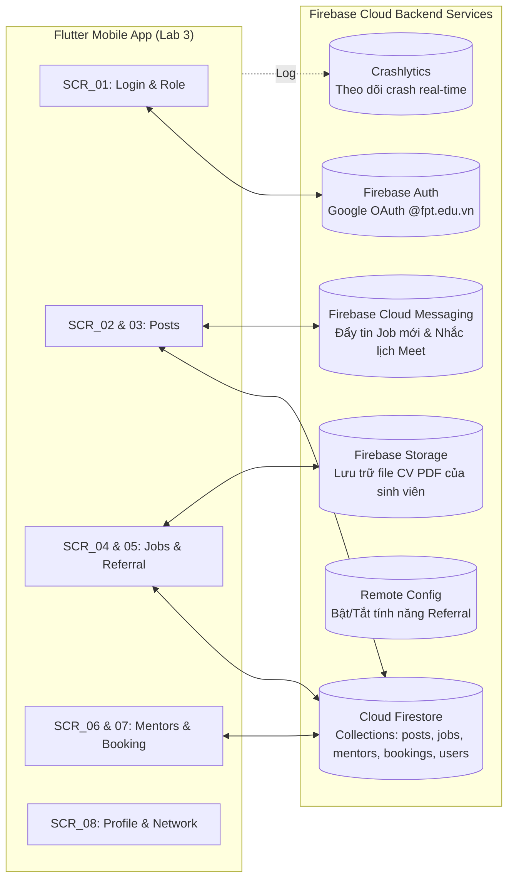

# 🚀 Flutter Developer Handoff Specification
**Dự án:** F-Alumni — FPT Alumni Mentorship & Opportunity Network  
**Môn học:** PRM323 — Cross-Platform Application Development  
**Nhóm thực hiện:** PRM Nhóm 4 — Đại học FPT TP.HCM  
**Thành viên:** Trương Chí Trung (SE193059), Nguyễn Phương Khải (SE183590), Đỗ Trọng Tín, Võ Quang Tâm  
**Mục tiêu:** Bản đặc tả kỹ thuật chi tiết để lập trình viên Flutter xây dựng giao diện hoàn hảo mà không cần hỏi lại, đồng thời chuẩn bị sẵn sàng cho **Lab 3 (Flutter + Firebase Backend)**.

---

## 1. Bảng Ánh xạ Kỹ thuật Toàn cục (Global Mapping Tables)

### 1.1. Bảng Ánh xạ Design Tokens sang Mã nguồn Flutter (Tokens to Flutter)

```dart
// Theme code cấu hình cho Flutter
class AppColors {
  static const Color primary = Color(0xFFF27024); // FPT Orange
  static const Color primaryContainer = Color(0xFFFFF0E6);
  static const Color secondary = Color(0xFF1B365D); // FPT Navy Blue
  static const Color secondaryContainer = Color(0xFFE8EEF5);
  static const Color surface = Color(0xFFFFFFFF);
  static const Color background = Color(0xFFF8F9FA);
  static const Color textPrimary = Color(0xFF1A1A1A);
  static const Color textSecondary = Color(0xFF595959);
  static const Color textDisabled = Color(0xFF8C8C8C);
  static const Color border = Color(0xFFE0E0E0);
  static const Color success = Color(0xFF1E8E3E);
  static const Color error = Color(0xFFD93025);
  static const Color errorContainer = Color(0xFFFDF3F2);
  static const Color warning = Color(0xFFE37400);
}

class AppSpacing {
  static const double xxs = 4.0;
  static const double xs = 8.0;
  static const double sm = 12.0;
  static const double md = 16.0; // Standard Screen Margin
  static const double lg = 24.0;
  static const double xl = 32.0;
  static const double xxl = 48.0; // Min Touch Target
}

class AppRadius {
  static const double sm = 8.0;
  static const double md = 12.0;
  static const double lg = 16.0;
  static const double full = 999.0;
}
```

| Tên Token trong Figma / DESIGN.md | Giá trị Kỹ thuật | Tên Thuộc tính Tương ứng trong Flutter ThemeData |
| :--- | :--- | :--- |
| `color-primary` | `#F27024` | `Theme.of(context).colorScheme.primary` |
| `color-primary-container` | `#FFF0E6` | `Theme.of(context).colorScheme.primaryContainer` |
| `color-secondary` | `#1B365D` | `Theme.of(context).colorScheme.secondary` |
| `color-secondary-container` | `#E8EEF5` | `Theme.of(context).colorScheme.secondaryContainer` |
| `color-surface` | `#FFFFFF` | `Theme.of(context).colorScheme.surface` |
| `color-background` | `#F8F9FA` | `Theme.of(context).scaffoldBackgroundColor` |
| `color-text-primary` | `#1A1A1A` | `Theme.of(context).colorScheme.onSurface` |
| `color-text-secondary` | `#595959` | `Theme.of(context).textTheme.bodyMedium?.color` |
| `color-success` | `#1E8E3E` | Hằng số `AppColors.success` |
| `color-error` | `#D93025` | `Theme.of(context).colorScheme.error` |
| `type-display-large` | 26sp, Bold 700, h=34 | `Theme.of(context).textTheme.headlineMedium` |
| `type-title-large` | 20sp, Bold 700, h=28 | `Theme.of(context).textTheme.titleLarge` |
| `type-title-medium` | 18sp, SemiBold 600, h=24 | `Theme.of(context).textTheme.titleMedium` |
| `type-body-large` | 16sp, Regular 400, h=24 | `Theme.of(context).textTheme.bodyLarge` |
| `type-body-medium` | 14sp, Regular 400, h=20 | `Theme.of(context).textTheme.bodyMedium` (chuẩn WCAG min 14sp) |
| `type-label-large` | 14sp, SemiBold 600, h=20 | `Theme.of(context).textTheme.labelLarge` (Button Text) |
| `type-label-small` | 12sp, Medium 500, h=16 | `Theme.of(context).textTheme.labelSmall` (Badge/Tag) |

---

### 1.2. Bảng Ánh xạ Component Figma sang Widget Flutter (Components to Widgets)

| Component trong Figma (Page 05) | Widget Chuẩn trong Flutter (Material 3) | Gói Thư viện Phụ thuộc (Dependencies nếu có) | Các Thuộc tính / Variant Tương ứng |
| :--- | :--- | :--- | :--- |
| **Button (Primary)** | `FilledButton` | Built-in Flutter SDK | `style: FilledButton.styleFrom(backgroundColor: AppColors.primary, minimumSize: Size(double.infinity, 48))` |
| **Button (Secondary/Outlined)** | `OutlinedButton` | Built-in Flutter SDK | `style: OutlinedButton.styleFrom(foregroundColor: AppColors.primary, side: BorderSide(color: AppColors.primary))` |
| **Button (Loading)** | `FilledButton` chứa `SizedBox(width: 24, height: 24, child: CircularProgressIndicator(color: Colors.white, strokeWidth: 2.5))` | Built-in | Tắt callback `onPressed: null` để khóa tương tác |
| **Text Field** | `TextFormField` | Built-in Flutter SDK | `decoration: InputDecoration(border: OutlineInputBorder(borderRadius: BorderRadius.circular(8)), contentPadding: EdgeInsets.symmetric(horizontal: 16, vertical: 14))` |
| **Post / Job Card** | `Card` bọc trong `InkWell` | Built-in Flutter SDK | `elevation: 1, shape: RoundedRectangleBorder(borderRadius: BorderRadius.circular(12))` |
| **Category Chip** | `FilterChip` hoặc `ChoiceChip` | Built-in Flutter SDK | `shape: StadiumBorder(), selectedColor: AppColors.primaryContainer` |
| **Navigation Bottom Bar** | `NavigationBar` | Built-in Flutter SDK (Material 3) | `destinations: [NavigationDestination(icon, label)...], indicatorColor: AppColors.primaryContainer` |
| **App Bar** | `AppBar` hoặc `SliverAppBar` | Built-in Flutter SDK | `backgroundColor: AppColors.secondary, foregroundColor: Colors.white` |
| **Confirmation Dialog** | `AlertDialog` | Built-in Flutter SDK | Gọi qua `showDialog(context: context, builder: (context) => AlertDialog(...))` |
| **Loading State (Skeleton)** | `Shimmer.fromColors(...)` | Package `shimmer: ^3.0.0` | `baseColor: Colors.grey[300]!, highlightColor: Colors.grey[100]!` |
| **File Picker (CV upload)** | `FilePicker.platform.pickFiles()` | Package `file_picker: ^8.0.0` | Hỗ trợ chọn file định dạng `.pdf`, `.docx` |
| **Avatar Profile** | `CircleAvatar` | Built-in Flutter SDK | `radius: 24, backgroundImage: NetworkImage(user.photoUrl)` |

---

## 2. Đặc tả Chi tiết 6 Mục cho Toàn bộ 8 Màn hình

---

### 📱 SCR_01: Login & Role Selection Screen

#### 1. Layout Structure
- `Scaffold`
  - `SafeArea`
    - `Padding(horizontal: 24)`
      - `Column` (Căn giữa theo chiều dọc `MainAxisAlignment.center`):
        - `Image.asset('assets/images/f_alumni_logo.png', height: 110)`
        - `AppSpacing.md`
        - `Text("F-Alumni", style: AppTypography.displayLarge.copyWith(color: AppColors.primary))`
        - `Text("Mạng lưới Kết nối Cựu sinh viên & Sinh viên FPT", style: AppTypography.bodyMedium, textAlign: TextAlign.center)`
        - `AppSpacing.xl`
        - `DropdownButtonFormField<String>` (Chọn vai trò: "Sinh viên trường" hoặc "Cựu sinh viên Mentor")
        - `AppSpacing.sm`
        - `DropdownButtonFormField<String>` (Chọn chuyên ngành: "Kỹ thuật phần mềm (SE)", "Trí tuệ nhân tạo (AI)", "Quản trị kinh doanh", "Thiết kế đồ họa"...)
        - `AppSpacing.lg`
        - `OutlinedButton.icon` (Nút Google Sign-in với icon Google)
        - `AppSpacing.lg`
        - `Text("Đăng nhập dành riêng cho tài khoản FPT Edu (@fpt.edu.vn)", style: AppTypography.labelSmall, textAlign: TextAlign.center)`

#### 2. Components Sử dụng
- `DropdownButtonFormField` (Variant: `Default`, `Bordered`)
- `Button` (Variant: `GoogleSignInButton` - chiều cao 48dp)

#### 3. States Áp dụng
- `Default`: Sẵn sàng để chọn vai trò/chuyên ngành và bấm đăng nhập.
- `Loading`: Spinner quay tròn trong nút đăng nhập.
- `Error`: `SnackBar` báo lỗi nếu email không thuộc `@fpt.edu.vn`.

#### 4. User Interactions & Validation Rules
- **Chọn Chuyên ngành:** Bắt buộc sinh viên chọn chuyên ngành trước khi bấm đăng nhập để hệ thống cá nhân hóa Home Feed `SCR_02`.
- **Validation Email Google:** Bắt buộc đuôi kết thúc `@fpt.edu.vn`.

#### 5. Navigation
- **Hành động chuyển tiếp:** Đăng nhập thành công → `context.go('/home')` mở `SCR_02`.
- **Nút Back:** Thoát app Android.

#### 6. Important UI Constraints
- Nút Google Sign-in đạt chiều cao **48 dp**.
- Màn hình rộng (≥ 600 dp): Khung form căn giữa với chiều rộng tối đa `400 dp`.

---

### 📱 SCR_02: Home Feed Screen (Không gian Chung & Nhóm ngành)

#### 1. Layout Structure
- `Scaffold`
  - `AppBar` (Header lời chào và avatar sinh viên)
  - `RefreshIndicator` (Pull-to-refresh)
    - `CustomScrollView`:
      - `SliverToBoxAdapter`:
        - `Padding(horizontal: 16)`: Search Bar (`TextField` chiều cao 44dp)
        - `AppSpacing.sm`
        - `SegmentedButton` / `TabBar` ngang: **"🌐 Không gian chung"** vs **"💻 Nhóm ngành IT / Software"**
        - `AppSpacing.sm`
        - `SizedBox(height: 36)`: `ListView.separated` chứa các chip chủ đề con ("Nổi bật", "Việc làm", "Học bổng", "OJT")
        - `AppSpacing.md`
        - `Text("Bài chia sẻ nổi bật từ Alumni 🔥", style: AppTypography.titleLarge)`
        - `AppSpacing.xs`
        - `FeaturedPostCard` (Thẻ bài viết nổi bật có ảnh bìa và tác giả VNG)
        - `AppSpacing.lg`
        - `Text("Mới nhất trong tuần", style: AppTypography.titleLarge)`
        - `AppSpacing.xs`
      - `SliverList.builder`: Render danh sách `PostCard`
      - `SliverToBoxAdapter`: `SizedBox(height: 80)` (Khoảng đệm an toàn)
  - `bottomNavigationBar`: `NavigationBar` (Tab 1 `Trang chủ` ở trạng thái `Selected`)

#### 2. Components Sử dụng
- `SearchField` (Variant: `Default`)
- `SpaceSegmentedButton` (Variant: 2 tabs)
- `CategoryChip` (Variant: `Selected`, `Unselected`)
- `PostCard` (Variant: `Default`, `Pressed`)
- `BottomNavigationBar` (4 tabs)

#### 3. States Áp dụng
- `Loading`: Skeleton shimmer 3 bài viết.
- `Populated`: Danh sách bài viết tải từ Cloud Firestore.
- `Empty`: Khi nhóm ngành chưa có bài viết mới → Hiện Empty State vector + nút *"Khám phá bài viết chung"*.

#### 4. User Interactions & Validation Rules
- **Chuyển đổi Tab Không gian:** Chuyển đổi linh hoạt giữa các bài viết chung toàn trường và bài viết chuyên sâu của ngành.
- **Chạm vào Thẻ Bài viết:** Mở màn hình chi tiết `SCR_03`.

#### 5. Navigation
- **Hành động chuyển tiếp:** Chạm bài viết → `Navigator.pushNamed(context, '/post-detail', arguments: post)`.

#### 6. Important UI Constraints
- Touch target của mọi chip đạt tối thiểu **48 × 48 dp**.
- Màn hình rộng (≥ 600 dp): Chuyển `SliverList` thành `SliverGrid` 2 cột.

---

### 📱 SCR_03: Post / Experience Detail Screen

#### 1. Layout Structure
- `Scaffold`
  - `CustomScrollView`:
    - `SliverAppBar` (Hiển thị tiêu đề bài viết, nút Back, nút Bookmark)
    - `SliverToBoxAdapter`:
      - `Padding(all: 16)`:
        - `Row`: Chip chuyên mục ("Kinh nghiệm phỏng vấn") + Thời gian đọc ("5 phút đọc")
        - `AppSpacing.xs`
        - `Text(post.title, style: AppTypography.titleLarge)`
        - `AppSpacing.md`
        - `AlumniAuthorCard` (Avatar, tên cựu SV, chức danh Senior tại VNG, nút xem profile)
        - `AppSpacing.md`
        - `Text(post.content, style: AppTypography.bodyLarge)`
        - `AppSpacing.lg`
        - `AttachmentCard` (Tệp checklist PDF đính kèm + nút tải về)
        - `AppSpacing.lg`
        - `Text("Hỏi đáp với tác giả", style: AppTypography.titleMedium)`
        - `CommentList` (Các câu hỏi và phản hồi)
        - `SizedBox(height: 100)` (Khoảng trống cho Sticky Bottom Bar)
  - `bottomNavigationBar`: **Sticky Bottom Action Bar**:
    - `Container` (Chiều cao 80dp, nền trắng, viền trên, elevation 3):
      - `Padding(horizontal: 16, vertical: 12)`
        - `FilledButton` ("ĐẶT LỊCH TƯ VẤN 1-1 VỚI MENTOR" - chiều cao 48dp, full-width)

#### 2. Components Sử dụng
- `AlumniAuthorCard` (Variant: `Compact`)
- `AttachmentCard` (Variant: `PDF`)
- `StickyBottomBar` (Variant: `SingleButtonCTA`)

#### 3. States Áp dụng
- `Default`: Nội dung bài viết đầy đủ.
- `Loading`: Skeleton shimmer bài viết.

#### 4. User Interactions & Validation Rules
- **Chạm "Đặt lịch tư vấn 1-1 với Mentor":** Điều hướng sang màn hình đặt lịch `SCR_07` với thông tin Mentor được chọn tự động.
- **Chạm Bookmark:** Lưu bài viết vào mục Hồ sơ `SCR_08`.

#### 5. Navigation
- **Nguồn đến:** Từ `SCR_02`.
- **Hành động chuyển tiếp:** Chạm Đặt lịch → `Navigator.pushNamed(context, '/mentor-booking', arguments: mentor)`.

#### 6. Important UI Constraints
- Chiều cao Sticky Bottom Bar luôn cố định **80 dp**.
- Màn hình rộng (≥ 600 dp): Chia thành 2 cột: Cột trái (65% bài viết) và Cột phải (35% thông tin Mentor + nút đặt lịch).

---

### 📱 SCR_04: Career & Opportunity Board Screen

#### 1. Layout Structure
- `Scaffold`
  - `AppBar(title: Text("Cơ hội Việc làm & Học bổng"))`
  - `Column`:
    - `Padding(horizontal: 16, vertical: 8)`:
      - `SizedBox(height: 36)`: `ListView` chứa các chip lọc: "Tất cả", "Thực tập OJT", "Việc làm (Job)", "Học bổng"
    - `Expanded`:
      - `ListView.separated`:
        - Render danh sách các `JobCard`: Logo công ty, tiêu đề vị trí, mức lương, địa điểm, badge *"Cựu SV bảo lãnh Referral"*, nút "Xem & Xin Referral"
  - `bottomNavigationBar`: `NavigationBar` (Tab 2 `Việc làm` ở trạng thái `Selected`)

#### 2. Components Sử dụng
- `CategoryChip` (Bộ lọc hình thức tuyển dụng)
- `JobCard` (Variant: Có badge Referral nổi bật)

#### 3. States Áp dụng
- `Populated`: Danh sách cơ hội tải từ Firestore.
- `Empty`: Khi không có vị trí nào phù hợp bộ lọc.

#### 4. User Interactions & Validation Rules
- **Chạm "Xem & Xin Referral" trên thẻ Job:** Mở chi tiết công việc `SCR_05`.

#### 5. Navigation
- **Hành động chuyển tiếp:** Chuyển sang `SCR_05`.

#### 6. Important UI Constraints
- Chiều cao mỗi thẻ Job đạt chuẩn tối thiểu **110 dp**.
- Màn hình rộng (≥ 600 dp): Chuyển thành dạng lưới 2 cột.

---

### 📱 SCR_05: Job Detail & Referral Apply Screen

#### 1. Layout Structure
- `Scaffold`
  - `AppBar(title: Text("Chi tiết Tuyển dụng & Referral"))`
  - `SingleChildScrollView`:
    - `Padding(all: 16)`:
      - `JobHeaderCard` (Tên vị trí, công ty, lương, địa điểm)
      - `AppSpacing.md`
      - `ReferralAlumniNoteCard` (Ghi chú từ cựu sinh viên bảo lãnh)
      - `AppSpacing.md`
      - `Text("Mô tả công việc (JD) & Quyền lợi", style: AppTypography.titleMedium)`
      - `Text(job.description, style: AppTypography.bodyMedium)`
      - `AppSpacing.lg`
      - `Text("Nộp CV xin Referral", style: AppTypography.titleMedium)`
      - `UploadCVCard` (Nút chọn file PDF, hiển thị tên file: `TruongChiTrung_SE_CV.pdf`)
      - `AppSpacing.sm`
      - `TextFormField` (Thư ngỏ gửi cựu SV - `maxLines: 4`)
      - `AppSpacing.lg`
      - `FilledButton` ("GỬI YÊU CẦU XIN REFERRAL" - chiều cao 48dp)
      - `SizedBox(height: 24)`

#### 2. Components Sử dụng
- `UploadCVCard` (Variant: `FileAttached` có icon PDF và dung lượng)
- `TextFormField` (Nhập thư ngỏ)
- `Button` (Variant: `Primary`, `Loading`)
- `ErrorBanner` (Variant: Hiển thị khi mất mạng và bảo lưu form)

#### 3. States Áp dụng
- `Default`: Sẵn sàng nộp hồ sơ.
- `Loading`: Đang upload CV lên Firebase Storage.
- `Network Error (Phục hồi)`: Mất kết nối internet → Hiển thị Error Banner, **giữ nguyên toàn bộ text thư ngỏ và file CV**, bấm "Thử lại (Retry)" để gửi lại.

#### 4. User Interactions & Validation Rules
- **Validation File CV:** Bắt buộc định dạng `.pdf` hoặc `.docx`, dung lượng tối đa 10MB.

#### 5. Navigation
- **Hành động chuyển tiếp:** Gửi thành công → Mở Dialog xác nhận → Trở về `SCR_04` hoặc chuyển sang xem hồ sơ tại `SCR_08`.

#### 6. Important UI Constraints
- `Scaffold` có `resizeToAvoidBottomInset: true` tránh bàn phím che khuất ô nhập thư ngỏ.

---

### 📱 SCR_06: Alumni Mentors Directory Screen

#### 1. Layout Structure
- `Scaffold`
  - `AppBar(title: Text("Danh bạ Cựu sinh viên FPT"))`
  - `Column`:
    - `Padding(horizontal: 16, vertical: 8)`:
      - `SizedBox(height: 36)`: Chip lọc công ty: "Tất cả", "FPT Software", "VNG", "Google", "Shopee"
    - `Expanded`:
      - `ListView.separated`:
        - Render các `MentorCard`: Avatar tròn, Tên cựu SV, Niên khóa, Chức danh, Công ty, Lĩnh vực tư vấn, Đánh giá sao, Nút "Đặt lịch tư vấn 1-1"
  - `bottomNavigationBar`: `NavigationBar` (Tab 3 `Mentors` ở trạng thái `Selected`)

#### 2. Components Sử dụng
- `MentorCard` (Variant: `FullBio`)
- `RatingBadge` (5.0 ⭐)

#### 3. States Áp dụng
- `Populated`: Danh bạ cựu sinh viên.
- `Empty`: Không tìm thấy mentor theo công ty lọc.

#### 4. User Interactions & Validation Rules
- **Chạm "Đặt lịch tư vấn 1-1":** Mở màn hình đặt lịch `SCR_07`.

#### 5. Navigation
- **Hành động chuyển tiếp:** Chuyển sang `SCR_07`.

#### 6. Important UI Constraints
- Nút bấm trên mỗi thẻ Mentor đạt chiều cao tối thiểu **48 dp**.

---

### 📱 SCR_07: Mentor Booking & Session Pass Screen

#### 1. Layout Structure
- `Scaffold(backgroundColor: AppColors.secondary)`
  - `AppBar(title: Text("Đặt lịch Hẹn Tư vấn 1-1"))`
  - `Center`:
    - `SingleChildScrollView`:
      - `Padding(all: 20)`:
        - `BookingCard` (Thẻ trắng bo góc 16dp):
          - Header: Tóm tắt thông tin Mentor được chọn
          - `AppSpacing.md`
          - `Text("Chọn ngày hẹn", style: AppTypography.titleSmall)`
          - `DatePickerStrip` (Dải ngày ngang trong tuần)
          - `AppSpacing.sm`
          - `Text("Khung giờ rảnh khả dụng", style: AppTypography.titleSmall)`
          - `Wrap`: Các chip giờ rảnh (`09:00 - 09:45`, `14:00 - 14:45`, `20:00 - 20:45`)
          - `AppSpacing.md`
          - `TextFormField` ("Chủ đề bạn muốn hỏi Mentor")
          - `AppSpacing.lg`
          - `FilledButton` ("XÁC NHẬN ĐẶT LỊCH HẸN (GOOGLE MEET)")
        - `AppSpacing.lg`
        - `SessionPassCard` (Thẻ lịch hẹn sau khi đặt thành công: Link Google Meet, Mã lịch hẹn, Nút thêm vào Google Calendar, Nút hủy lịch)

#### 2. Components Sử dụng
- `TimeSlotChip` (Variant: `Available`, `Selected`, `Conflict/Disabled`)
- `SessionPassCard` (Variant: `Confirmed` màu xanh lá)
- `ConfirmationDialog` (Xác nhận hủy lịch)

#### 3. States Áp dụng
- `Booking Form`: Chọn giờ và nhập chủ đề.
- `Conflict Error`: Nếu khung giờ vừa bị người khác đặt → Hiện Alert Dialog gợi ý 2 khung giờ kế tiếp.
- `Confirmed Pass`: Hiển thị thẻ lịch hẹn hoàn chỉnh.

#### 4. User Interactions & Validation Rules
- **Chạm "Hủy lịch hẹn":** Mở Confirmation Dialog 2 bước giải thích quyền lợi nhường khung giờ cho bạn khác.

#### 5. Navigation
- **Hành động chuyển tiếp:** Đặt xong → Chuyển sang lưu vào `SCR_08`.

#### 6. Important UI Constraints
- Thẻ Session Pass giữ chiều rộng cố định `360 dp` căn giữa màn hình.

---

### 📱 SCR_08: Profile & My Network Screen

#### 1. Layout Structure
- `Scaffold`
  - `AppBar(title: Text("Hồ sơ & Lịch tư vấn"))`
  - `SingleChildScrollView`:
    - `Padding(all: 16)`:
      - `StudentProfileCard` (Avatar, Tên Trương Chí Trung, MSSV SE193059, Ngành SE K19)
      - `AppSpacing.md`
      - `TabBar` (3 Tabs: "Lịch tư vấn", "Hồ sơ Referral", "Bài viết đã lưu")
      - `AppSpacing.sm`
      - Danh sách các thẻ tương ứng theo tab được chọn
      - `AppSpacing.lg`
      - `Text("Cài đặt tài khoản", style: AppTypography.titleMedium)`
      - `Card`: Các `ListTile` cài đặt thông báo, đổi ngành, đăng xuất
  - `bottomNavigationBar`: `NavigationBar` (Tab 4 `Hồ sơ` ở trạng thái `Selected`)

#### 2. Components Sử dụng
- `StudentProfileCard`
- `TabBar` (3 tabs quản lý)
- `ListTile` (Cài đặt)

#### 3. States Áp dụng
- `Populated`: Thông tin cá nhân và dữ liệu lưu trữ.

#### 4. User Interactions & Validation Rules
- **Chạm Đăng xuất:** Mở AlertDialog xác nhận.

#### 5. Navigation
- **Hành động chuyển tiếp:** Đăng xuất → Chuyển về `SCR_01`.

#### 6. Important UI Constraints
- Chiều cao các `ListTile` tối thiểu **48 dp**.

---

## 3. Định hướng Kiến trúc Lab 3 (Flutter + Firebase Backend)

Bản đặc tả thiết kế này được thiết kế tương thích 100% với các dịch vụ Firebase cho bài **Lab 3**:



1. **Firebase Authentication:** Quản lý đăng nhập Google với quy tắc kiểm tra email `@fpt.edu.vn`.
2. **Cloud Firestore Collections:**
   - Collection `posts`: `{ postId, title, content, category, major: 'SE' | 'AI' | 'general', authorId, authorName, authorCompany, createdAt }`.
   - Collection `jobs`: `{ jobId, title, company, salary, location, major, alumniReferralId, deadline, createdAt }`.
   - Collection `mentors`: `{ mentorId, fullName, graduationYear, currentCompany, currentRole, availableSlots: [] }`.
   - Collection `bookings`: `{ bookingId, studentId, studentName, mentorId, meetLink, timeSlot, status: 'confirmed' | 'cancelled' }`.
   - Collection `users`: `{ uid, mssv, fullName, email, role: 'student' | 'alumni', major, savedPostIds: [], appliedJobIds: [] }`.
3. **Firebase Storage:** Lưu trữ file CV `.pdf` khi sinh viên nộp hồ sơ xin Referral.
4. **Firebase Cloud Messaging (FCM):** Đăng ký Topic theo ngành (ví dụ `topics/major_se_jobs`) và đẩy thông báo nhắc hẹn trước 15 phút.
5. **Firebase Remote Config:** Kiểm soát cờ tính năng mở cổng nhận Referral từ cựu sinh viên.
6. **Firebase Crashlytics:** Giám sát lỗi ứng dụng thời gian thực.
