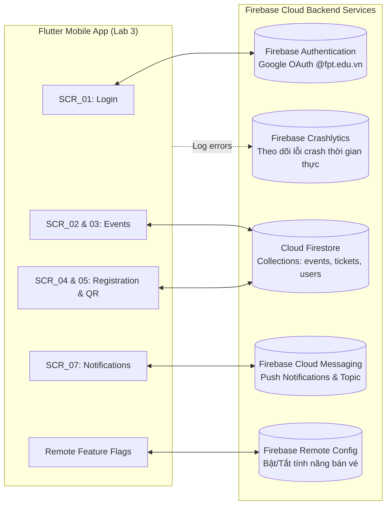

# 🚀 Flutter Developer Handoff Specification
**Dự án:** F-Event — FPT Campus Event Hub  
**Môn học:** PRM323 — Cross-Platform Application Development  
**Sinh viên thực hiện:** Nguyễn Minh Tú (MSSV: SE193059)  
**Mục tiêu:** Bản đặc tả kỹ thuật toàn diện để bất kỳ lập trình viên Flutter nào cũng có thể cài đặt chính xác 100% ứng dụng mà không cần phải hỏi lại tác giả, sẵn sàng làm nền tảng cho **Lab 3 (Flutter + Firebase BE)**.

---

## 1. Bảng Ánh xạ Kỹ thuật Toàn cục (Global Mapping Tables)

### 1.1. Bảng Ánh xạ Design Tokens sang Mã nguồn Flutter (Tokens to Flutter)

Lập trình viên tích hợp trực tiếp bộ Token này vào file cấu hình giao diện `theme/app_theme.dart`:

```dart
// Theme code dự kiến cho Flutter
class AppColors {
  static const Color primary = Color(0xFFF27024); // FPT Orange
  static const Color primaryContainer = Color(0xFFFFF0E6);
  static const Color secondary = Color(0xFF1B365D); // FPT Navy Blue
  static const Color secondaryContainer = Color(0xFFE8EEF5);
  static const Color surface = Color(0xFFFFFFFF);
  static const Color background = Color(0xFFF8F9FA);
  static const Color textPrimary = Color(0xFF1A1A1A);
  static const Color textSecondary = Color(0xFF595959);
  static const Color textDisabled = Color(0xFF8C8C8C);
  static const Color border = Color(0xFFE0E0E0);
  static const Color success = Color(0xFF1E8E3E);
  static const Color error = Color(0xFFD93025);
  static const Color errorContainer = Color(0xFFFDF3F2);
  static const Color warning = Color(0xFFE37400);
}

class AppSpacing {
  static const double xxs = 4.0;
  static const double xs = 8.0;
  static const double sm = 12.0;
  static const double md = 16.0; // Standard Screen Margin
  static const double lg = 24.0;
  static const double xl = 32.0;
  static const double xxl = 48.0; // Min Touch Target
}

class AppRadius {
  static const double sm = 8.0;
  static const double md = 12.0;
  static const double lg = 16.0;
  static const double full = 999.0;
}
```

| Tên Token trong Figma / DESIGN.md | Giá trị Kỹ thuật | Tên Thuộc tính Tương ứng trong Flutter ThemeData |
| :--- | :--- | :--- |
| `color-primary` | `#F27024` | `Theme.of(context).colorScheme.primary` |
| `color-primary-container` | `#FFF0E6` | `Theme.of(context).colorScheme.primaryContainer` |
| `color-secondary` | `#1B365D` | `Theme.of(context).colorScheme.secondary` |
| `color-secondary-container` | `#E8EEF5` | `Theme.of(context).colorScheme.secondaryContainer` |
| `color-surface` | `#FFFFFF` | `Theme.of(context).colorScheme.surface` |
| `color-background` | `#F8F9FA` | `Theme.of(context).scaffoldBackgroundColor` |
| `color-text-primary` | `#1A1A1A` | `Theme.of(context).colorScheme.onSurface` |
| `color-text-secondary` | `#595959` | `Theme.of(context).textTheme.bodyMedium?.color` |
| `color-success` | `#1E8E3E` | Hằng số `AppColors.success` |
| `color-error` | `#D93025` | `Theme.of(context).colorScheme.error` |
| `type-display-large` | 26sp, Bold 700, h=34 | `Theme.of(context).textTheme.headlineMedium` |
| `type-title-large` | 20sp, Bold 700, h=28 | `Theme.of(context).textTheme.titleLarge` |
| `type-title-medium` | 18sp, SemiBold 600, h=24 | `Theme.of(context).textTheme.titleMedium` |
| `type-body-large` | 16sp, Regular 400, h=24 | `Theme.of(context).textTheme.bodyLarge` |
| `type-body-medium` | 14sp, Regular 400, h=20 | `Theme.of(context).textTheme.bodyMedium` (chuẩn WCAG min 14sp) |
| `type-label-large` | 14sp, SemiBold 600, h=20 | `Theme.of(context).textTheme.labelLarge` (Button Text) |
| `type-label-small` | 12sp, Medium 500, h=16 | `Theme.of(context).textTheme.labelSmall` (Badge/Tag) |

---

### 1.2. Bảng Ánh xạ Component Figma sang Widget Flutter (Components to Widgets)

| Component trong Figma (Page 05) | Widget Chuẩn trong Flutter (Material 3) | Gói Thư viện Phụ thuộc (Dependencies nếu có) | Các Thuộc tính / Variant Tương ứng |
| :--- | :--- | :--- | :--- |
| **Button (Primary)** | `FilledButton` | Built-in Flutter SDK | `style: FilledButton.styleFrom(backgroundColor: AppColors.primary, minimumSize: Size(double.infinity, 48))` |
| **Button (Secondary/Waitlist)** | `OutlinedButton` | Built-in Flutter SDK | `style: OutlinedButton.styleFrom(foregroundColor: AppColors.primary, side: BorderSide(color: AppColors.primary))` |
| **Button (Loading)** | `FilledButton` chứa `SizedBox(width: 24, height: 24, child: CircularProgressIndicator(color: Colors.white, strokeWidth: 2.5))` | Built-in | Tắt callback `onPressed: null` để khóa tương tác |
| **Text Field** | `TextFormField` | Built-in Flutter SDK | `decoration: InputDecoration(border: OutlineInputBorder(borderRadius: BorderRadius.circular(8)), contentPadding: EdgeInsets.symmetric(horizontal: 16, vertical: 14))` |
| **Event Card** | `Card` bọc trong `InkWell` | Built-in Flutter SDK | `elevation: 1, shape: RoundedRectangleBorder(borderRadius: BorderRadius.circular(12))` |
| **Category Chip** | `FilterChip` hoặc `ChoiceChip` | Built-in Flutter SDK | `shape: StadiumBorder(), selectedColor: AppColors.primaryContainer` |
| **Navigation Bottom Bar** | `NavigationBar` | Built-in Flutter SDK (Material 3) | `destinations: [NavigationDestination(icon, label)...], indicatorColor: AppColors.primaryContainer` |
| **App Bar** | `AppBar` hoặc `SliverAppBar` | Built-in Flutter SDK | `backgroundColor: AppColors.secondary, foregroundColor: Colors.white` |
| **Confirmation Dialog** | `AlertDialog` | Built-in Flutter SDK | Gọi qua `showDialog(context: context, builder: (context) => AlertDialog(...))` |
| **Loading State (Skeleton)** | `Shimmer.fromColors(...)` | Package `shimmer: ^3.0.0` | `baseColor: Colors.grey[300]!, highlightColor: Colors.grey[100]!` |
| **Dynamic QR Code** | `QrImageView` | Package `qr_flutter: ^4.1.0` | `data: ticketCode, version: QrVersions.auto, size: 200.0` |
| **Avatar Profile** | `CircleAvatar` | Built-in Flutter SDK | `radius: 24, backgroundImage: NetworkImage(user.photoUrl)` |

---

## 2. Đặc tả Chi tiết 6 Mục cho Toàn bộ 8 Màn hình

---

### 📱 SCR_01: Authentication / Sign-in Screen

#### 1. Layout Structure
- `Scaffold`
  - `SafeArea`
    - `Padding(padding: EdgeInsets.symmetric(horizontal: AppSpacing.lg))`
      - `Column` (Căn giữa theo chiều dọc `mainAxisAlignment: MainAxisAlignment.center`, **không cuộn trang**):
        - `AppSpacing.xl`
        - `Image.asset('assets/images/fpt_event_logo.png', height: 120)`
        - `AppSpacing.md`
        - `Text("F-Event", style: AppTypography.displayLarge.copyWith(color: AppColors.primary))`
        - `Text("Không gian Sự kiện Đại học FPT", style: AppTypography.bodyMedium.copyWith(color: AppColors.textSecondary))`
        - `AppSpacing.xl`
        - `DropdownButtonFormField<String>` (Chọn campus: HCM, Hòa Lạc, Đà Nẵng, Cần Thơ, Quy Nhơn)
        - `AppSpacing.lg`
        - `OutlinedButton.icon` (Nút Google Sign-in với icon Google)
        - `AppSpacing.xl`
        - `Text("Bằng việc đăng nhập, bạn đồng ý với Điều khoản sinh viên FPT", style: AppTypography.labelSmall, textAlign: TextAlign.center)`

#### 2. Components Sử dụng
- `DropdownButtonFormField` (Variant: `Default`, `Bordered`)
- `Button` (Variant: `GoogleSignInButton` - chiều cao 48dp, viền xám, icon Google đa màu)

#### 3. States Áp dụng
- `Default`: Sẵn sàng cho người dùng chọn campus và bấm đăng nhập.
- `Loading`: Khi người dùng chạm nút Google Sign-in, nút chuyển sang spinner quay tròn, vô hiệu hóa dropdown.
- `Error`: Hiển thị `SnackBar` màu đỏ ở đáy màn hình nếu tài khoản Google không thuộc miền `@fpt.edu.vn`.

#### 4. User Interactions & Validation Rules
- **Chạm vào Dropdown Campus:** Mở danh sách các phân hiệu Đại học FPT. Giá trị mặc định: `"Campus TP. Hồ Chí Minh"`.
- **Chạm nút "Tiếp tục với Email FPT Edu":** Kích hoạt Google OAuth SDK.
  - *Validation Rule:* Email trả về bắt buộc phải có đuôi kết thúc bằng `@fpt.edu.vn`.
  - *Nếu sai đuôi (ví dụ dùng `@gmail.com` cá nhân):* Hiển thị cảnh báo: *"Chỉ chấp nhận tài khoản sinh viên FPT (@fpt.edu.vn). Vui lòng chọn đúng tài khoản."*

#### 5. Navigation
- **Nguồn đến:** Màn hình đầu tiên khi khởi động ứng dụng (nếu chưa lưu token đăng nhập).
- **Hành động chuyển tiếp:** Khi xác thực Google thành công → Điều hướng thay thế (`context.go('/home')` hoặc `Navigator.pushReplacementNamed`) sang `SCR_02`.
- **Nút Back hệ thống:** Thoát ứng dụng Android.

#### 6. Important UI Constraints
- Touch target nút Google Sign-in tối thiểu **48 × 48 dp**.
- Text không bị tràn chữ trên màn hình nhỏ nhờ căn lề chuẩn 24dp hai bên.
- **Hành vi trên màn hình rộng (≥ 600 dp):** Khối form đăng nhập được giới hạn chiều rộng tối đa `maxWidth: 400 dp` và căn chính giữa màn hình máy tính bảng.

---

### 📱 SCR_02: Home / Discover Screen

#### 1. Layout Structure
- `Scaffold`
  - `AppBar` (Custom Header với lời chào và Avatar)
  - `RefreshIndicator` (Hỗ trợ kéo xuống để làm mới dữ liệu - Pull-to-refresh)
    - `CustomScrollView` (**Toàn bộ phần nội dung cuộn mượt mà**):
      - `SliverToBoxAdapter`:
        - `Padding(horizontal: 16)`: Search Bar (`TextField` chiều cao 44dp)
        - `AppSpacing.md`
        - `SizedBox(height: 36)`: `ListView.separated` nằm ngang chứa các `CategoryChip`
        - `AppSpacing.lg`
        - `Text("Sự kiện nổi bật 🔥", style: AppTypography.titleLarge)`
        - `AppSpacing.xs`
        - `FeaturedEventBanner` (Thẻ Hero Banner nền Navy cao 160dp)
        - `AppSpacing.lg`
        - `Text("Sắp diễn ra", style: AppTypography.titleLarge)`
        - `AppSpacing.xs`
      - `SliverList.builder` / `SliverList.separated`:
        - Render danh sách các `EventCard` (chiều cao 100dp/thẻ)
        - `SizedBox(height: 80)` (Khoảng đệm an toàn chân trang tránh bị Bottom Bar che khuất)
  - `bottomNavigationBar`: `NavigationBar` (4 Destinations)

#### 2. Components Sử dụng
- `SearchField` (Variant: `Default`, `LeadingIconSearch`)
- `CategoryChip` (Variant: `Selected` [nền cam viền cam], `Unselected` [nền trắng viền xám])
- `FeaturedEventBanner` (Variant: `HeroCard` [nền navy, bo góc 12dp, có badge cam])
- `EventCard` (Variant: `Default`, `Pressed` có hiệu ứng gợn sóng InkWell)
- `BottomNavigationBar` (Variant: Tab 1 `Home` ở trạng thái `Selected`)

#### 3. States Áp dụng
- `Loading`: Hiển thị `Shimmer` skeleton loader cho banner và 4 thẻ card mô phỏng.
- `Populated`: Hiển thị đầy đủ danh sách sự kiện từ Firestore.
- `Empty`: Khi tìm kiếm từ khóa không có kết quả → Hiển thị hình vẽ vector + *"Không tìm thấy sự kiện phù hợp"*.
- `Error`: Mất mạng khi tải danh sách → Hiển thị thẻ lỗi với nút "Tải lại trang".

#### 4. User Interactions & Validation Rules
- **Gõ vào thanh Search:** Lọc trực thời (debounce 300ms) danh sách sự kiện bên dưới theo tiêu đề.
- **Chạm vào Category Chip:** Lọc sự kiện theo chuyên mục (Tech, Âm nhạc, Thể thao). Chỉ cho phép chọn 1 danh mục tại 1 thời điểm.
- **Chạm vào Thẻ Sự kiện (Event Card / Banner):** Kích hoạt hiệu ứng InkWell và mở màn hình `SCR_03`.
- **Chuyển Tab trên Bottom Bar:** Chuyển đổi màn hình giữa Home, Schedule, Notifications, Profile.

#### 5. Navigation
- **Nguồn đến:** Màn hình gốc sau khi đăng nhập thành công.
- **Hành động chuyển tiếp:** Chạm sự kiện → `Navigator.pushNamed(context, '/event-detail', arguments: eventId)`.
- **Nút Back hệ thống:** Hiện dialog hỏi "Bạn có muốn thoát ứng dụng F-Event?".

#### 6. Important UI Constraints
- Touch target của mọi chip danh mục đạt tối thiểu **48 × 48 dp** (chiều cao chip 32dp + padding mở rộng 8dp trên dưới).
- Tiêu đề sự kiện trên thẻ tối đa 2 dòng, nếu dài hơn áp dụng `TextOverflow.ellipsis`.
- **Hành vi trên màn hình rộng (≥ 600 dp):** Thay thế `SliverList` bằng `SliverGrid` hiển thị dạng lưới 2 cột hoặc 3 cột; `NavigationBar` chuyển sang `NavigationRail` cố định bên lề trái.

---

### 📱 SCR_03: Event Detail Screen

#### 1. Layout Structure
- `Scaffold`
  - `CustomScrollView` (**Phần nội dung chính cuộn độc lập bên trên**):
    - `SliverAppBar` (Chiều cao mở rộng `expandedHeight: 220 dp`, ghim cố định khi cuộn `pinned: true`, hiển thị nút Back và Bookmark)
    - `SliverToBoxAdapter`:
      - `Padding(all: 16)`:
        - `Row`: Chip thể loại + Badge số điểm PDP (`+5 PDP`)
        - `AppSpacing.sm`
        - `Text(event.title, style: AppTypography.titleLarge)`
        - `AppSpacing.xs`
        - `Text("Tổ chức bởi: " + event.clubName, style: AppTypography.bodyMedium)`
        - `AppSpacing.md`
        - `Card` thông tin nhanh: Ngày giờ, Địa điểm phòng hội trường
        - `AppSpacing.lg`
        - `Text("Mô tả chi tiết", style: AppTypography.titleMedium)`
        - `AppSpacing.xs`
        - `Text(event.description, style: AppTypography.bodyMedium)`
        - `AppSpacing.lg`
        - `Text("Diễn giả", style: AppTypography.titleMedium)`
        - `AppSpacing.xs`
        - `SpeakerCard` (Avatar tròn, tên diễn giả, chức danh)
        - `SizedBox(height: 100)` (Khoảng trống dự phòng cho thanh Bottom Bar cố định)
  - `bottomNavigationBar`: **Sticky Bottom Action Bar** (**Cố định ở chân màn hình, không cuộn**):
    - `Container` (Chiều cao 80dp, nền trắng, viền trên `Border(top: BorderSide(color: AppColors.border))`, đổ bóng Elevation 3)
      - `Padding(horizontal: 16, vertical: 12)`
        - `Row`:
          - `Column`: Text "Còn lại: 18/100 chỗ" + Thanh tiến độ nhỏ
          - `FilledButton` ("ĐĂNG KÝ THAM GIA" - chiều cao 48dp, chiều rộng tối thiểu 160dp)

#### 2. Components Sử dụng
- `SliverAppBar` (Variant: `FlexibleSpaceBar` với ảnh cover sự kiện)
- `IconButton` (Back button, Bookmark toggle button)
- `PDPBadge` (Variant: Nền cam nhạt, chữ cam đậm)
- `SpeakerTile` (Variant: ListTile có CircleAvatar)
- `StickyBottomBar` (Variant: Có slot counter và nút CTA chính)

#### 3. States Áp dụng
- `Default (Available)`: Sự kiện còn chỗ → Nút cam "ĐĂNG KÝ THAM GIA".
- `Full (Waitlist)`: Sự kiện hết 100% chỗ → Nút chuyển sang Outlined Button viền cam *"THAM GIA DANH SÁCH CHỜ (WAITLIST)"*.
- `Registered`: Sinh viên đã đăng ký sự kiện này trước đó → Nút đổi thành màu xanh lá *"XEM VÉ CỦA BẠN"*.
- `Loading`: Skeleton shimmer cho nội dung chi tiết bài viết.

#### 4. User Interactions & Validation Rules
- **Chạm nút Back trên AppBar:** Trở về màn hình trước đó (`Navigator.pop(context)`).
- **Chạm nút Bookmark:** Đổi icon từ Outline sang Filled, hiển thị thông báo Toast nhanh: *"Đã lưu sự kiện"*.
- **Chạm nút "ĐĂNG KÝ THAM GIA":** Mở màn hình đăng ký `SCR_04`.
- **Chạm nút "THAM GIA DANH SÁCH CHỜ":** Gửi yêu cầu xếp hàng lên hệ thống và hiển thị vị trí trên hàng đợi.

#### 5. Navigation
- **Nguồn đến:** Từ thẻ sự kiện trên `SCR_02` hoặc thông báo `SCR_07`.
- **Hành động chuyển tiếp:** Chạm Đăng ký → `Navigator.pushNamed(context, '/event-register', arguments: event)`.
- **Nút Back:** `Navigator.pop(context)` quay lại màn hình gọi trước đó.

#### 6. Important UI Constraints
- Chiều cao Sticky Bottom Bar luôn cố định **80 dp** (đã bao gồm vùng đệm ngón tay).
- **Hành vi trên màn hình rộng (≥ 600 dp):** Bố cục chia thành 2 cột: Cột trái (60% chiều rộng) hiển thị ảnh và mô tả chi tiết; Cột phải (40% chiều rộng) hiển thị thông tin thời gian, diễn giả và khối nút Đăng ký cố định dạng Card bên cạnh.

---

### 📱 SCR_04: Event Registration / Checkout Form Screen

#### 1. Layout Structure
- `Scaffold`
  - `AppBar(title: Text("Xác nhận Đăng ký"))`
  - `SingleChildScrollView` (**Cuộn trang tránh tràn bàn phím khi nhập liệu**):
    - `Padding(all: 16)`:
      - `Form(key: _formKey)`:
        - `EventMiniSummaryCard` (Tóm tắt nhanh tên sự kiện, ngày giờ, hội trường)
        - `AppSpacing.md`
        - `Text("Thông tin người tham dự", style: AppTypography.titleMedium)`
        - `AppSpacing.sm`
        - `TextFormField` (Họ và tên - Pre-filled, `readOnly: true`)
        - `AppSpacing.sm`
        - `TextFormField` (MSSV - Pre-filled, `readOnly: true`, có icon verified xanh)
        - `AppSpacing.sm`
        - `TextFormField` (Email FPT Edu - Pre-filled, `readOnly: true`)
        - `AppSpacing.md`
        - `Text("Hình thức tham gia", style: AppTypography.titleMedium)`
        - `RadioListTile` (Tham gia Offline tại hội trường)
        - `RadioListTile` (Xem Livestream trực tuyến)
        - `AppSpacing.sm`
        - `TextFormField` (Câu hỏi cho diễn giả - `maxLines: 3`, không bắt buộc)
        - `AppSpacing.md`
        - `CheckboxListTile` (Cam kết tham dự đúng giờ nhận điểm PDP)
        - `AppSpacing.lg`
        - `FilledButton` ("XÁC NHẬN ĐĂNG KÝ VÉ" - chiều cao 48dp, full-width)
        - `SizedBox(height: 24)`

#### 2. Components Sử dụng
- `TextFormField` (Variant: `ReadOnly / Pre-filled` với màu nền `#F5F5F5`; Variant: `Editable` cho câu hỏi)
- `RadioListTile` (Chọn hình thức)
- `CheckboxListTile` (Cam kết tham dự)
- `Button` (Variant: `Primary`, `Loading` với spinner quay tròn)
- `ErrorBanner` (Variant: Nền đỏ nhạt `#FDF3F2`, viền đỏ, icon cảnh báo, nút Thử lại)

#### 3. States Áp dụng
- `Default`: Form sẵn sàng với dữ liệu tài khoản sinh viên đã điền tự động.
- `Loading`: Khi người dùng bấm xác nhận, nút chuyển sang spinner, các trường nhập khóa tạm thời.
- `Network Error (Phục hồi)`: Mất kết nối internet → Hiển thị Error Banner ở đầu form, **giữ nguyên toàn bộ dữ liệu form đã điền**, người dùng bấm "Thử lại (Retry)" để gửi lại yêu cầu.
- `Success`: Mở Dialog Thành công Overlay và chuyển hướng sang `SCR_05`.

#### 4. User Interactions & Validation Rules
- **Validation Hộp kiểm Cam kết:** Bắt buộc phải đánh dấu chọn cam kết trước khi nút "Xác nhận đăng ký" kích hoạt (`isCommitted == true`).
- **Xử lý bàn phím mở lên:** Tự động cuộn trang (`ScrollController`) để trường nhập câu hỏi không bị bàn phím ảo che khuất.
- **Chạm nút "XÁC NHẬN ĐĂNG KÝ VÉ":** Kích hoạt `_formKey.currentState!.validate()`. Nếu hợp lệ → Chuyển sang State Loading → Gửi dữ liệu lên Firestore.

#### 5. Navigation
- **Nguồn đến:** Từ nút Đăng ký trên `SCR_03`.
- **Hành động chuyển tiếp:** Đăng ký thành công → Mở Dialog Thành công → Bấm "Xem vé" → `Navigator.pushReplacementNamed(context, '/ticket-pass')`.
- **Nút Back:** Hiển thị dialog cảnh báo nếu người dùng đã gõ câu hỏi: *"Bạn có muốn hủy bỏ thông tin đăng ký?"*.

#### 6. Important UI Constraints
- Chiều cao vùng bấm nút luôn đạt **48 dp**.
- Toàn bộ form bọc trong `SingleChildScrollView` kết hợp `resizeToAvoidBottomInset: true` trên `Scaffold` để triệt tiêu lỗi `RenderFlex overflowed by XX pixels`.
- **Hành vi trên màn hình rộng (≥ 600 dp):** Khung form giới hạn chiều rộng tối đa `500 dp` căn giữa màn hình.

---

### 📱 SCR_05: Ticket Pass / Dynamic QR Check-in Screen

#### 1. Layout Structure
- `Scaffold(backgroundColor: AppColors.secondary)` (Nền xanh Navy trang trọng)
  - `AppBar(backgroundColor: Colors.transparent, elevation: 0, title: Text("Vé Tham Dự Sự Kiện"))`
  - `Center`:
    - `SingleChildScrollView`:
      - `Padding(all: 20)`:
        - `TicketContainer` (Thẻ vé trắng bo góc 16dp, có vết cắt hình bán nguyệt ở hai bên mép giữa):
          - `Container` đầu vé (Màu FPT Orange): Tên sự kiện, thời gian, hội trường
          - `Padding(all: 16)`:
            - `Row`: Badge trạng thái vé (`● VÉ HỢP LỆ` viền xanh lá) + Mã số ghế
            - `Divider` nét đứt cách điệu (Dashed line divider)
            - `Center`:
              - `QrImageView` (Mã QR động kích thước 200 × 200 dp)
            - `Text("Xuất trình mã này cho Ban tổ chức tại cửa Hội trường", style: AppTypography.labelSmall)`
            - `AppSpacing.md`
            - `StudentInfoSummary`: Tên ("Nguyễn Minh Tú"), MSSV ("SE193059"), Mã vé
        - `AppSpacing.lg`
        - `OutlinedButton.icon` ("LƯU VÉ VÀO THƯ VIỆN ẢNH" - Nút viền trắng, chữ trắng, cao 48dp)
        - `AppSpacing.sm`
        - `TextButton` ("Hủy đăng ký vé" - Chữ màu vàng cảnh báo/đỏ nhạt)

#### 2. Components Sử dụng
- `TicketContainer` (Custom Shape Border có 2 vết khuyết bán nguyệt)
- `QrImageView` (Mã QR động từ thư viện `qr_flutter`)
- `Badge` (Variant: `Valid` màu xanh lá, `Used` màu xanh đậm, `Cancelled` màu xám)
- `Button` (OutlinedButton trắng cho hành động lưu ảnh, TextButton cho hành động hủy vé)
- `ConfirmationDialog` (Variant: Modal xác nhận hủy vé mở dưới dạng Overlay)

#### 3. States Áp dụng
- `Valid (Hợp lệ)`: Mã QR hiển thị rõ nét, badge xanh lá cây.
- `Checked-in (Đã điểm danh)`: Sau khi được quét tại cửa → Badge đổi thành "ĐÃ ĐIỂM DANH", mã QR mờ đi kèm dấu tích xanh to bản.
- `Cancelled (Đã hủy)`: Khi sinh viên xác nhận hủy vé → Mã QR bị gạch chéo mờ, badge đổi thành "ĐÃ HỦY VÉ".

#### 4. User Interactions & Validation Rules
- **Tự động kích hoạt khi mở màn hình:** Tự động thiết lập độ sáng màn hình lên 100% (sử dụng plugin `screen_brightness` nếu có) để máy quét của ban tổ chức đọc mã nhanh nhất.
- **Chạm nút "LƯU VÉ VÀO THƯ VIỆN ẢNH":** Chụp màn hình thẻ vé lưu thành file ảnh PNG vào bộ sưu tập máy để dùng offline.
- **Chạm nút "Hủy đăng ký vé":** Kích hoạt `showDialog()` mở `ConfirmationDialog` với thông điệp: *"Bạn có chắc chắn muốn hủy vé? Thao tác này sẽ nhường slot cho bạn sinh viên đang đợi trong danh sách chờ."*

#### 5. Navigation
- **Nguồn đến:** Từ form đăng ký `SCR_04` hoặc từ danh sách sự kiện cá nhân `SCR_06`.
- **Hành động chuyển tiếp:** Chạm Back → Trở về màn hình `SCR_06` (My Schedule).
- **Nút Back:** Trở về danh sách vé.

#### 6. Important UI Constraints
- Mã QR Code luôn giữ tỷ lệ vuông kích thước tối thiểu **200 × 200 dp**, khoảng cách lề an toàn (quiet zone) xung quanh mã tối thiểu 16 dp.
- **Hành vi trên màn hình rộng (≥ 600 dp):** Khung vé giữ chiều rộng cố định `360 dp` nằm giữa màn hình nền xanh Navy.

---

### 📱 SCR_06: My Schedule Screen

#### 1. Layout Structure
- `Scaffold`
  - `AppBar(title: Text("Lịch trình Sự kiện"))`
  - `Column`:
    - `TabBar` (3 Tabs: "Sắp tới", "Chờ duyệt (Waitlist)", "Lịch sử")
    - `Expanded`:
      - `TabBarView`:
        - Tab 1: `ListView.separated` chứa các thẻ sự kiện sắp tới có nút "Xem vé QR"
        - Tab 2: `ListView.separated` chứa các sự kiện trong Waitlist kèm badge số thứ tự hàng chờ
        - Tab 3: `ListView.separated` chứa lịch sử các sự kiện đã tham gia và điểm PDP đã cộng
  - `bottomNavigationBar`: `NavigationBar` (Tab 2 `Schedule` ở trạng thái `Selected`)

#### 2. Components Sử dụng
- `TabBar` (Variant: Primary indicator màu cam FPT)
- `ScheduleCard` (Variant: Có vạch chỉ báo thời gian đếm ngược)
- `WaitlistCard` (Variant: Hiển thị badge vàng vị trí hàng đợi)
- `EmptyStateWidget` (Variant: Vector minh họa lịch trống + Nút CTA "Khám phá ngay")

#### 3. States Áp dụng
- `Populated`: Hiển thị danh sách vé tương ứng với từng tab.
- `Empty State`: Khi chưa có vé nào trong tab → Hiển thị hình vẽ minh họa thân thiện, dòng chữ *"Bạn chưa đăng ký sự kiện nào"* và nút *"Khám phá sự kiện ngay"*.
- `Loading`: Skeleton shimmer 3 thẻ hàng ngang.

#### 4. User Interactions & Validation Rules
- **Vuốt ngang (Swipe):** Vuốt qua lại giữa 3 tab "Sắp tới", "Chờ duyệt", "Lịch sử".
- **Chạm vào thẻ sự kiện:** Mở chi tiết vé `SCR_05`.
- **Chạm nút "Khám phá ngay" trên Empty State:** Tự động chuyển đổi tab điều hướng về Tab 1 `SCR_02` (Home).

#### 5. Navigation
- **Nguồn đến:** Tab 2 trên Bottom Navigation Bar.
- **Hành động chuyển tiếp:** Chạm vé → Mở `SCR_05`.
- **Nút Back:** Chuyển về Tab Home `SCR_02`.

#### 6. Important UI Constraints
- Chiều cao mỗi thẻ trong lịch đạt chuẩn tối thiểu **80 dp**, touch target rộng rãi.
- **Hành vi trên màn hình rộng (≥ 600 dp):** Hiển thị dạng Split-view: Cột trái là danh sách lịch sự kiện, Cột phải là bản xem trước của vé QR được chọn.

---

### 📱 SCR_07: Notifications Screen

#### 1. Layout Structure
- `Scaffold`
  - `AppBar(title: Text("Thông báo"), actions: [TextButton("Đã đọc tất cả")])`
  - `ListView.separated`:
    - Nhóm thông báo "Hôm nay":
      - `NotificationTile` (Nhắc lịch: Icon chuông cam, tiêu đề, thời gian diễn ra, thời gian gửi "15 phút trước")
      - `NotificationTile` (Mở slot Waitlist: Icon vé xanh, nút "Nhận vé ngay trong 15p")
    - Nhóm thông báo "Trước đó":
      - `NotificationTile` (Cộng điểm PDP: Icon sao vàng, thông báo cộng +5 điểm)
      - `NotificationTile` (Đổi phòng học: Icon cảnh báo)
  - `bottomNavigationBar`: `NavigationBar` (Tab 3 `Notifications` ở trạng thái `Selected`)

#### 2. Components Sử dụng
- `NotificationTile` (Variant: `Unread` có nền cam nhạt và chấm cam tròn; Variant: `Read` nền trắng)
- `CategoryBadge` trên thông báo
- `EmptyStateWidget` (Khi không có thông báo mới)

#### 3. States Áp dụng
- `Populated`: Hiển thị danh sách các tin nhắn đẩy từ Firebase Cloud Messaging.
- `Unread / Read`: Phân biệt trực quan giữa thông báo đã xem và chưa xem bằng màu nền và icon.
- `Empty`: Hiển thị hình minh họa chuông ngủ yên và chữ *"Không có thông báo mới"*.

#### 4. User Interactions & Validation Rules
- **Chạm vào thông báo nhắc lịch:** Điều hướng trực tiếp đến màn hình chi tiết sự kiện `SCR_03` hoặc vé QR `SCR_05`.
- **Chạm thông báo mở slot Waitlist:** Mở trực tiếp hộp thoại xác nhận nhận vé trong thời hạn 15 phút.
- **Vuốt ngang (Dismissible):** Vuốt sang trái để xóa thông báo khỏi danh sách.

#### 5. Navigation
- **Nguồn đến:** Tab 3 trên Bottom Bar hoặc mở ứng dụng từ Push Notification ngoài màn hình khóa Android.
- **Hành động chuyển tiếp:** Điều hướng sâu (Deep linking) vào thẳng sự kiện liên quan.
- **Nút Back:** Trở về Tab Home `SCR_02`.

#### 6. Important UI Constraints
- Chiều cao dòng thông báo tối thiểu **64 dp**, vùng bấm bao trọn toàn bộ thẻ.
- **Hành vi trên màn hình rộng (≥ 600 dp):** Danh sách thông báo căn giữa với chiều rộng tối đa `600 dp`.

---

### 📱 SCR_08: Profile & PDP Tracking Screen

#### 1. Layout Structure
- `Scaffold`
  - `AppBar(title: Text("Hồ sơ & Điểm rèn luyện"))`
  - `SingleChildScrollView`:
    - `Padding(all: 16)`:
      - `StudentProfileCard` (Avatar tròn, Họ tên "Nguyễn Minh Tú", MSSV "SE193059", Khóa K19)
      - `AppSpacing.md`
      - `PDPProgressDashboardCard` (Thẻ theo dõi tiến độ điểm PDP):
        - `Row`: Vòng tròn tiến độ tròn `CircularProgressIndicator` (85/100 Điểm PDP) + Thông tin số sự kiện đã tham gia
      - `AppSpacing.lg`
      - `Text("Cài đặt ứng dụng", style: AppTypography.titleMedium)`
      - `AppSpacing.xs`
      - `Card`:
        - `ListTile` (Icon danh mục: "Chủ đề sự kiện yêu thích", trailing arrow)
        - `Divider`
        - `ListTile` (Icon chuông: "Cài đặt thông báo nhắc nhở")
        - `Divider`
        - `ListTile` (Icon bảo mật: "Điều khoản & Quyền riêng tư")
        - `Divider`
        - `ListTile` (Icon đăng xuất màu đỏ: "Đăng xuất tài khoản")
  - `bottomNavigationBar`: `NavigationBar` (Tab 4 `Profile` ở trạng thái `Selected`)

#### 2. Components Sử dụng
- `StudentProfileCard` (Variant: Card trắng, avatar tròn, badge ngành SE)
- `PDPProgressDashboardCard` (Variant: Card nền FPT Navy, chữ trắng, vòng tròn tiến độ màu cam FPT)
- `SettingsListTile` (Variant: Standard, Destructive chữ đỏ cho đăng xuất)
- `AlertDialog` (Hộp thoại xác nhận đăng xuất)

#### 3. States Áp dụng
- `Populated`: Hiển thị thông tin sinh viên và điểm PDP đồng bộ từ máy chủ.
- `Loading`: Shimmer avatar và thanh tiến độ.

#### 4. User Interactions & Validation Rules
- **Chạm vào Đăng xuất:** Mở `AlertDialog` xác nhận: *"Bạn có chắc chắn muốn đăng xuất tài khoản FPT Edu khỏi thiết bị này?"*.
- **Chạm "Xác nhận đăng xuất":** Xóa token xác thực cục bộ và chuyển hướng thay thế về màn hình `SCR_01` (Login Screen).

#### 5. Navigation
- **Nguồn đến:** Tab 4 trên Bottom Navigation Bar.
- **Hành động chuyển tiếp:** Đăng xuất → Điều hướng về `SCR_01`.
- **Nút Back:** Trở về Tab Home `SCR_02`.

#### 6. Important UI Constraints
- Vùng chạm của mỗi mục cài đặt `ListTile` đạt tối thiểu **48 dp** chiều cao.
- **Hành vi trên màn hình rộng (≥ 600 dp):** Khối Profile và Dashboard điểm PDP xếp thành 2 cột song song.

---

## 3. Định hướng Kiến trúc Lab 3 (Flutter + Firebase Backend)

Bản đặc tả thiết kế này được xây dựng tương thích 100% với kiến trúc dịch vụ Firebase cho bài **Lab 3** sắp tới của giảng viên:



1. **Firebase Authentication:** Quản lý phiên đăng nhập Google với quy tắc kiểm tra miền email `hd == "fpt.edu.vn"`.
2. **Cloud Firestore Data Models:**
   - Collection `events`: `{ eventId, title, clubName, bannerUrl, startTime, venue, totalSlots, registeredSlots, pdpPoints, isWaitlistActive }`.
   - Collection `tickets`: `{ ticketId, eventId, studentId, studentName, studentEmail, qrDataCode, status: 'valid' | 'used' | 'cancelled', createdAt }`.
   - Collection `users`: `{ uid, mssv, fullName, email, currentPdpPoints, registeredEventIds: [] }`.
3. **Firebase Cloud Messaging (FCM):** Đăng ký Topic thông báo theo chuyên mục (ví dụ `topics/tech_events`) và gửi thông báo nhắc lịch tự động trước 24 giờ và 1 giờ qua Cloud Functions.
4. **Firebase Remote Config:** Kiểm soát các biến cấu hình từ xa như cờ bật tắt đăng ký sớm (`early_bird_rsvp_enabled`), số slot tối đa, và banner thông báo khẩn cấp của trường mà không cần phát hành lại bản build app.
5. **Firebase Crashlytics:** Theo dõi các lỗi phát sinh trong quá trình quét mã QR và gửi đơn đăng ký trên thiết bị của sinh viên.
