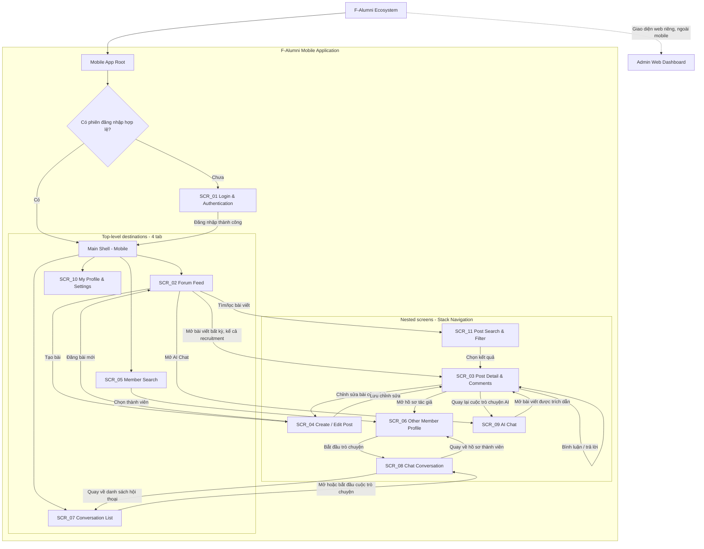
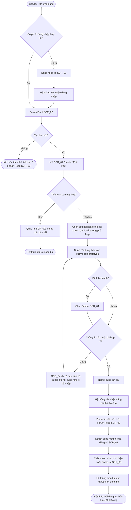
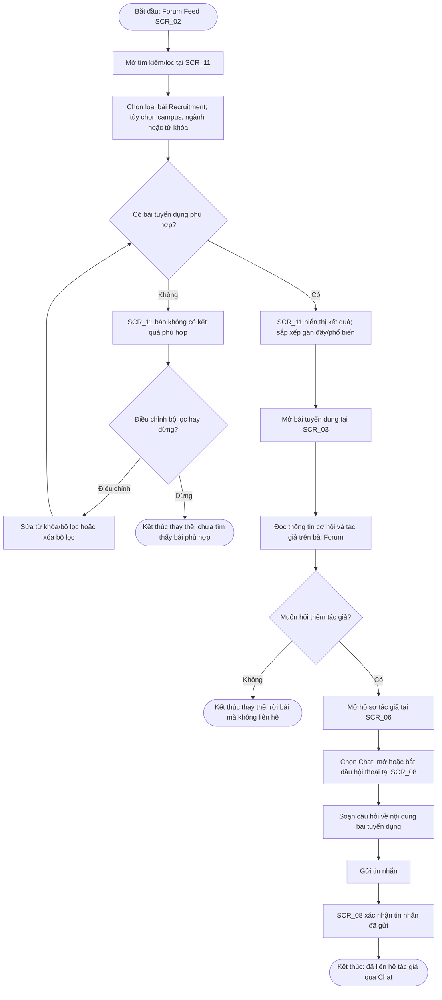
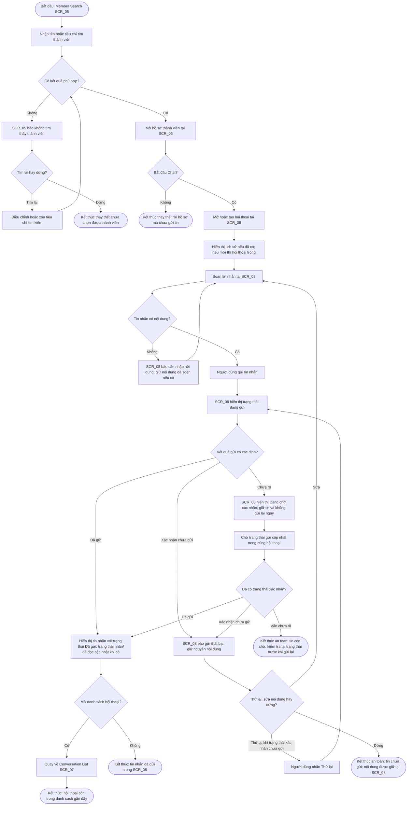

# 🗺️ UX Analysis: Information Architecture & User Flows
**Dự án:** F-Alumni — FPT Alumni Mentorship & Opportunity Network  
**Môn học:** PRM323 — Cross-Platform Application Development  
**Nhóm thực hiện:** PRM Nhóm 4 — Đại học FPT TP.HCM  
**Thành viên:** Trương Chí Trung (SE193059), Nguyễn Phương Khải (SE183590), Đỗ Trọng Tín, Võ Quang Tâm (SE192621)  

---

## 1. Kiến trúc Thông tin (Information Architecture - IA)

### 1.1. Phân cấp Cấu trúc Điều hướng (Navigation Structure)

IA mobile F-Alumni dùng **Bottom Navigation Bar với 4 điểm đến cấp cao** và **Stack Navigation cho các màn hình theo ngữ cảnh**. AppRoot kiểm tra phiên đăng nhập; người dùng chưa đăng nhập đi qua `SCR_01`, còn phiên hợp lệ vào Main Shell theo quy tắc UX đề xuất. Các tác vụ xác minh email và khôi phục mật khẩu được biểu diễn như trạng thái/nhánh hỗ trợ trong `SCR_01`, không tính thành màn hình độc lập.

**Phân cấp điều hướng:** `SCR_02` Forum Feed, `SCR_05` Member Search, `SCR_07` Conversation List và `SCR_10` My Profile & Settings là bốn tab cấp cao sau đăng nhập. Các màn hình còn lại được mở từ ngữ cảnh bài viết, thành viên, cuộc trò chuyện hoặc AI Chat và quay lại ngữ cảnh trước bằng điều hướng stack.

**Ranh giới mobile/web:** Admin dùng dashboard web riêng với ngữ cảnh truy cập và điều hướng riêng. Dashboard thuộc hệ sinh thái F-Alumni nhưng không nằm trong ứng dụng mobile và không được tính vào inventory 11 màn hình mobile bên dưới.

**Giả định UX:** Nếu đã có phiên hợp lệ, người dùng vào Main Shell mà không thấy màn hình đăng nhập; cơ chế lưu/duy trì phiên chưa được mô tả trong yêu cầu. Profile visibility do người dùng kiểm soát; quyền xem hồ sơ hoặc chặn thành viên cần theo trạng thái quyền riêng tư được sản phẩm xác định, không suy diễn thêm quy tắc truy cập tại IA này. Liên kết Google Calendar trên hồ sơ là thông tin liên hệ, không dẫn tới luồng đặt lịch trong ứng dụng.

### 1.2. Danh mục Màn hình Mobile (Screen Inventory)

Inventory đề xuất **11 màn hình có mục đích riêng** theo danh sách khởi điểm của task. Các màn hình tách biệt theo mục tiêu người dùng như đọc bài, soạn bài, tìm thành viên, hội thoại và AI; trạng thái đăng nhập/xác minh, loading, thiếu nguồn AI, tab nội bộ và dialog không được tính thành màn hình mới. User Story IDs dưới đây được gắn theo các nhóm domain và capability đã cung cấp; repository hiện không có danh sách tên/định nghĩa chi tiết từng ID để đối chiếu chéo chính xác hơn. Bảng mapping không khẳng định toàn bộ User Stories đã được thiết kế hoặc triển khai.

| ID | English name | Tên tiếng Việt | Mục đích | Phân cấp | Đường vào chính | User Stories liên quan theo domain/capability | Flow tương lai |
| :--- | :--- | :--- | :--- | :--- | :--- | :--- | :--- |
| **SCR_01** | Login & Authentication | Đăng nhập và xác thực | Đăng nhập bằng email/mật khẩu hoặc Google; thể hiện trạng thái xác minh email và khôi phục mật khẩu. | Entry point / auth | `Mobile App Root → AuthGate` khi chưa có phiên hợp lệ | US-01–US-11: xác thực, xác minh email, mật khẩu và phiên người dùng | Điều kiện vào cho các flow mobile cần đăng nhập |
| **SCR_02** | Forum Feed | Bảng tin Forum | Duyệt câu hỏi, chia sẻ kinh nghiệm và bài tuyển dụng theo nhóm nội dung; mở bài, tạo bài, tìm/lọc và vào AI Chat. | Top-level — tab Forum | `Main Shell → Forum` sau đăng nhập | FO-01–FO-16: feed, nội dung Forum, phân loại và tương tác | Khám phá/đóng góp Forum; mở AI Chat |
| **SCR_03** | Post Detail & Comments | Chi tiết bài viết và bình luận | Đọc bài và trao đổi qua bình luận/trả lời; tương tác với bài và mở hồ sơ tác giả. Bài recruitment vẫn là bài Forum. | Nested — post context | Từ thẻ bài ở `SCR_02` hoặc kết quả `SCR_11`; từ citation ở `SCR_09` | FO-01–FO-16: xem bài, bình luận/trả lời, like, bookmark, report; US-01–US-11: xem hồ sơ tác giả | Forum discussion; AI citation → bài nguồn → quay lại AI |
| **SCR_04** | Create / Edit Post | Tạo và chỉnh sửa bài viết | Soạn câu hỏi, chia sẻ kiến thức hoặc recruitment post; chọn loại bài/ngành/đối tượng và thêm ảnh khi cần; sửa bài của mình. | Nested — Forum authoring | Nút tạo bài từ `SCR_02`; chỉnh sửa từ bài của mình trên `SCR_03` | FO-01–FO-16: tạo/sửa/xóa bài, loại bài, ngành/đối tượng và ảnh | Forum participation |
| **SCR_05** | Member Search | Tìm kiếm thành viên | Tìm thành viên trong cộng đồng và mở hồ sơ phù hợp. | Top-level — tab Members | `Main Shell → Members` sau đăng nhập | US-01–US-11: tìm thành viên và xem hồ sơ người dùng | Member discovery → Chat |
| **SCR_06** | Other Member Profile | Hồ sơ thành viên khác | Xem thông tin hồ sơ theo quyền riêng tư; bắt đầu Chat, hoặc dùng liên kết Google Calendar nếu thành viên cung cấp. Liên kết không tạo cuộc hẹn trong app. | Nested — member context | Từ `SCR_03` (tác giả) hoặc kết quả `SCR_05` | US-01–US-11: xem hồ sơ, quyền riêng tư, chặn người dùng và liên kết liên hệ | Member discovery → direct communication |
| **SCR_07** | Conversation List | Danh sách cuộc trò chuyện | Xem, tìm và mở hội thoại; bắt đầu hội thoại mới từ người dùng đã tìm thấy; mute/hide hội thoại theo chức năng được hỗ trợ. | Top-level — tab Chat | `Main Shell → Chat` sau đăng nhập | CH-01–CH-10: bắt đầu hội thoại, danh sách, mute/hide | Direct Chat |
| **SCR_08** | Chat Conversation | Cuộc trò chuyện | Đọc/tìm lịch sử tin nhắn, gửi tin nhắn văn bản/hình ảnh và xem trạng thái gửi/đã đọc, typing indicator. | Nested — conversation context | Từ `SCR_07` hoặc CTA Chat tại `SCR_06` | CH-01–CH-10: nhắn tin thời gian thực, lịch sử/tìm kiếm, ảnh và trạng thái | Direct Chat; quay lại danh sách hoặc hồ sơ đã mở hội thoại |
| **SCR_09** | AI Chat | Trò chuyện với AI | Hỏi về nội dung Forum, đọc câu trả lời có nguồn, đặt câu hỏi tiếp theo và mở bài Forum được dẫn chiếu. Trạng thái loading/thiếu nguồn nằm trong màn hình này. | Nested — AI conversation | Hành động AI Chat trên `SCR_02` | AI-01–AI-04: hỏi đáp dựa trên Forum, trích dẫn nguồn và câu hỏi tiếp nối; FO-01–FO-16: bài viết nguồn | AI knowledge discovery; citation mở `SCR_03` rồi quay lại đây |
| **SCR_10** | My Profile & Settings | Hồ sơ của tôi và cài đặt | Xem/cập nhật hồ sơ của mình, quản lý hiển thị, mật khẩu, phiên đăng nhập và đăng xuất. | Top-level — tab Profile | `Main Shell → Profile` sau đăng nhập | US-01–US-11: quản lý hồ sơ, quyền riêng tư, mật khẩu và phiên | Account/profile management |
| **SCR_11** | Post Search & Filter | Tìm kiếm và lọc bài viết | Tìm/lọc Forum theo từ khóa, loại bài, ngành, campus, audience và trạng thái câu hỏi đã/chưa trả lời. | Nested — Forum search context | Từ tìm kiếm/lọc trên `SCR_02` | FO-01–FO-16: tìm kiếm, bộ lọc Forum và câu hỏi đã/chưa trả lời | Forum discovery → kết quả mở `SCR_03` |

**Không thuộc mobile inventory:** AD-01–AD-09 thuộc Admin Web Dashboard riêng; các màn hình admin không được đưa vào sơ đồ mobile hoặc tính trong tổng số màn hình Lab 2.

**Chủ sở hữu flow trong các task tiếp theo:** dự kiến tách thành năm hành trình đại diện: (1) xác thực và quản lý tài khoản, (2) khám phá/tìm kiếm và thảo luận Forum, (3) tạo hoặc chỉnh sửa bài, (4) tìm thành viên và trao đổi qua Chat, (5) hỏi AI Chat và mở bài nguồn. Đây mới là phân công phạm vi cho việc thiết kế flow; điểm bắt đầu, nhánh thay thế/lỗi và kết thúc sẽ được xác định trong TASK 03, không được xem là các flow đã hoàn thành hoặc kiểm chứng.

**Trạng thái chuyển tiếp:** các flow và flow-to-screen mapping phía dưới mục 1 vẫn là tài liệu cũ, còn tham chiếu booking/referral và inventory 8 màn hình trước đây. Chúng được giữ nguyên theo phạm vi TASK 02 và sẽ được thay/đối chiếu trong task sau; không dùng chúng làm bằng chứng rằng inventory mới đã được phủ bởi flow.

---

## 2. Đặc tả Chi tiết 3 User Flows

---

### 🟢 User Flow 1: Đăng bài và thảo luận trên Forum
- **Điểm bắt đầu:** Sinh viên mở F-Alumni; nếu chưa có phiên hợp lệ thì đăng nhập tại `SCR_01`, sau đó vào Forum Feed `SCR_02`.
- **Mục tiêu:** Đăng câu hỏi hoặc bài chia sẻ hợp lệ để cộng đồng có thể trao đổi qua bình luận và trả lời.
- **Điểm kết thúc thành công:** Bài đã xuất bản, hiển thị tại `SCR_03` và có bình luận/trả lời hiển thị trong thảo luận. Kết thúc thay thế: rời màn hình soạn bài mà không xuất bản.
- **User Stories:** FO-01–FO-03, FO-05–FO-07.

**Nhánh và giả định UX:** Không đính kèm ảnh vẫn có thể tiếp tục đăng. Khi thiếu hoặc sai thông tin bắt buộc, `SCR_04` báo lỗi tại chỗ và giữ nội dung hợp lệ để người dùng sửa; chi tiết trường bắt buộc theo prototype, không tự đặt thêm quy tắc. Hủy trước khi đăng quay về `SCR_02`; chính sách lưu nháp chưa được xác định, nên không khẳng định nội dung được lưu hoặc xóa. Thành viên khác có thể bình luận/trả lời tại `SCR_03`; việc bài đã đăng không phụ thuộc vào thời điểm có phản hồi.

**Success target liên quan:** Metric đăng bài trong persona đo từ khi đề bài xuất hiện đến khi bài hiển thị sau xuất bản; mục tiêu đề xuất là ≥80% hoàn thành độc lập và trung vị ≤120 giây. Đây là ngưỡng kiểm thử, chưa phải kết quả đo.

---

### 🔵 User Flow 2: Khám phá cơ hội tuyển dụng qua Forum
- **Điểm bắt đầu:** Sinh viên đã đăng nhập và đang ở Forum Feed `SCR_02`.
- **Mục tiêu:** Tìm một bài đăng tuyển dụng/OJT phù hợp trong Forum và liên hệ tác giả qua Chat.
- **Điểm kết thúc thành công:** Tin nhắn hỏi thông tin được xác nhận đã gửi tại `SCR_08`. Kết thúc thay thế: không liên hệ tác giả hoặc kết thúc tìm kiếm khi chưa có kết quả.
- **User Stories:** FO-02, FO-05, FO-12–FO-14, US-05, CH-01.

**Nhánh và giới hạn:** Khi không có kết quả, người dùng có thể đổi/xóa bộ lọc rồi tìm lại hoặc dừng. Sau khi đọc bài, người dùng có thể rời mà không liên hệ. Recruitment là loại bài Forum; gửi tin nhắn chỉ mở trao đổi với tác giả, không có nghĩa là đã ứng tuyển hoặc nhận được việc.

---

### 🔴 User Flow 3: Tìm thành viên và nhắn tin trực tiếp
- **Điểm bắt đầu:** Người dùng đã đăng nhập và chọn tab Members để mở Member Search `SCR_05`.
- **Mục tiêu:** Tìm một sinh viên/alumni phù hợp và gửi thành công tin nhắn trực tiếp.
- **Điểm kết thúc:** Tin nhắn có trạng thái đã gửi trong `SCR_08`, hoặc người dùng kết thúc an toàn mà không gửi / tin nhắn còn chờ xác nhận.
- **User Stories:** US-05, US-06, CH-01–CH-07.

**Nhánh lỗi và phụ thuộc:** Tin rỗng bị chặn tại `SCR_08`. Chỉ hiển thị hành động retry khi trạng thái xác nhận tin chưa được gửi; nếu kết quả mạng chưa rõ, giữ tin ở trạng thái chờ và không gửi trùng. Ý nghĩa chính xác của trạng thái “xác nhận chưa gửi” và khả năng cập nhật/đối soát trạng thái là phụ thuộc triển khai cần xác nhận; flow không giả định backend có idempotency hoặc bảo đảm loại trùng. Nếu trạng thái chưa rõ, kết thúc an toàn là chờ và kiểm tra lại hội thoại.

**Success target liên quan:** Metric tìm thành viên và gửi tin trong persona có mục tiêu đề xuất ≥80% hoàn thành độc lập, trung vị ≤90 giây; đây chưa phải kết quả usability test.

---

## 3. Bảng Ánh xạ Flow sang Màn hình (Flow-to-Screen Mapping Matrix)

Bảng ma trận dưới đây đối chiếu từng màn hình với node hoặc đường đi thực tế trong ba sơ đồ; dấu ✓ chỉ màn hình có xuất hiện trong flow tương ứng.

| Mã màn hình | Tên màn hình theo screen spec | Flow 1 — Bài viết & mentor | Flow 2 — Referral | Flow 3 — Đặt lịch & phục hồi | Ghi chú node/đường đi |
| :---: | :--- | :---: | :---: | :---: | :--- |
| **SCR_01** | Login & Role Selection Screen | ✓ | — | — | Flow 1: `AuthGate → Login → LoginSuccess` |
| **SCR_02** | Home Feed Screen (Không gian Chung & Nhóm ngành) | ✓ | — | — | Flow 1: `EnterHome`, duyệt feed |
| **SCR_03** | Post / Experience Detail Screen | ✓ | — | — | Flow 1: `OpenDetail` |
| **SCR_04** | Career & Opportunity Board Screen | — | ✓ | — | Flow 2: `Start`, tìm kiếm và lọc cơ hội |
| **SCR_05** | Job Detail & Referral Apply Screen | — | ✓ | — | Flow 2: `Review`, form, validation, gửi và retry khi lỗi mạng |
| **SCR_06** | Alumni Mentors Directory Screen | ✓ | — | ✓ | Flow 1: `OpenMentors`; Flow 3: `Start`, `SelectMentor` |
| **SCR_07** | Mentor Booking & Session Pass Screen | ✓ | — | ✓ | Flow 1: `OpenBooking`, `ShowSessionPass`; Flow 3: form, xác nhận, recovery và Session Pass |
| **SCR_08** | Profile & My Network Screen | ✓ | ✓ | ✓ | Flow 1: `OpenMySessions`; Flow 2: `Track`; Flow 3: `CheckBookings` |

> **Kết luận:** Cả 8 màn hình đều có đường truy cập trong IA và xuất hiện trong ít nhất một user flow theo bảng đối chiếu trên.
