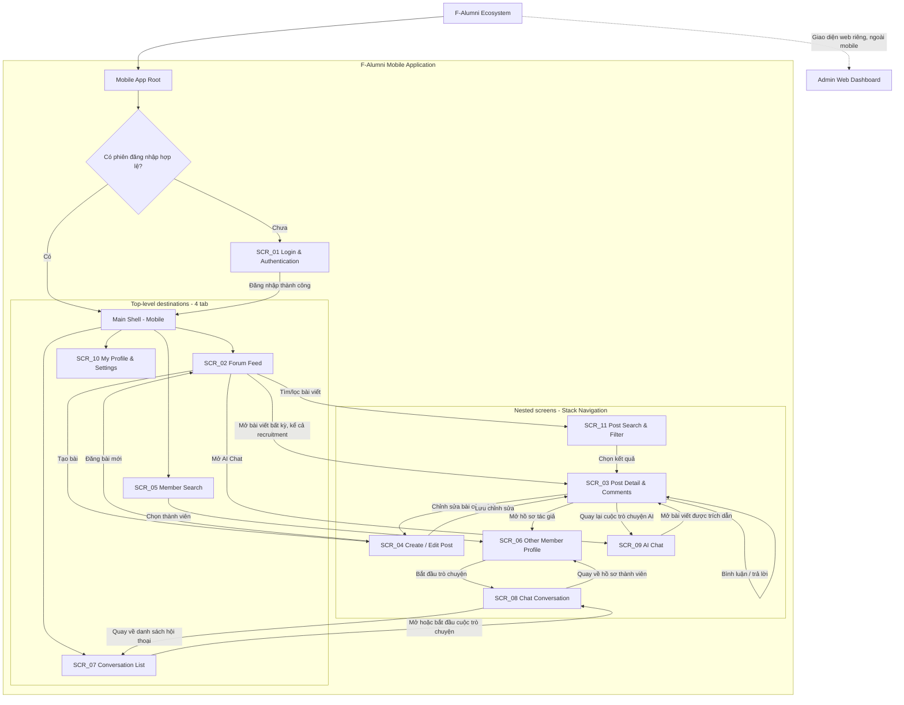
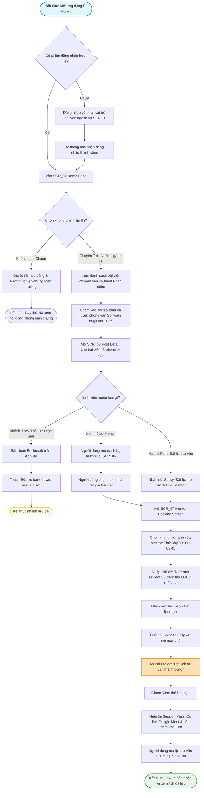
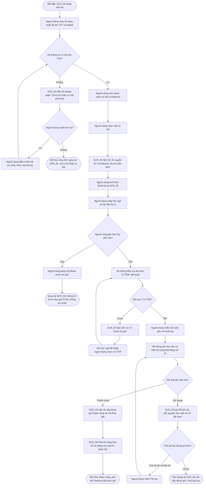
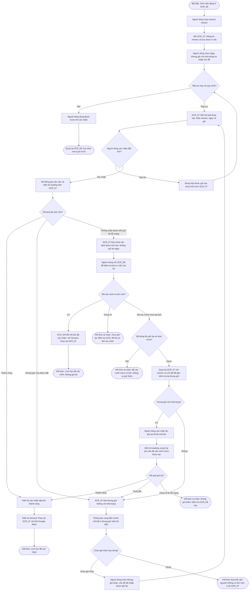

# 🗺️ UX Analysis: Information Architecture & User Flows
**Dự án:** F-Alumni — FPT Alumni Mentorship & Opportunity Network  
**Môn học:** PRM323 — Cross-Platform Application Development  
**Nhóm thực hiện:** PRM Nhóm 4 — Đại học FPT TP.HCM  
**Thành viên:** Trương Chí Trung (SE193059), Nguyễn Phương Khải (SE183590), Đỗ Trọng Tín, Võ Quang Tâm (SE192621)  

---

## 1. Kiến trúc Thông tin (Information Architecture - IA)

### 1.1. Phân cấp Cấu trúc Điều hướng (Navigation Structure)

IA mobile F-Alumni dùng **Bottom Navigation Bar với 4 điểm đến cấp cao** và **Stack Navigation cho các màn hình theo ngữ cảnh**. AppRoot kiểm tra phiên đăng nhập; người dùng chưa đăng nhập đi qua `SCR_01`, còn phiên hợp lệ vào Main Shell theo quy tắc UX đề xuất. Các tác vụ xác minh email và khôi phục mật khẩu được biểu diễn như trạng thái/nhánh hỗ trợ trong `SCR_01`, không tính thành màn hình độc lập.

**Phân cấp điều hướng:** `SCR_02` Forum Feed, `SCR_05` Member Search, `SCR_07` Conversation List và `SCR_10` My Profile & Settings là bốn tab cấp cao sau đăng nhập. Các màn hình còn lại được mở từ ngữ cảnh bài viết, thành viên, cuộc trò chuyện hoặc AI Chat và quay lại ngữ cảnh trước bằng điều hướng stack.

**Ranh giới mobile/web:** Admin dùng dashboard web riêng với ngữ cảnh truy cập và điều hướng riêng. Dashboard thuộc hệ sinh thái F-Alumni nhưng không nằm trong ứng dụng mobile và không được tính vào inventory 11 màn hình mobile bên dưới.

**Giả định UX:** Nếu đã có phiên hợp lệ, người dùng vào Main Shell mà không thấy màn hình đăng nhập; cơ chế lưu/duy trì phiên chưa được mô tả trong yêu cầu. Profile visibility do người dùng kiểm soát; quyền xem hồ sơ hoặc chặn thành viên cần theo trạng thái quyền riêng tư được sản phẩm xác định, không suy diễn thêm quy tắc truy cập tại IA này. Liên kết Google Calendar trên hồ sơ là thông tin liên hệ, không dẫn tới luồng đặt lịch trong ứng dụng.

### 1.2. Danh mục Màn hình Mobile (Screen Inventory)

Inventory đề xuất **11 màn hình có mục đích riêng** theo danh sách khởi điểm của task. Các màn hình tách biệt theo mục tiêu người dùng như đọc bài, soạn bài, tìm thành viên, hội thoại và AI; trạng thái đăng nhập/xác minh, loading, thiếu nguồn AI, tab nội bộ và dialog không được tính thành màn hình mới. User Story IDs dưới đây được gắn theo các nhóm domain và capability đã cung cấp; repository hiện không có danh sách tên/định nghĩa chi tiết từng ID để đối chiếu chéo chính xác hơn. Bảng mapping không khẳng định toàn bộ User Stories đã được thiết kế hoặc triển khai.

| ID | English name | Tên tiếng Việt | Mục đích | Phân cấp | Đường vào chính | User Stories liên quan theo domain/capability | Flow tương lai |
| :--- | :--- | :--- | :--- | :--- | :--- | :--- | :--- |
| **SCR_01** | Login & Authentication | Đăng nhập và xác thực | Đăng nhập bằng email/mật khẩu hoặc Google; thể hiện trạng thái xác minh email và khôi phục mật khẩu. | Entry point / auth | `Mobile App Root → AuthGate` khi chưa có phiên hợp lệ | US-01–US-11: xác thực, xác minh email, mật khẩu và phiên người dùng | Điều kiện vào cho các flow mobile cần đăng nhập |
| **SCR_02** | Forum Feed | Bảng tin Forum | Duyệt câu hỏi, chia sẻ kinh nghiệm và bài tuyển dụng theo nhóm nội dung; mở bài, tạo bài, tìm/lọc và vào AI Chat. | Top-level — tab Forum | `Main Shell → Forum` sau đăng nhập | FO-01–FO-16: feed, nội dung Forum, phân loại và tương tác | Khám phá/đóng góp Forum; mở AI Chat |
| **SCR_03** | Post Detail & Comments | Chi tiết bài viết và bình luận | Đọc bài và trao đổi qua bình luận/trả lời; tương tác với bài và mở hồ sơ tác giả. Bài recruitment vẫn là bài Forum. | Nested — post context | Từ thẻ bài ở `SCR_02` hoặc kết quả `SCR_11`; từ citation ở `SCR_09` | FO-01–FO-16: xem bài, bình luận/trả lời, like, bookmark, report; US-01–US-11: xem hồ sơ tác giả | Forum discussion; AI citation → bài nguồn → quay lại AI |
| **SCR_04** | Create / Edit Post | Tạo và chỉnh sửa bài viết | Soạn câu hỏi, chia sẻ kiến thức hoặc recruitment post; chọn loại bài/ngành/đối tượng và thêm ảnh khi cần; sửa bài của mình. | Nested — Forum authoring | Nút tạo bài từ `SCR_02`; chỉnh sửa từ bài của mình trên `SCR_03` | FO-01–FO-16: tạo/sửa/xóa bài, loại bài, ngành/đối tượng và ảnh | Forum participation |
| **SCR_05** | Member Search | Tìm kiếm thành viên | Tìm thành viên trong cộng đồng và mở hồ sơ phù hợp. | Top-level — tab Members | `Main Shell → Members` sau đăng nhập | US-01–US-11: tìm thành viên và xem hồ sơ người dùng | Member discovery → Chat |
| **SCR_06** | Other Member Profile | Hồ sơ thành viên khác | Xem thông tin hồ sơ theo quyền riêng tư; bắt đầu Chat, hoặc dùng liên kết Google Calendar nếu thành viên cung cấp. Liên kết không tạo cuộc hẹn trong app. | Nested — member context | Từ `SCR_03` (tác giả) hoặc kết quả `SCR_05` | US-01–US-11: xem hồ sơ, quyền riêng tư, chặn người dùng và liên kết liên hệ | Member discovery → direct communication |
| **SCR_07** | Conversation List | Danh sách cuộc trò chuyện | Xem, tìm và mở hội thoại; bắt đầu hội thoại mới từ người dùng đã tìm thấy; mute/hide hội thoại theo chức năng được hỗ trợ. | Top-level — tab Chat | `Main Shell → Chat` sau đăng nhập | CH-01–CH-10: bắt đầu hội thoại, danh sách, mute/hide | Direct Chat |
| **SCR_08** | Chat Conversation | Cuộc trò chuyện | Đọc/tìm lịch sử tin nhắn, gửi tin nhắn văn bản/hình ảnh và xem trạng thái gửi/đã đọc, typing indicator. | Nested — conversation context | Từ `SCR_07` hoặc CTA Chat tại `SCR_06` | CH-01–CH-10: nhắn tin thời gian thực, lịch sử/tìm kiếm, ảnh và trạng thái | Direct Chat; quay lại danh sách hoặc hồ sơ đã mở hội thoại |
| **SCR_09** | AI Chat | Trò chuyện với AI | Hỏi về nội dung Forum, đọc câu trả lời có nguồn, đặt câu hỏi tiếp theo và mở bài Forum được dẫn chiếu. Trạng thái loading/thiếu nguồn nằm trong màn hình này. | Nested — AI conversation | Hành động AI Chat trên `SCR_02` | AI-01–AI-04: hỏi đáp dựa trên Forum, trích dẫn nguồn và câu hỏi tiếp nối; FO-01–FO-16: bài viết nguồn | AI knowledge discovery; citation mở `SCR_03` rồi quay lại đây |
| **SCR_10** | My Profile & Settings | Hồ sơ của tôi và cài đặt | Xem/cập nhật hồ sơ của mình, quản lý hiển thị, mật khẩu, phiên đăng nhập và đăng xuất. | Top-level — tab Profile | `Main Shell → Profile` sau đăng nhập | US-01–US-11: quản lý hồ sơ, quyền riêng tư, mật khẩu và phiên | Account/profile management |
| **SCR_11** | Post Search & Filter | Tìm kiếm và lọc bài viết | Tìm/lọc Forum theo từ khóa, loại bài, ngành, campus, audience và trạng thái câu hỏi đã/chưa trả lời. | Nested — Forum search context | Từ tìm kiếm/lọc trên `SCR_02` | FO-01–FO-16: tìm kiếm, bộ lọc Forum và câu hỏi đã/chưa trả lời | Forum discovery → kết quả mở `SCR_03` |

**Không thuộc mobile inventory:** AD-01–AD-09 thuộc Admin Web Dashboard riêng; các màn hình admin không được đưa vào sơ đồ mobile hoặc tính trong tổng số màn hình Lab 2.

**Chủ sở hữu flow trong các task tiếp theo:** dự kiến tách thành năm hành trình đại diện: (1) xác thực và quản lý tài khoản, (2) khám phá/tìm kiếm và thảo luận Forum, (3) tạo hoặc chỉnh sửa bài, (4) tìm thành viên và trao đổi qua Chat, (5) hỏi AI Chat và mở bài nguồn. Đây mới là phân công phạm vi cho việc thiết kế flow; điểm bắt đầu, nhánh thay thế/lỗi và kết thúc sẽ được xác định trong TASK 03, không được xem là các flow đã hoàn thành hoặc kiểm chứng.

**Trạng thái chuyển tiếp:** các flow và flow-to-screen mapping phía dưới mục 1 vẫn là tài liệu cũ, còn tham chiếu booking/referral và inventory 8 màn hình trước đây. Chúng được giữ nguyên theo phạm vi TASK 02 và sẽ được thay/đối chiếu trong task sau; không dùng chúng làm bằng chứng rằng inventory mới đã được phủ bởi flow.

---

## 2. Đặc tả Chi tiết 3 User Flows

---

### 🟢 User Flow 1: Khám phá Bài viết & Đặt lịch Tư vấn 1-1 với Mentor
- **Điểm bắt đầu:** Sinh viên mở ứng dụng; nếu đã có phiên đăng nhập hợp lệ thì vào `SCR_02`, nếu chưa thì đăng nhập tại `SCR_01` rồi vào `SCR_02`.
- **Mục tiêu:** Học hỏi kinh nghiệm phỏng vấn OJT và hoàn tất đặt một buổi hẹn tư vấn trực tuyến 1-1 với cựu sinh viên tác giả qua Google Meet.
- **Điểm kết thúc:** Mở màn hình `SCR_07` hiển thị thẻ xác nhận lịch hẹn (Session Pass) thành công, lịch tự động lưu vào `SCR_08`.

---

### 🔵 User Flow 2: Tìm cơ hội OJT & Gửi yêu cầu Referral
- **Điểm bắt đầu:** Sinh viên đã đăng nhập và đang ở `SCR_04` (Career & Opportunity Board).
- **Mục tiêu:** Tìm cơ hội phù hợp, xem thông tin vị trí và gửi CV cùng yêu cầu Referral.
- **Kết thúc thành công:** `SCR_05` xác nhận gửi thành công; trạng thái hồ sơ có thể theo dõi tại `SCR_08`.
- **Kết thúc thay thế:** Không có kết quả sau khi thử điều chỉnh/xóa bộ lọc; hoặc sinh viên rời form chưa gửi và quay lại `SCR_04`.

**Quy tắc và giả định:** CV PDF là điều kiện bắt buộc của yêu cầu này; thư ngỏ có giới hạn 500 ký tự theo đặc tả, nhưng tính bắt buộc của thư ngỏ chưa được quy định. Sơ đồ chỉ kiểm tra đã chọn CV PDF; chưa có quy tắc khác về nội dung thư ngỏ hoặc file. Thông báo thiếu CV và giữ thư ngỏ khi bổ sung CV là hành vi UX đề xuất. Đường Back từ form về `SCR_04` cũng là đề xuất; thông tin chưa gửi bị bỏ và không lưu thành draft. Không có xác nhận hủy vì screen spec chưa mô tả dialog này. Khi gặp lỗi mạng, `SCR_05` giữ form và CV theo screen spec; người dùng có thể thử lại hoặc tạm dừng tại form. Flow 3 tập trung vào đặt lịch mentor.

---

### 🔴 User Flow 3: Đặt lịch Mentor và phục hồi khi có sự cố
- **Điểm bắt đầu:** Sinh viên đã đăng nhập và đang xem danh bạ alumni tại `SCR_06`.
- **Mục tiêu:** Chọn mentor và khung giờ phù hợp, xác nhận buổi tư vấn 1-1 và nhận thông tin lịch hẹn.
- **Kết thúc thành công:** Lịch hẹn được xác nhận; sinh viên xem Session Pass tại `SCR_07` với thông tin buổi hẹn và link Google Meet.
- **Kết thúc thay thế:** Sinh viên rời quy trình trước khi xác nhận và trở về `SCR_06`, hoặc trạng thái đặt lịch còn chưa xác định nên không gửi lại yêu cầu cho đến khi kiểm tra được.

**Quy tắc và giả định:** Đường thành công, hộp thoại xác nhận hai bước, cảnh báo xung đột với hai giờ thay thế, Session Pass và link Google Meet được mô tả tại `design/screen-spec.md`. `SCR_08` có danh sách lịch tư vấn để đối chiếu khi kết quả gửi không rõ. Để tránh đặt trùng, chỉ cho phép gửi lại sau khi trạng thái trước đó đã được xác minh là chưa tạo lịch; nếu chưa thể xác minh, người dùng không gửi lại và kiểm tra sau. Quy trình kiểm tra trạng thái, thông báo lỗi mạng, giữ lựa chọn khi quay lại và việc chỉ cho retry sau xác minh là **đề xuất UX**, chưa được đặc tả như hành vi đã triển khai. Xung đột giờ quay lại `SCR_07` để chọn giờ khác và xác nhận lại. Nút **Hủy bỏ** trên hộp thoại xác nhận chỉ đóng hộp thoại và giữ form; để rời hẳn quy trình trước khi đặt, Back từ form trở về `SCR_06` và bỏ lựa chọn chưa gửi là **đề xuất UX**, không phải hủy một lịch đã xác nhận. Screen spec có hành động hủy lịch sau khi đặt; hành động đó không thuộc flow đặt lịch này.

---

## 3. Bảng Ánh xạ Flow sang Màn hình (Flow-to-Screen Mapping Matrix)

Bảng ma trận dưới đây đối chiếu từng màn hình với node hoặc đường đi thực tế trong ba sơ đồ; dấu ✓ chỉ màn hình có xuất hiện trong flow tương ứng.

| Mã màn hình | Tên màn hình theo screen spec | Flow 1 — Bài viết & mentor | Flow 2 — Referral | Flow 3 — Đặt lịch & phục hồi | Ghi chú node/đường đi |
| :---: | :--- | :---: | :---: | :---: | :--- |
| **SCR_01** | Login & Role Selection Screen | ✓ | — | — | Flow 1: `AuthGate → Login → LoginSuccess` |
| **SCR_02** | Home Feed Screen (Không gian Chung & Nhóm ngành) | ✓ | — | — | Flow 1: `EnterHome`, duyệt feed |
| **SCR_03** | Post / Experience Detail Screen | ✓ | — | — | Flow 1: `OpenDetail` |
| **SCR_04** | Career & Opportunity Board Screen | — | ✓ | — | Flow 2: `Start`, tìm kiếm và lọc cơ hội |
| **SCR_05** | Job Detail & Referral Apply Screen | — | ✓ | — | Flow 2: `Review`, form, validation, gửi và retry khi lỗi mạng |
| **SCR_06** | Alumni Mentors Directory Screen | ✓ | — | ✓ | Flow 1: `OpenMentors`; Flow 3: `Start`, `SelectMentor` |
| **SCR_07** | Mentor Booking & Session Pass Screen | ✓ | — | ✓ | Flow 1: `OpenBooking`, `ShowSessionPass`; Flow 3: form, xác nhận, recovery và Session Pass |
| **SCR_08** | Profile & My Network Screen | ✓ | ✓ | ✓ | Flow 1: `OpenMySessions`; Flow 2: `Track`; Flow 3: `CheckBookings` |

> **Kết luận:** Cả 8 màn hình đều có đường truy cập trong IA và xuất hiện trong ít nhất một user flow theo bảng đối chiếu trên.
